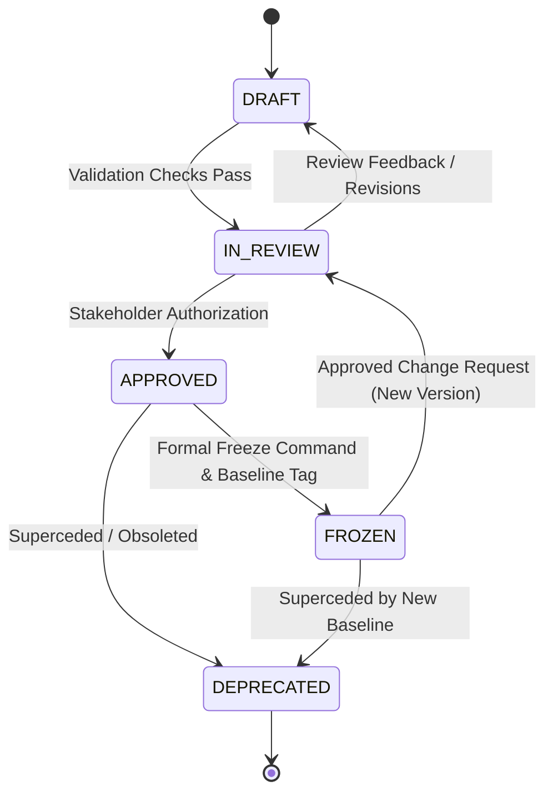
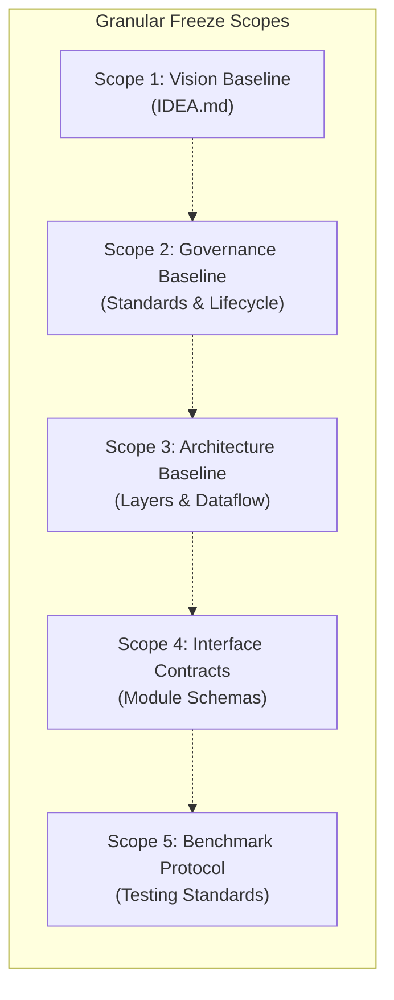

# LARIS Document Lifecycle and Freeze Governance Policy

## 1. Purpose and Philosophy

In a complex, multi-layered research intelligence system, architectural ambiguity or uncoordinated document modifications lead to wasted compute, broken module contracts, and irreproducible research. 

This policy establishes:
1. The lifecycle states through which all LARIS technical documents transition.
2. The formal protocol for freezing baseline documents into immutable reference standards.
3. The Change Request (CR) process required to modify a frozen baseline.
4. Independent freeze scopes preventing premature lock-in across disparate layers.

---

## 2. Document Lifecycle States

All technical documents in LARIS MUST reflect exactly one of the five canonical lifecycle states in their YAML front matter:

### 2.1. Detailed State Definitions

| State | Mutability | Implementation Authority | Definition & Operational Constraints |
| :--- | :--- | :--- | :--- |
| **`DRAFT`** | Fully Mutable | Advisory Only | Document is under active authoring. Ideas, schemas, or outlines may fluctuate freely. Code MUST NOT rely on draft specs as stable contracts. |
| **`IN_REVIEW`** | Substantively Stable | Provisional | Document is functionally complete and undergoing formal verification. All open questions, assumptions, and potential conflicts are explicitly documented. |
| **`APPROVED`** | Controlled Edits | Binding Baseline | Document has received explicit authorization from the project owner/lead architect. Serves as a binding specification for downstream implementation. |
| **`FROZEN`** | **Strictly Immutable** | **Permanent Ground Truth** | Versioned, locked reference baseline. Direct edits are programmatically prohibited. Any modification requires a formal Change Request (CR) and version bump. |
| **`DEPRECATED`** | Read-Only | Historical Reference | Document is obsolete. MUST contain a prominent banner linking directly to the replacement document. Retained for historical audit trails. |

> [!CAUTION]
> Creating a file, completing a draft, or running a code generator DOES NOT automatically transition a document to `APPROVED` or `FROZEN`. Premature declaration of `FROZEN` status without formal stakeholder review is a governance violation.

---

## 3. Baseline Freeze Protocol

A document transitions from `APPROVED` to `FROZEN` only when an explicit baseline freeze milestone is reached.

### 3.1. Step-by-Step Freeze Workflow
1. **Authoring Completion:** Document is completed under `DRAFT` status and verified against [docs/DOCUMENTATION_STANDARD.md](file:///home/thientn204/laris/docs/DOCUMENTATION_STANDARD.md).
2. **Automated Verification:** The automated validation script (`scripts/validate_docs.py`) runs clean with zero errors:
   - Metadata schema completeness.
   - Internal link target validity.
   - ADR cross-reference resolution.
   - Absence of uncalibrated claims or marketing buzzwords.
3. **Epistemic & Risk Review:** All assumptions, potential failure modes, and open questions are vetted. No unverified assumptions are hidden in prose.
4. **Consistency Verification:** Document content is verified against all existing accepted ADRs to ensure zero architectural contradictions.
5. **Stakeholder Approval:** The project lead or designated review board reviews the document and marks it `APPROVED`.
6. **Freeze Execution:** Upon explicit instruction to establish a baseline:
   - The status is updated to `FROZEN`.
   - A cryptographic SHA-256 checksum or Git commit reference is calculated.
   - A permanent freeze entry is recorded in [docs/DECISION_LOG.md](file:///home/thientn204/laris/docs/DECISION_LOG.md).
   - The version is tagged in the project's milestone record.
7. **Post-Freeze Lock:** Any subsequent pull request or edit targeting the file directly without an accompanying Change Request is rejected by automated CI checks.

---

## 4. Change Request (CR) Protocol for Frozen Baselines

Once a document is `FROZEN`, direct in-place modifications are strictly prohibited. Improvements, bug fixes, or architectural pivots MUST proceed through the formal Change Request workflow.

### 4.1. Required Change Request Schema
Every change request targeting a frozen document MUST be documented in an RFC/CR record containing:
- **Change Request ID:** Format `CR-<TARGET_DOC_ID>-<SEQUENTIAL_NUM>` (e.g. `CR-DOC-IDEA-001-01`).
- **Motivation & Driver:** Empirical failure, newly discovered research bottleneck, or requirement shift justifying the change.
- **Impacted Documents & Versions:** Exact files, current versions, and downstream dependent specifications affected.
- **Detailed Delta Description:** Exact proposed textual, algorithmic, or schema modifications.
- **Architectural & Hardware Impact:** Detailed assessment of impacts on VRAM, host RAM, latency, modularity, and layer boundaries.
- **Test & Validation Impact:** Required additions or revisions to unit tests, contract suites, and capability benchmarks.
- **Migration & Rollback Plan:** Steps required to transition active implementations without breaking existing data pipelines.
- **Designated Approver & Decision:** Approval timestamp and decision record.
- **Next Version Number:** Target semantic version bump (e.g., `0.1.0` $\rightarrow$ `0.2.0` or `1.0.0`).

### 4.2. Version Bumping Rules for Documentation
- **PATCH (`x.y.Z`):** Typographical corrections, clarification of existing non-normative text, or adding examples that do not alter interface contracts or architectural rules.
- **MINOR (`x.Y.0`):** Adding new optional fields to contracts, introducing new non-breaking skills/tools, or expanding taxonomies while maintaining backward compatibility.
- **MAJOR (`X.0.0`):** Breaking changes to module contracts, restructuring layer boundaries, altering core architectural principles, or changing fundamental epistemic rules.

---

## 5. Granular Freeze Scopes

To maintain engineering velocity without sacrificing rigor, LARIS does not require freezing the entire repository at once. Freezes occur across targeted, independent scopes:

1. **Vision Baseline:** Freezes `docs/IDEA.md`, locking foundational goals, local-first requirements, and non-goals.
2. **Governance Baseline:** Freezes `docs/DOCUMENTATION_STANDARD.md` and `docs/DOCUMENT_LIFECYCLE.md`.
3. **Architecture Topology Baseline:** Freezes `docs/architecture/` documents, locking layer boundaries and execution concepts.
4. **Interface Contract Baseline:** Freezes `docs/specifications/MODULE_CONTRACTS.md` and `DATA_SCHEMAS.md`, locking schemas for implementation.
5. **Benchmark & Evaluation Baseline:** Freezes `docs/testing/` test datasets, metrics, and regression thresholds.
6. **Milestone Release Baseline:** Comprehensive freeze tagged across all documentation and source code corresponding to a completed milestone release.
