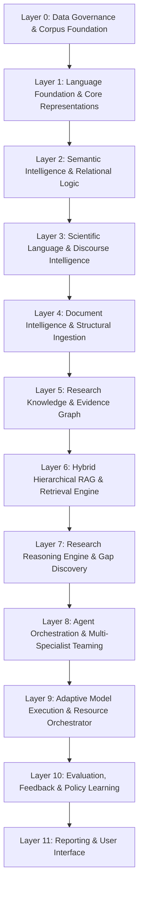
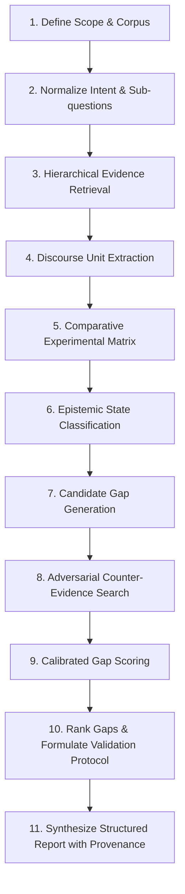

# Local Agentic Research Intelligence System (LARIS)
*System Vision, Architectural Principles, and Research Strategy*

---

## 1. Vision and Strategic Objectives

The **Local Agentic Research Intelligence System (LARIS)** is an autonomous, local-first scientific intelligence platform engineered to comprehend natural language, model complex semantic relations, reason over empirical evidence, synthesize knowledge across multiple scientific publications, discover research gaps, and propose verifiable research directions.

LARIS is fundamentally **not** designed as:
- A superficial PDF chat tool or question-answering wrapper.
- A naive semantic search engine.
- A standard Retrieval-Augmented Generation (RAG) pipeline reliant on off-the-shelf closed or open large language models.

The system is constructed from the ground up: starting with foundational linguistic capability and semantic representation, ascending to scientific discourse understanding, evidence management, cross-document reasoning, and multi-agent orchestration.

### Core Strategic Focus
1. **Self-Built Models and Specialized Capabilities:** Developing in-house, transparent NLP and reasoning modules tailored to scientific text, ensuring complete data ownership and computational provenance.
2. **Local-First Operation:** Running entirely on local workstation hardware, guaranteeing privacy, reproducibility, zero cloud reliance, and freedom from third-party API deprecation.
3. **Verifiability and Evidence-First Rigor:** Every scientific claim, conclusion, and identified gap must be traceable to empirical evidence. Fluency is never an acceptable proxy for truth.
4. **Modularity and Extensibility:** An explicit 12-layer architectural model with strict contracts, allowing skills, tools, and specialist modules to be added and benchmarked independently.
5. **Default Output: Structured Research Report:** The default deliverable is a comprehensive, structured research report with complete evidence citations, confidence scores, and limitation boundaries. Scientific manuscripts and publication-ready drafts are generated strictly upon explicit user request.

---

## 2. Locked Architectural Decisions

### 2.1. Self-Built Models as the Foundational Principle
- **No Mandatory Pretrained Foundation Models:** Tier 1 core language capabilities do not utilize pre-existing open or closed pretrained language models as an architectural dependency.
- **In-House Core NLP Stack:** Tokenizers, subword models, lexical analyzers, sentence encoders, semantic relation extractors, Natural Language Inference (NLI) classifiers, discourse analyzers, and scientific reasoning components are built and trained within the project ecosystem.
- **Hybrid Engineering:** "Self-built" does not mandate that every component must be a massive neural network. Statistical techniques, graph algorithms, rule-based heuristics, domain ontologies, and self-trained machine learning models are deployed wherever they provide superior determinism, efficiency, or interpretability.
- **Provenance and Licensing:** Every dataset, training pipeline, licensing term, and model checkpoint must have an auditable lineage record.

### 2.2. Language-First, Not PDF-First
Scientific capability cannot exist without foundational linguistic capability. The system must master general language semantics before optimizing for document-level scientific discourse.
- **Linguistic Capability Hierarchy:**
  1. Characters, subwords, tokens, lexical units, and phrases.
  2. Syntactic parsing, grammatical dependencies, and semantic representations.
  3. Paraphrase detection, semantic equivalence, and question intent normalization.
  4. Sentence similarity that rigorously distinguishes *topical relatedness* from *semantic equivalence*.
  5. Natural Language Inference (NLI): robust discrimination among *entailment*, *contradiction*, and *neutral*.
  6. Coreference resolution, discourse connectives, causal logic, and argumentative structures.
  7. Technical STEM and Electrical/Electronic engineering terminology and symbolic notations.
  8. Scientific discourse units: claims, experimental methods, metrics, results, evidence, limitations, assumptions, and future directions.
  9. Cross-document synthesis of claims, supporting evidence, and conflicting findings.
- **Document-Agnostic Extraction:** PDF, DOCX, HTML, and TXT are ingestion formats. The reasoning core operates on normalized linguistic and discourse trees, completely invariant to whether an author included explicit section headings such as "Methodology" or "Limitations".

### 2.3. Selective Loading, Selective Computation, and Selective Information Access
Scientific reasoning across hundreds of papers must not assume infinite VRAM or attempt to stuff whole corpora into massive context windows. LARIS strictly separates three computational mechanics:
1. **Selective Loading:** Only load the specific model weights or specialist expert parameters into GPU VRAM required for the immediate task, offloading idle components to host RAM or NVMe storage.
2. **Selective Computation:** Dynamically route requests through task-specific experts or compact modules, activating only the relevant subset of parameters rather than a monolithic dense network.
3. **Selective Information Access:** Hierarchically retrieve only the necessary sentences, claims, and evidence units required to address the active intent, while retaining adaptive multi-hop expansion capabilities when evidence is insufficient or uncertain.

The target architectural paradigm is a **Modular Sparse Research Architecture** featuring a learned router, specialist models, external structured memory, and adaptive computation depth.

> [!IMPORTANT]
> Sparse Mixture-of-Experts (MoE) does not magically eliminate memory consumption. Total model footprint, active parameter count, actual VRAM usage, host RAM usage, weight transfer latency, and end-to-end inference latency must be measured separately and monitored continuously.

### 2.4. Evidence-First Epistemology: Zero Tolerance for Fluency Hallucinations
A scientifically fluent statement is worthless without empirical backing. LARIS strictly classifies every knowledge assertion into explicit epistemic categories:
- **Direct Author Claim:** Explicitly stated by the source author.
- **Empirically Supported Finding:** Backed by concrete numerical data, figures, tables, or experimental protocols.
- **Multi-Source Synthesis:** Deduced across multiple distinct studies by the system.
- **Hypothesis:** Plausible theoretical conjecture requiring empirical testing.
- **Insufficient Evidence:** Inadequate data to substantiate or refute the claim.
- **Conflicting Evidence:** Contradictory findings reported across distinct studies.
- **Unverifiable Assertion:** Lacks experimental validation or reproducibility details.

A **Research Gap** is never declared merely because a keyword is rare, an author concludes with "future work," or an absence of search hits is observed.

---

## 3. Overall 12-Layer System Architecture

### Detailed Layer Responsibilities

#### Layer 0 — Data Governance & Corpus Foundation
- Ingestion of authorized, licensed scientific text and general corpora.
- Strict provenance tracking, license compliance, versioning, and corpus deduplication.
- Rigorous text normalization: Unicode cleanup, whitespace repair, mathematical symbol conversion, unit canonicalization.
- Leakage-proof dataset partitioning: Train/Dev/Test splits partitioned strictly by document, author group, or institutional venue to prevent train-test contamination.

#### Layer 1 — Language Foundation
- Custom-trained tokenizer and subword models (e.g. customized Byte-level BPE or Unigram models).
- Lexical, morphological, and phrase-level representation models.
- Sentence boundary detection and syntactic normalization.
- In-house sentence and paragraph encoders trained strictly on permitted corpora.
- Primary support for English with bilingual English/Vietnamese alignment planned based on empirical benchmarks.

#### Layer 2 — Semantic Intelligence
- Paraphrase detection and semantic equivalence modeling.
- Question intent parsing and normalization.
- In-house Natural Language Inference (NLI) classifier (Entailment, Contradiction, Neutral).
- Coreference resolution across complex scientific noun phrases.
- Discourse relation classification (causal, comparative, conditional, and argumentative connectives).
- Explicit uncertainty and ambiguity scoring.

#### Layer 3 — Scientific Language Intelligence
- Extraction of fine-grained discourse units: claims, experimental methods, datasets, metrics, and quantitative results.
- Heading-agnostic limitation inference (detecting caveats, sample size constraints, uncalibrated instruments, and boundary assumptions in plain narrative).
- Boundary condition and assumption extraction.
- Extraction of negative, null, or contradictory experimental outcomes.
- Terminology normalization for STEM and Electrical & Electronic Engineering.
- Epistemic classification: separating correlation, direct causation, speculation, and empirically validated claims.

#### Layer 4 — Document Intelligence
- Multi-format ingestion: PDF, DOCX, HTML, TXT, LaTeX source.
- Structural preservation: section hierarchies, tables, figures, captions, mathematical equations, and bibliographic references.
- Construction of hierarchical Document Trees (`Document -> Section -> Subsection -> Paragraph -> Sentence -> Token`).
- Bi-directional linking between extracted claims and their exact source coordinates (bounding box, page, paragraph index).
- OCR error detection, extraction confidence estimation, and quality gating.

#### Layer 5 — Research Knowledge & Evidence Graph
- Heterogeneous scientific entity modeling: `Document`, `Author`, `Institution`, `Topic`, `Method`, `Dataset`, `Metric`, `Claim`, `Evidence`, `Limitation`, `Assumption`.
- Explicit relational edges: `supports`, `contradicts`, `extends`, `reproduces`, `depends_on`, `compares_with`, `measures`.
- Cross-paper evidence aggregation and temporal citation progression.
- Strict differentiation between *author-stated relationships* and *system-inferred relationships*.

#### Layer 6 — Hybrid Hierarchical RAG
- Multi-channel retrieval engine:
  - Lexical / Keyword retrieval (BM25 with scientific stemming).
  - Dense semantic retrieval via self-built sentence/discourse encoders.
  - Claim and evidence unit retrieval.
  - Graph traversal across the Layer 5 Evidence Graph.
  - Strict metadata filtering (temporal bounds, venue, peer-review status).
- Multi-stage reranking combining semantic similarity, discourse relevance, and evidence credibility.
- Hierarchical depth retrieval: `Sentence -> Paragraph -> Section -> Document -> Cross-Paper Subgraph`.
- Adaptive retrieval expansion triggered by evidence uncertainty or conflicting claims.

#### Layer 7 — Research Reasoning Engine
- Synthesis of empirical evidence across heterogeneous studies.
- Methodological comparison under identical or divergent experimental conditions.
- Detection of empirical inconsistencies and irreproducible results.
- Discovery of hidden assumptions, overlooked boundary conditions, and methodological blind spots.
- Multi-dimensional research gap evaluation: Novelty, Evidence Support, Feasibility, Significance, and Epistemic Uncertainty.
- Hypothesis generation complete with supporting rationale, counter-evidence analysis, and concrete empirical validation protocols.
- Prohibition of global novelty assertions when corpus coverage is incomplete.

#### Layer 8 — Agent Orchestration
- Dynamic multi-specialist agent architecture:
  - `Supervisor / Orchestrator`: Decomposes research queries, assigns goals, and monitors convergence.
  - `Query Planner`: Translates high-level research questions into structured execution DAGs.
  - `Language Analysis Agent`: Evaluates syntax, paraphrasing, and linguistic ambiguity.
  - `Document Analysis Agent`: Manages document ingestion, structural parsing, and OCR quality checks.
  - `Evidence Retrieval Agent`: Executes hierarchical multi-hop retrieval across texts and graphs.
  - `Scientific Claim Agent`: Extracts, verifies, and categorizes claims and empirical results.
  - `Cross-Paper Synthesis Agent`: Reconciles findings and constructs cross-study comparison matrices.
  - `Gap Discovery Agent`: Discovers, categorizes, and validates research gaps.
  - `Critical Reviewer / Verifier`: Adversarial agent seeking counter-evidence and citation flaws.
  - `Report Composer`: Synthesizes findings into the final structured research report.
- Standardized agent contracts, state machines, retry policies, and resource budgets. No task is forced to run agents unnecessarily.

#### Layer 9 — Adaptive Model Execution & Resource Orchestrator
- Intelligent task router selecting specialist models based on task type, difficulty, uncertainty, and compute budget.
- Execution hierarchy: fast deterministic rules/heuristics -> small specialist neural models -> larger reasoning experts.
- Dynamic expert weight loading and unloading across GPU VRAM, host RAM, and NVMe SSD.
- Adaptive computation depth: terminates inference when evidence confidence threshold is satisfied; expands depth when uncertainty persists.
- Real-time hardware telemetry: continuous monitoring of VRAM, host memory, latency, and throughput.

#### Layer 10 — Evaluation, Feedback & Policy Learning
- Continuous capability benchmarking and automated regression testing.
- Human-in-the-loop expert review and annotation feedback loops.
- Formal scientific error taxonomy tracking false claims, misattributed evidence, and hallucinated gaps.
- Hard-negative mining for iterative model fine-tuning.
- Contextual bandit and reinforcement learning for agent routing and tool selection—activated only once verified rewards and deterministic simulation environments are established.
- Strict isolation between data updates, weight updates, skill updates, and orchestration policy updates.

#### Layer 11 — Reporting & User Interface
- Default primary output: Comprehensive, structured, evidence-anchored Research Report.
- Secondary on-demand output: Academic manuscript or publication draft (generated only upon explicit user command).
- Granular evidence inspection: interactive exploration of source sentences, extracted tables, and citation lineage.
- Transparent reporting of confidence scores, methodological caveats, and open research questions.
- Project, corpus, run history, and report version management.
- User intervention interface: accept, modify, or reject system inferences.

---

## 4. Skills, Tools, Rules, Workflows, and Memory Architecture

LARIS employs an extensible runtime substrate enabling capability expansion without requiring full foundation model retraining.

### 4.1. Core Primitives
- **Skill:** A high-level, declarative capability specification describing goals, inputs, outputs, prerequisite tools, and evaluation benchmarks. (e.g., `extract_scientific_claims`, `compare_experimental_methods`, `infer_latent_limitations`, `detect_empirical_contradictions`, `evaluate_research_gap`).
- **Tool:** A deterministic executable component with strict input/output schemas, timeout limits, and failure handling. (e.g., `pdf_layout_parser`, `corpus_bm25_search`, `graph_path_query`, `unit_conversion_normalizer`, `benchmark_runner`).
- **Rule:** Invariant policies and epistemic guardrails enforced programmatically. (e.g., *Every major assertion must reference a verified evidence ID*; *Never state a hypothesis as an established fact*; *Never assert absence of a method without bounded corpus proof*).
- **Workflow:** A directed execution graph defining agent sequences, branching conditions, retry mechanisms, timeouts, and resource-bounded termination gates.

### 4.2. Tiered Memory Subsystem
- **Working Memory:** Ephemeral scratchpad for intermediate agent reasoning steps, active query trees, and execution traces for the current task. Cleared upon task completion.
- **Project Memory:** Persistent workspace state capturing user preferences, accepted claims, rejected hypotheses, project-specific ontologies, and research milestones.
- **Corpus & Evidence Memory:** The canonical, versioned repository of ingested papers, parsed document trees, normalized claims, and the global Layer 5 Evidence Graph.
- **Experience Memory:** Validated historical execution traces, error corrections, user feedback, and benchmark failure cases used for offline optimization.

> [!CAUTION]
> Conversational chit-chat and unverified agent outputs are never automatically ingested into persistent memory. Every item entering long-term storage must be classified, validated, and assigned a versioned provenance record.

---

## 5. Scientific Research Gap Discovery Mechanism

Research gap detection is a multi-step analytical process grounded in comparative discourse and evidence topology, not keyword frequency.

### 5.1. Minimum Research Gap Taxonomy (12 Classes)
1. **Knowledge Gap:** Complete absence of empirical investigation regarding a specific phenomenon or system behavior.
2. **Methodological Gap:** Existing studies employ flawed, uncalibrated, biased, or suboptimal experimental procedures.
3. **Measurement / Evaluation Gap:** Inconsistent, inadequate, or unstandardized metrics preventing cross-study comparison.
4. **Dataset / Domain Gap:** Methods evaluated exclusively on synthetic, narrow, or unrepresentative benchmarks.
5. **Generalization Gap:** Validated findings in one domain fail or remain untested across broader operational environments.
6. **Reproducibility Gap:** Incomplete disclosure of hyper-parameters, hardware setups, or datasets preventing independent replication.
7. **Conflicting-Evidence Gap:** Directly contradictory empirical outcomes reported by independent research groups under comparable conditions.
8. **Assumption / Boundary-Condition Gap:** Critical unstated assumptions (e.g., linearity, thermal equilibrium, infinite data) that collapse in real-world deployment.
9. **Integration / Interdisciplinary Gap:** Mature solutions in one discipline remain unapplied to analogous bottlenecks in another.
10. **Deployment / Resource Gap:** Algorithms whose computational, energy, or memory demands prevent practical implementation on target edge/local hardware.
11. **Temporal Gap:** Outdated conclusions invalidated by recent technological, algorithmic, or experimental breakthroughs.
12. **Underexplored Research Question:** High-value hypotheses explicitly or implicitly raised in scientific literature that received no systematic experimental follow-up.

### 5.2. Eleven-Step Evidence-First Gap Discovery Pipeline

1. **Scope and Corpus Boundary Definition:** Establish explicit topical boundaries, inclusion/exclusion criteria, and baseline corpus version.
2. **Intent Normalization:** Decompose the primary user research query into atomic research intents and semantic sub-questions.
3. **Hierarchical Evidence Retrieval:** Multi-level retrieval yielding relevant sentences, paragraphs, sections, tables, and connected evidence subgraphs.
4. **Discourse Unit Extraction:** Extract claims, methods, datasets, metrics, results, limitations, and unstated assumptions from retrieved documents.
5. **Comparative Experimental Matrix Construction:** Align findings across studies according to comparable experimental conditions, baselines, and evaluation protocols.
6. **Epistemic State Classification:** Categorize scientific assertions into known facts, empirical contradictions, unverified claims, and boundary limits.
7. **Candidate Gap Generation:** Synthesize candidate gaps matching the 12-class gap taxonomy.
8. **Adversarial Counter-Evidence Search:** Actively query the entire corpus to locate any paper that already addressed, solved, or refuted the candidate gap.
9. **Calibrated Multi-Dimensional Scoring:** Evaluate candidate gaps against five calibrated metrics:
   $$\text{Score} = f(\text{Novelty}, \text{Evidence Grounding}, \text{Feasibility}, \text{Scientific Significance}, 1 - \text{Uncertainty})$$
10. **Ranking & Validation Proposal:** Rank confirmed gaps and formulate concrete experimental validation procedures.
11. **Structured Report Synthesis:** Compile the comprehensive Research Report with full citation lineages, confidence intervals, and epistemic qualifications.

---

## 6. Local-First Engineering & Target Hardware Envelope

LARIS is engineered specifically for workstation deployment under strict physical hardware constraints:
- **Graphics Processing Unit (GPU):** NVIDIA GeForce RTX 5070 Ti with 16 GB VRAM.
- **Host System Memory (RAM):** 32 GB DDR5 RAM.
- **Central Processing Unit (CPU):** Intel Core i5-14600KF (14 cores / 20 threads).
- **Secondary Storage:** NVMe PCIe Gen 4 SSD for fast model weight offloading and vector index storage.

### Operational Principles under Hardware Constraints
- **Zero Heavy Co-residency:** The architecture never assumes multiple large neural models can reside simultaneously in 16 GB VRAM.
- **Specialist Encoders over Monolithic LLMs:** Deploy compact, highly specialized neural models (e.g., 50M–350M parameters) dedicated to distinct tasks (sentence embedding, NLI, token classification).
- **Three-Tier Storage Hierarchy:** Active weights in GPU VRAM (16 GB) $\leftrightarrow$ Cached weights and indexes in Host RAM (32 GB) $\leftrightarrow$ Checkpoints, corpora, and graphs on NVMe SSD.
- **Deterministic Resource Budgets:** Every execution graph specifies maximum VRAM allocations, RAM ceilings, and batch limits.
- **Empirical Profiling:** Resource efficiency must be proven by empirical telemetry (peak VRAM allocated, host RAM usage, swap activity, transfer latency), never estimated from theoretical parameter counts.
- **No Unfounded General Foundation Pretraining Promises:** Training a multi-billion general foundation LLM from scratch on this hardware is physically intractable without petabyte corpora and exaFLOP compute. LARIS focuses on training specialized, task-adapted scientific neural architectures and dense representations.

---

## 7. Engineering Quality and Epistemic Principles

1. **Local-First & Privacy-Preserving:** Zero telemetry, zero external data leakage, fully functional offline.
2. **Modular, Testable, Versioned:** Every layer, module, schema, and dataset is versioned under semantic versioning.
3. **Evidence-First & Provenance-Preserving:** Every factual statement must cite its underlying evidence coordinates down to the document, page, and sentence index.
4. **Language-First & Document-Agnostic:** Robust against irregular layouts, missing section titles, and OCR artifacts.
5. **No Conflation of Semantic Similarity with Entailment:** Two sentences expressing opposite conclusions on the same topic have high semantic similarity, but contradictory NLI polarity. LARIS must never confuse the two.
6. **No Conflation of Absence of Evidence with Evidence of Absence:** If the corpus contains no mention of a technique, the system records "no evidence found in corpus," never "the technique does not exist or is invalid."
7. **No Conflation of Correlation with Causation:** Correlational statistical findings must never be translated into causal mechanisms without explicit causal identification proof.
8. **Agent Outputs Are Hypotheses, Not Ground Truth:** Outputs from agents are treated as candidate hypotheses subject to automated rule verification and critical review.
9. **Immutability of Frozen Artifacts:** Agents are strictly forbidden from modifying baseline documents or test sets marked as `FROZEN`.
10. **Evaluation Before Capability Claims:** No capability, accuracy improvement, or performance speedup may be asserted without peer-reviewable, reproducible benchmark test results.

---

## 8. Definition of Success and Empirical Capability Milestones

The project achieves verified progress only when objective, reproducible metrics improve across these core capabilities:

1. **Paraphrase & Intent Equivalence:** Quantifiable F1/accuracy on scientific paraphrase benchmarks.
2. **NLI & Contradiction Detection:** Precision and recall in detecting scientific contradictions and nuanced entailment across technical claims.
3. **Discourse & Claim Extraction:** Exact-match and token F1 scores on scientific claims, methods, metrics, and results.
4. **Heading-Agnostic Limitation Inference:** Sensitivity and specificity in discovering limitations buried in discussion or experimental sections lacking explicit headings.
5. **Cross-Paper Synthesis Consistency:** Coherence, accuracy, and citation precision in aggregating results across multiple independent publications.
6. **Verifiable Research Gap Discovery:** Demonstration that discovered gaps are non-trivial, not previously solved in wider literature, and accompanied by actionable validation designs.
7. **Zero Hallucination Tolerance:** Complete elimination of unreferenced or fabricated citations in generated research reports.
8. **Hardware Efficiency:** Peak VRAM strictly within 16 GB, host RAM within 32 GB, with sub-second retrieval and bounded inference latency on the local workstation.

---

## 9. Foundational Architecture Questions Answered

### 1. What problem does the system solve?
Scientific researchers drown in thousands of papers, missing subtle methodological flaws, unstated assumptions, irreproducible claims, and genuine research opportunities. LARIS automates deep reading, cross-paper evidence synthesis, and research gap discovery directly on local hardware without compromising data privacy.

### 2. Why not a standard RAG chatbot?
Standard RAG relies on naive lexical/vector chunking, superficial top-$k$ similarity, and dense LLM fluency. It fails to distinguish semantic similarity from entailment, fails to parse complex discourse structures, hallucinates evidence, and cannot reason about what is *missing* or *contradicted* across hundreds of studies.

### 3. How is the language foundation built?
Starting from custom tokenizers optimized for technical STEM text, building morphological and syntactic analyzers, training compact sentence and discourse encoders on authorized corpora, and calibrating relational models (paraphrase, NLI, discourse) before touching scientific documents.

### 4. How are research gaps inferred across papers?
By constructing a multi-study comparative matrix of methods, parameters, and outcomes, classifying the epistemic status of claims, identifying unaddressed contradictions or boundary failures against a 12-class gap taxonomy, and executing adversarial counter-evidence retrieval before scoring.

### 5. How are provenance and verification ensured?
Every claim and evidence node in the Layer 5 Graph retains an immutable link to its source document ID, section, page, paragraph, and sentence index. Reports present direct source citations for every assertion.

### 6. How are modules/models selected per task?
Layer 9 Adaptive Execution evaluates the incoming task type, required reasoning depth, and current VRAM/RAM utilization, routing the execution DAG to lightweight heuristics, specialized models, or deeper reasoning components accordingly.

### 7. How does it run locally within hardware constraints?
Through strict selective loading (staging weights between NVMe, RAM, and GPU), selective computation (activating only task-specific specialist modules), and selective information access (hierarchical retrieval rather than massive context windows).

### 8. How does the system learn new capabilities?
Through modular additions of declarative skills, executable tools, and workflow specifications without full model retraining, complemented by offline hard-negative mining, error collection, and calibrated policy optimization in Layer 10.

### 9. What are the limitations and risks?
Corpus boundary constraints (cannot know what is not ingested), potential biases in local training data, latency of weight offloading across the storage hierarchy, and the risk of generating syntactically convincing but scientifically infeasible validation proposals if domain rules are uncalibrated.

### 10. By what criteria is progress measured?
Progression is measured strictly by documented, reproducible benchmark evaluations across the 8 capability dimensions specified in Section 8, validated against frozen test sets.
