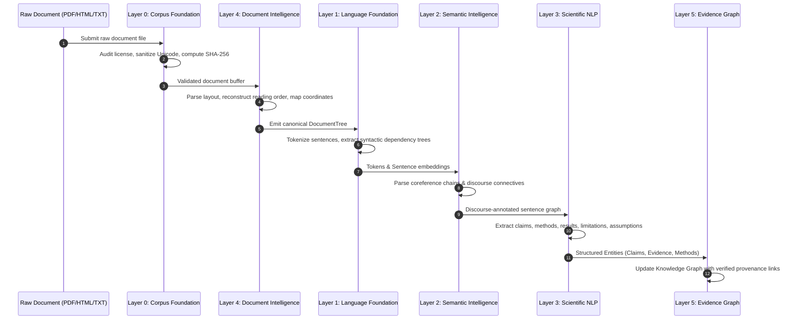
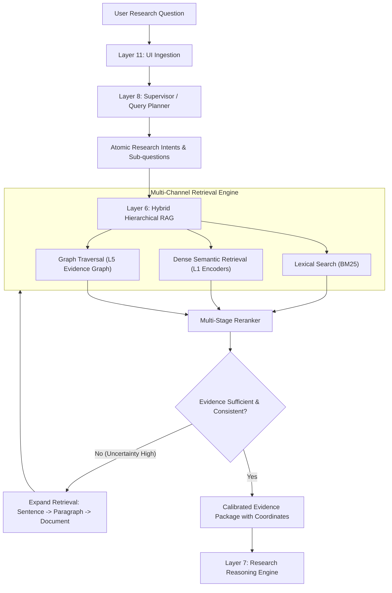
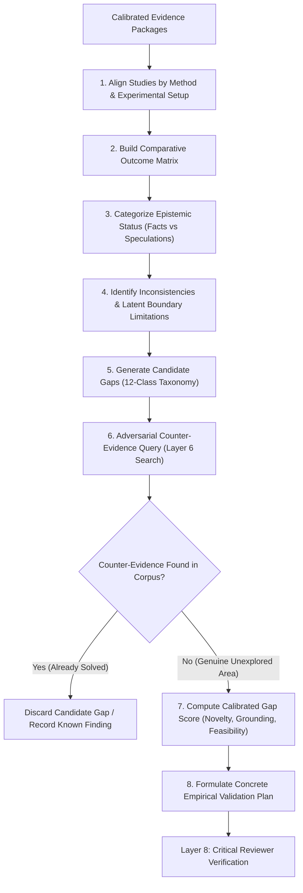
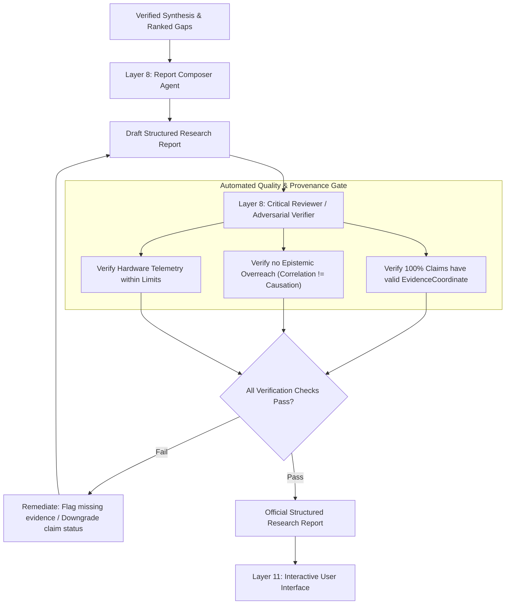

# LARIS End-to-End Data Flow and Pipeline Architecture

This document maps the flow of data through LARIS, tracing data transformations, intermediate schemas, validation checkpoints, and failure recovery pathways across four core operational pipelines.

---

## 1. Pipeline 1: Document Ingestion and Knowledge Construction

The Ingestion Pipeline transforms raw, multi-format scientific literature into structured, queryable knowledge graph representations anchored to source coordinates.

### Intermediate Data Formats in Pipeline 1:
- **L0 $\rightarrow$ L4:** `CleanCorpusItem` (raw text, license tag, document SHA-256).
- **L4 $\rightarrow$ L1:** `DocumentTree` (hierarchical sections, paragraphs, sentences, exact bounding boxes).
- **L1 $\rightarrow$ L2:** `TokenizedSentence` with dense vector embeddings and dependency tags.
- **L2 $\rightarrow$ L3:** `DiscourseRelationSpan` with NLI and coreference links.
- **L3 $\rightarrow$ L5:** `ClaimRecord`, `EvidenceCoordinate`, `LimitationRecord`, `MethodRecord`.

---

## 2. Pipeline 2: Research Query & Hierarchical Evidence Retrieval

When a user submits a complex research question, Pipeline 2 decomposes the query and executes depth-adaptive retrieval across textual, semantic, and graph indexes.

---

## 3. Pipeline 3: Cross-Paper Synthesis & Research Gap Discovery

Pipeline 3 executes scientific reasoning over retrieved evidence packages to compare methodologies, detect empirical contradictions, and discover verifiable research gaps.

---

## 4. Pipeline 4: Synthesis, Verification, and Report Generation

Pipeline 4 converts reasoned conclusions into a structured research report with zero tolerance for unreferenced assertions.

