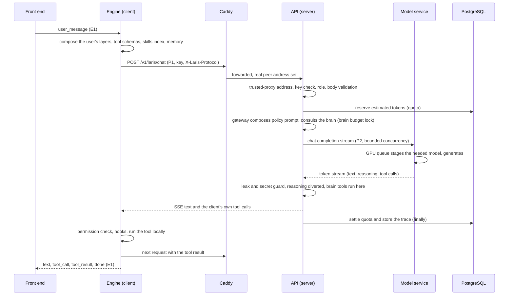
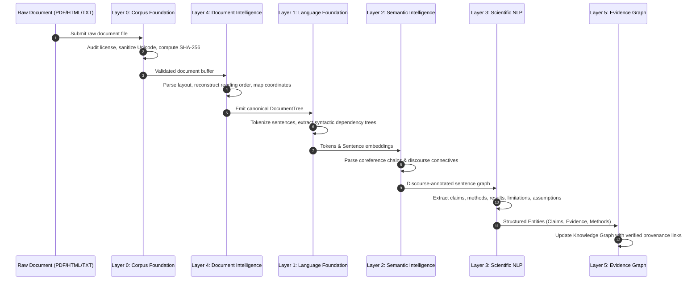
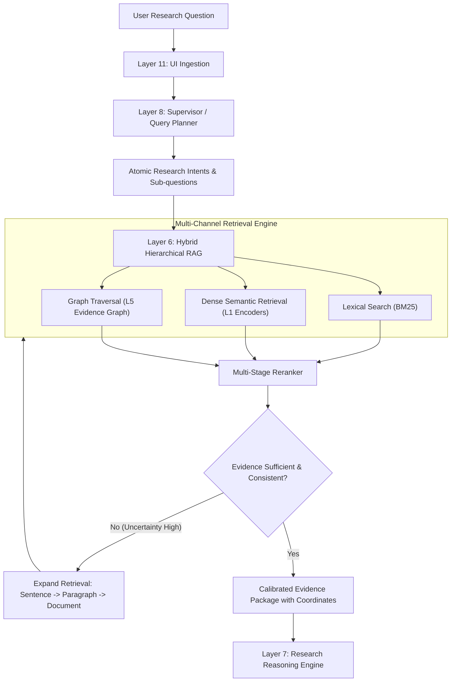
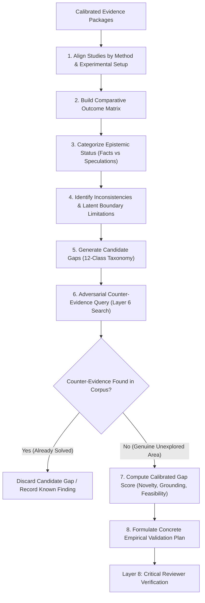
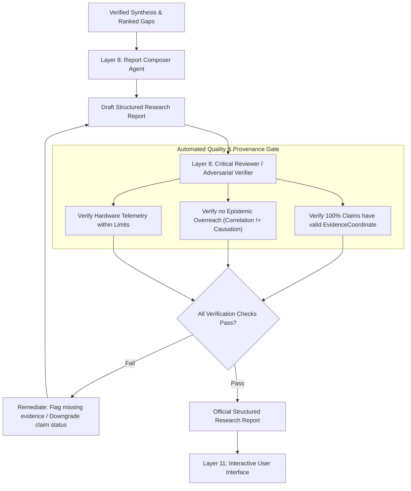

# LARIS End-to-End Data Flow and Pipeline Architecture

This document maps the flow of data through LARIS, tracing data transformations, intermediate schemas, validation checkpoints, and failure recovery pathways across the operational pipelines. Pipeline 0 is the runtime path of the 2.0 system (a chat turn); pipelines 1 to 4 are the research data pipelines.

---

## 0. Pipeline 0: One Chat Turn (release 2.0)

The runtime path from a typed message to a stored trace. The blocks and protocols are described in
[SYSTEM_OVERVIEW](SYSTEM_OVERVIEW.md) section 1b; the loop that wraps it is in
[AGENT_HARNESS](AGENT_HARNESS.md). The foundation model is not qualified, so this flow guarantees how
a turn is governed, not how good the answer is.

| Step | Where | Rule |
| :--- | :--- | :--- |
| 1. Compose | client | Only what belongs to the user leaves the machine: conversation, tool schemas, the user's instruction files, skills index and memory. Keys typed into a message are masked before storage |
| 2. Send | client to Caddy | HTTPS; the protocol header is checked by the server (426 on mismatch); a stream that fails is reported as an `error` event |
| 3. Admit | Caddy, API | Timeouts and the 32 MB limit at the edge; the real address comes from a trusted proxy only; the key is checked (401), the role must allow the route (403), the body is validated (4xx, never 500) and the estimated tokens are reserved (429 when the quota is used up) |
| 4. Compose policy | API gateway | The gateway adds the system prompt, rules, workflows and a short brain brief. Nothing in `.laris/` is ever sent back to the client; the brain lock covers the brain budget only |
| 5. Infer | API to model (P2) | Bounded concurrency; chat and embeddings share one GPU queue, which loads the model the job needs and evicts the least recently used idle model when the budget is exceeded |
| 6. Guard | API gateway | The stream passes the leak detector and secret redaction; reasoning is diverted and kept for the operator only (ADR-018); a leak is replaced by the configured refusal |
| 7. Return | API to client | SSE: text and the client's own tool calls; brain tool calls are run on the server and are not returned |
| 8. Settle | API, `finally` | The reservation is settled with real use (or released) and the trace stored, also when the client drops the stream |
| 9. Act | client | The engine applies permission modes and rules, runs `PreToolUse` hooks, runs the tool in the project folder (installs only in the sandbox), runs `PostToolUse` hooks, and sends the result in the next request. A turn ends at the step ceiling, a repeated call, the time budget, an interrupt or a final answer |

**Embeddings.** Dense search never runs a model on the client. The workspace sends passages to
`POST /v1/laris/embed`; the API forwards them to the model service over P2 (`/v1/embeddings`), and the
client caches the vectors in its SQLite `embeddings` table. Without a configured server only BM25 search works.

**Failure paths.** A model failure before the first byte is an HTTP error; after the stream starts it is an
`error` SSE event followed by the end marker. A client interrupt (Esc) ends the local turn and leaves the saved
conversation valid: every tool call has a result. The server settles quota in every case.

**What is stored where.** Conversation, uploads, tool results, learning data and the vault index stay in the
user's SQLite space and folders. The server keeps only `keys`, `usage` (token counts per key and month),
`traces` (including diverted reasoning, for the operator) and the daily summary; usage rows are dropped after
`serving.usage_retention_days` (90) and traces after `serving.trace_retention_days` (30).

---

## 1. Pipeline 1: Document Ingestion and Knowledge Construction

The Ingestion Pipeline transforms raw, multi-format scientific literature into structured, queryable knowledge graph representations anchored to source coordinates.

### Intermediate Data Formats in Pipeline 1:
- **L0 $\rightarrow$ L4:** `CleanCorpusItem` (raw text, license tag, document SHA-256).
- **L4 $\rightarrow$ L1:** `DocumentTree` (hierarchical sections, paragraphs, sentences, exact bounding boxes).
- **L1 $\rightarrow$ L2:** `TokenizedSentence` with dense vector embeddings and dependency tags.
- **L2 $\rightarrow$ L3:** `DiscourseRelationSpan` with NLI and coreference links.
- **L3 $\rightarrow$ L5:** `ClaimRecord`, `EvidenceCoordinate`, `LimitationRecord`, `MethodRecord`.

---

## 2. Pipeline 2: Research Query & Hierarchical Evidence Retrieval

When a user submits a complex research question, Pipeline 2 decomposes the query and executes depth-adaptive retrieval across textual, semantic, and graph indexes.

---

## 3. Pipeline 3: Cross-Paper Synthesis & Research Gap Discovery

Pipeline 3 executes scientific reasoning over retrieved evidence packages to compare methodologies, detect empirical contradictions, and discover verifiable research gaps.

---

## 4. Pipeline 4: Synthesis, Verification, and Report Generation

Pipeline 4 converts reasoned conclusions into a structured research report with zero tolerance for unreferenced assertions.

