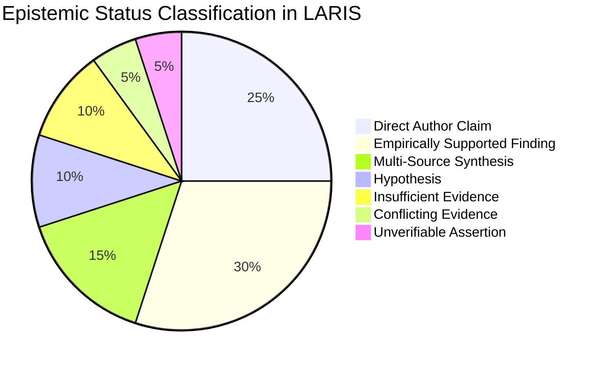

# LARIS Evidence Provenance & Epistemic Traceability Architecture

## 1. Epistemological Philosophy

Scientific truth is empirical, provisional, and contextual. In LARIS, natural language fluency is strictly separated from factual validity. A claim is never accepted as true merely because it is syntactically coherent or expressed with rhetorical authority.

Every factual assertion within LARIS MUST be backed by an immutable chain of custody leading back to primary empirical data or explicit author statements ([ADR-004](../adr/ADR-004-evidence-provenance-first-class.md)).

---

## 2. Seven-Class Epistemic Taxonomy

Every claim, finding, and synthesized assertion in LARIS is explicitly classified into exactly one of seven epistemic categories:



| Epistemic Status | Operational Definition | Evidentiary Requirement |
| :--- | :--- | :--- |
| **`DIRECT_AUTHOR_CLAIM`** | A factual assertion made explicitly in the source narrative by the author. | Verbatim text coordinate in the source paper. |
| **`EMPIRICALLY_SUPPORTED_FINDING`** | An assertion substantiated by experimental data, metrics, tables, or figures. | Data table cell, figure reference, or quantitative metric coordinate. |
| **`MULTI_SOURCE_SYNTHESIS`** | A deduction generated by LARIS comparing findings across two or more independent papers. | At least two independent `EvidenceCoordinate` records and an explicit reasoning trace. |
| **`HYPOTHESIS`** | A candidate explanation, potential research gap, or proposed direction for testing. | Stated rationale, expected validation protocol, and uncertainty score. |
| **`INSUFFICIENT_EVIDENCE`** | An evaluated proposition where ingested literature lacks adequate data to decide. | Explicit query bounds and list of analyzed papers demonstrating data gap. |
| **`CONFLICTING_EVIDENCE`** | An empirical disagreement between two or more reputable studies under comparable setups. | Pointers to conflicting study coordinates and comparative condition matrix. |
| **`UNVERIFIABLE_ASSERTION`** | A claim lacking empirical protocol details, source data, or baseline descriptions. | Document coordinate containing the unsupported statement. |

---

## 3. Physical Evidence Coordinate Anchoring

Every discrete piece of evidence is bound to a canonical `EvidenceCoordinate`:

```json
{
  "coordinate_id": "COORD-DOC042-P04-S12",
  "document_id": "DOC-ARXIV-2401-12345",
  "document_sha256": "e3b0c44298fc1c149afbf4c8996fb92427ae41e4649b934ca495991b7852b855",
  "page_number": 4,
  "section_identifier": "sec-3.2",
  "paragraph_index": 3,
  "sentence_index": 2,
  "char_start": 412,
  "char_end": 560,
  "verbatim_snippet": "The proposed low-noise amplifier achieved a noise figure of 1.4 dB at 28 GHz with 18 mW DC power consumption.",
  "extraction_confidence": 0.985
}
```

---

## 4. Invariant Epistemic Guardrails

LARIS enforces four mandatory epistemic rules programmatically:

1. **Rule 1 (Absence $\neq$ Negation):**
   $$\neg \text{ContainsEvidence}(C, \text{Claim}) \centernot\implies \text{IsFalse}(\text{Claim})$$
   Absence of evidence in the ingested corpus MUST be recorded as `INSUFFICIENT_EVIDENCE`, never as proof that a method or phenomenon is non-existent.

2. **Rule 2 (Correlation $\neq$ Causation):**
   Statistical associations or regression coefficients reported in papers MUST retain the label `CORRELATION` and MUST NOT be described as causal mechanisms without explicit causal identification protocols.

3. **Rule 3 (Gap Validation Invariant):**
   A candidate research gap MUST NOT be declared merely because an author wrote "this is left for future work" or because a keyword yields zero search hits. A research gap requires evidence of systematic methodological, empirical, or theoretical limitations across the corpus.

4. **Rule 4 (Automated Report Verification Gate):**
   Before any research report is finalized, the `Critical Reviewer` agent audits every claim against the Layer 5 Evidence Graph. Any assertion lacking a valid `EvidenceCoordinate` causes the report to be rejected and remediated.
