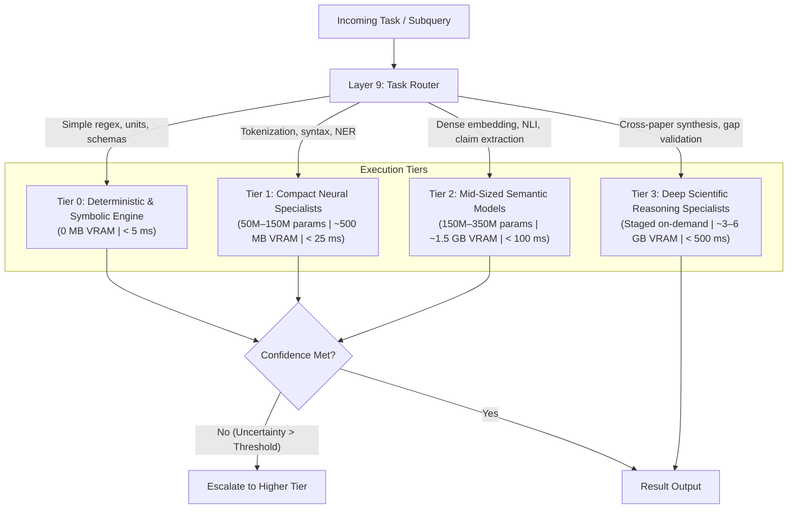

# LARIS Model Routing & Specialist Dispatch Architecture

## 1. Principles of Model Routing in LARIS

In accordance with [ADR-006](file:///home/thientn204/laris/docs/adr/ADR-006-modular-specialist-architecture-routing.md), LARIS rejects monolithic model architectures. Instead, system intelligence is partitioned across specialized tiers of varying computational weights.

The Model Router (situated in Layer 9) acts as the computational dispatcher: it evaluates task complexity, epistemic uncertainty, and real-time hardware telemetry to dynamically construct minimal execution graphs.

---

## 2. Multi-Tier Execution Hierarchy

### 2.1. Tier Specifications

| Tier | Component Types | Representative Modules | Resource Profile |
| :--- | :--- | :--- | :--- |
| **Tier 0** | Rules, Regular Expressions, Symbolic Math, Ontologies | SI Unit Normalizer, Citation Regex Parser, Schema Validator, Coordinate Hash Calculator. | 0 MB VRAM, negligible CPU, execution in $< 5$ ms. |
| **Tier 1** | Compact Statistical & Neural Encoders (50M–150M) | STEM Tokenizer, Part-of-Speech / Dependency Tagger, Fast Lexical Classifier. | $\sim 300 - 800$ MB VRAM, $< 25$ ms latency. |
| **Tier 2** | Specialized Semantic Networks (150M–350M) | Sentence Transformer, 3-way NLI Classifier, Discourse Relation Extractor, Claim Extractor. | $\sim 1.0 - 2.5$ GB VRAM, $< 100$ ms latency. |
| **Tier 3** | Deep Reasoning & Synthesis Specialists | Cross-paper Contradiction Analyzer, Multi-hop Graph Traversal Reasoner, Gap Validation Engine. | Staged dynamically into VRAM ($3.0 - 6.0$ GB), offloaded after execution. |

---

## 3. Router Decision Policy & Telemetry Gating

The Layer 9 Router determines the execution path based on four objective parameters:
1. **Task Domain & Type:** Identified by query intent (e.g., lexical lookup vs. cross-study contradiction detection).
2. **Epistemic Uncertainty Metric ($U \in [0, 1]$):** Computed by entropy of classification heads or retrieval divergence. If $U \le 0.15$, execution terminates at lower tiers; if $U > 0.15$, the router escalates to higher tiers.
3. **Physical VRAM Safety Ceiling:**
   $$\text{VRAM}_{\text{allocated}} + \text{VRAM}_{\text{requested}} \le 14.5\text{ GB}$$
   If the safety ceiling is violated, the router enforces offloading of least-recently-used (LRU) inactive specialist weights to host RAM before dispatching.
4. **Latency Budget Ceiling:** User-defined or pipeline-defined time limits per step.
