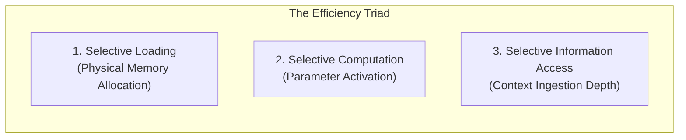

# LARIS Selective Loading, Computation, and Information Access Architecture

## 1. The Core Efficiency Triad

In modern deep learning systems, computational resource exhaustion typically arises from conflating model weight storage, activation computation, and context retrieval. Under the strict hardware budget of LARIS (16 GB VRAM, 32 GB RAM), these three dimensions are decoupled into distinct operational subsystems:

---

## 2. Dimension A: Selective Loading (Weight Staging)

Selective Loading governs the physical presence of neural network parameter tensors in GPU VRAM.

### 2.1. The 3-Tier Staging Subsystem
1. **Tier 1 (GPU VRAM - 16 GB):** Contains only the active specialist model weights actively computing forward passes, plus operational buffers (KV cache, CUDA kernels).
2. **Tier 2 (Host System RAM - 32 GB):** Acts as high-speed warm cache holding inactive specialist weights, tokenizers, and graph structures. Transfer over PCIe Gen4 x16 achieves $\sim 20 - 30$ GB/s bandwidth.
3. **Tier 3 (NVMe SSD Storage):** Cold repository storing all model checkpoints, historical runs, and static knowledge graph stores.

### 2.2. LRU Specialist Cache Policy
Layer 9 maintains a Least-Recently-Used (LRU) specialist cache. When an agent requests a specialist that is not currently resident in VRAM:
1. Layer 9 checks available VRAM headroom.
2. If headroom $< \text{Model Size} + 1.5\text{ GB}$, the least recently used inactive specialist in VRAM is evicted to host RAM.
3. The requested specialist is loaded from host RAM into VRAM using asynchronous CUDA streams.

---

## 3. Dimension B: Selective Computation (Parameter Activation)

Selective Computation governs how many floating-point operations (FLOPs) and network weights are evaluated during an active request.

### 3.1. Dynamic Early-Exit & Routing
- **Deterministic Pre-Filters:** Deterministic checks (e.g. unit validation, citation verification) run completely in CPU/Rust/C without invoking neural forward passes.
- **Cascade Classifiers:** Sentence classification begins with a fast, compact 50M parameter encoder. If output softmax confidence $\ge 0.95$, the prediction is accepted immediately; deeper models are only activated if confidence is low.
- **Sparse Specialized Heads:** Rather than running an all-in-one dense transformer, the router activates only the specific classification head required (e.g. NLI head vs. Boundary Condition head).

### 3.2. Debunking the Sparse MoE Fallacy
> [!IMPORTANT]
> A common misconception in modern AI is that Sparse Mixture-of-Experts (MoE) reduces memory consumption. While MoE activates only top-$k$ experts per token during computation, **all expert parameters must still reside in addressable memory**. On a 16 GB workstation GPU, an unmanaged 8x7B MoE cannot even be loaded into memory. In LARIS, "sparsity" is implemented via modular specialist offloading, where non-active experts are genuinely offloaded from VRAM.

---

## 4. Dimension C: Selective Information Access (Hierarchical Context)

Selective Information Access governs how much external text and graph context is fed into models during reasoning.

### 4.1. Hierarchical Context Expansion
Rather than injecting entire 20-page PDFs into working memory, retrieval scales adaptively:
1. **Sentence / Claim Level (Level 1):** Retrieves isolated atomic claims and metrics relevant to the subquestion.
2. **Paragraph / Discourse Context (Level 2):** If ambiguity or coreference resolution is required, expands context to the parent paragraph.
3. **Section / Methodology Context (Level 3):** If experimental parameters or boundary conditions require validation, loads the complete section.
4. **Full Document (Level 4):** Reserved exclusively for structural auditing or global synthesis tasks.

---

## 5. Required Telemetry & Empirical Profiling Metrics

LARIS telemetry must continuously collect and report the following empirical metrics during execution:
- `vram_allocated_bytes`: Current active CUDA memory allocated.
- `vram_reserved_bytes`: Total CUDA memory held by caching allocators.
- `host_ram_used_bytes`: Current system RAM utilized.
- `weight_transfer_ms`: Duration to load weights across PCIe from RAM to VRAM.
- `active_params_count`: Number of model parameters evaluated during current forward pass.
- `total_system_params`: Sum of all specialist model parameters in existence.
- `inference_latency_ms`: Time taken for the forward pass and token generation.
