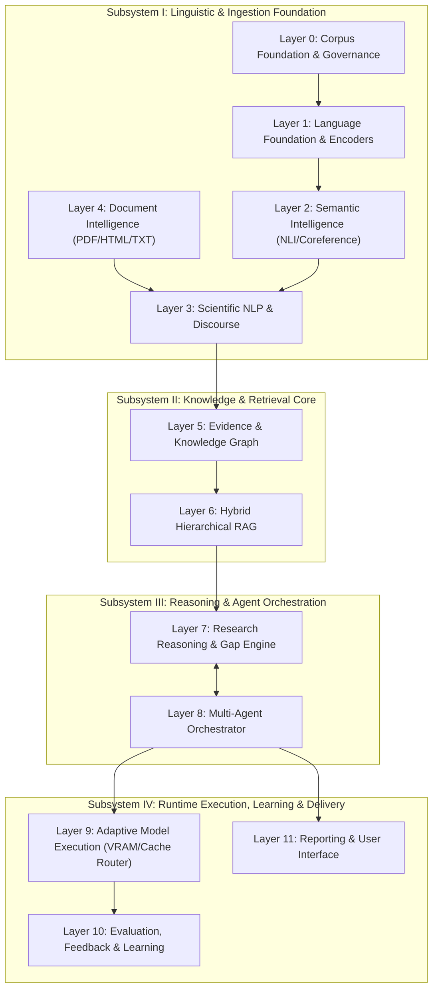

# LARIS System Overview and Topological Architecture

## 1. Executive Architecture Summary

The **Local Agentic Research Intelligence System (LARIS)** is a modular, local-first artificial intelligence platform designed to ingest scientific literature, comprehend complex domain-specific discourse, maintain an auditable evidence graph, synthesize findings across multiple papers, and identify verifiable research gaps.

Unlike standard RAG pipelines or conversational wrappers around monolithic foundation LLMs, LARIS is constructed on three non-negotiable architectural tenets:
1. **Self-Built Language & Specialist Foundations:** Core language representations, NLI, discourse parsers, and claim extractors are trained in-house without mandatory dependencies on external pretrained foundation models ([ADR-002](../adr/ADR-002-self-built-language-foundation.md)).
2. **Three-Tier Selective Execution:** Memory and computation are conserved through strict separation of *Selective Loading*, *Selective Computation*, and *Selective Information Access* ([ADR-005](../adr/ADR-005-selective-loading-computation-access.md)).
3. **Evidence-First Epistemic Provenance:** Every claim, conclusion, and research gap is anchored to immutable source coordinates down to page and sentence spans ([ADR-004](../adr/ADR-004-evidence-provenance-first-class.md)).

---

## 2. High-Level Subsystem Topology

LARIS is structured into four primary operational subsystems encompassing 12 distinct functional layers:

---

## 3. Physical Hardware & Storage Topology

LARIS operates within a strict local hardware budget:
- **Processor:** Intel Core i5-14600KF (14 cores, 20 threads).
- **GPU Accelerator:** NVIDIA GeForce RTX 5070 Ti (16 GB GDDR7 VRAM).
- **System Memory:** 32 GB DDR5 RAM.
- **Persistent Storage:** NVMe PCIe Gen4 SSD.

To execute deep research workflows without crashing this workstation, LARIS enforces a **Three-Tier Storage and Memory Hierarchy**:

| Tier | Physical Medium | Typical Content | Transfer Latency Target |
| :--- | :--- | :--- | :--- |
| **Tier 1 (GPU VRAM)** | 16 GB GDDR7 | Active specialist weights (e.g. active NLI or embedding model), current batch activations, KV cache. | Sub-millisecond |
| **Tier 2 (Host RAM)** | 32 GB DDR5 | Inactive specialist weights ready for dispatch, vector indexes, document tree cache, working memory graph. | $\sim 10 - 50$ ms |
| **Tier 3 (NVMe SSD)** | NVMe PCIe Gen4 | Complete corpus text, full Layer 5 Evidence Graph, model checkpoints, persistent project memory, report archives. | $\sim 100 - 500$ ms |

---

## 4. Architectural Boundaries and Cross-Cutting Concerns

### 4.1. The Epistemic Boundary
No component in LARIS is permitted to pass an ungrounded assertion as a factual input to another component. Layer 5 (Evidence Graph) acts as the epistemic firewall: all edges representing relations (`supports`, `contradicts`, `extends`) must record whether they were explicitly stated by an author or inferred by LARIS.

### 4.2. The Resource Safety Boundary
Layer 9 (Adaptive Model Execution) monitors physical GPU allocations via hardware hooks. Before any neural specialist is invoked, Layer 9 performs a pre-flight memory check. If estimated VRAM exceeds 14.5 GB, Layer 9 automatically offloads idle models or triggers sequential batching to prevent Out-Of-Memory crashes.

### 4.3. The Document Format Invariance Boundary
All downstream semantic analysis (Layers 2, 3, 5, 7) interacts exclusively with normalized `DocumentTree` objects. Downstream reasoning has zero dependency on whether the original paper was a two-column IEEE PDF, an arXiv LaTeX source, or a Nature HTML webpage.
