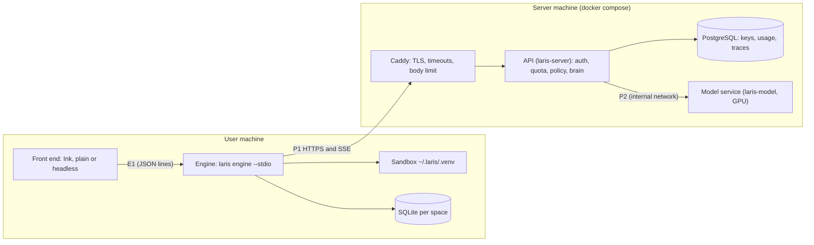
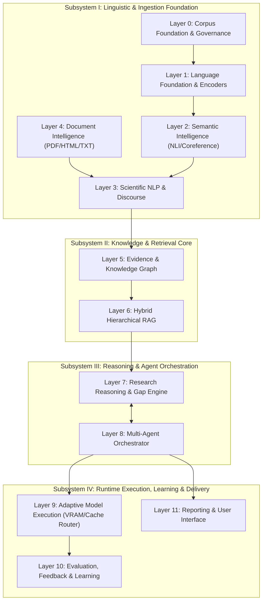

# LARIS System Overview and Topological Architecture

## 1. Executive Architecture Summary

The **Local Agentic Research Intelligence System (LARIS)** is a modular, local-first artificial intelligence platform designed to ingest scientific literature, comprehend complex domain-specific discourse, maintain an auditable evidence graph, synthesize findings across multiple papers, and identify verifiable research gaps.

Unlike standard RAG pipelines or conversational wrappers around monolithic foundation LLMs, LARIS is constructed on three non-negotiable architectural tenets:
1. **Self-Built Language & Specialist Foundations:** Core language representations, NLI, discourse parsers, and claim extractors are trained in-house without mandatory dependencies on external pretrained foundation models ([ADR-002](../adr/ADR-002-self-built-language-foundation.md)).
2. **Three-Tier Selective Execution:** Memory and computation are conserved through strict separation of *Selective Loading*, *Selective Computation*, and *Selective Information Access* ([ADR-005](../adr/ADR-005-selective-loading-computation-access.md)).
3. **Evidence-First Epistemic Provenance:** Every claim, conclusion, and research gap is anchored to immutable source coordinates down to page and sentence spans ([ADR-004](../adr/ADR-004-evidence-provenance-first-class.md)).

---

## 1b. Deployment topology of release 2.0

Release 2.0 splits the running system into three **blocks** that talk through two **protocols**
([ADR-019](../adr/ADR-019-three-blocks-two-protocols-two-sql-engines.md)). The foundation model is **not
qualified**; this section describes where code runs and what it may touch, not how good any answer is.

| Block | Runs on | Holds | Never holds |
| :--- | :--- | :--- | :--- |
| **client** (`laris.client`, `laris` command) | the user's machine | conversations, workspace, embedding cache, learning data and vault index in SQLite; the user's settings and key in `~/.laris/`; the tools and the sandbox | the system prompt, the brain, other users' data, model weights |
| **server** (`laris.server`, `laris-server` command) | the server machine, in Docker | API keys (encrypted), usage and traces in PostgreSQL; the confidential policy (`.laris/`, `LARIS.md`) and the brain, read-only | user files, conversations, weights |
| **model** (`laris.model`, `laris-model` command) | the server machine, GPU | the weights (mounted read-only), the GPU queue, the embedder | keys, policy, any user data at rest |

`laris.protocol` (wire types) and `laris.shared` (libraries used by more than one block) are the only
packages the blocks may import from each other; `laris.research` is owner-only tooling (data, training,
evaluation) that no block imports. A contract test enforces both rules.

**Protocols.** **P1** (client to server) is public HTTPS and Server-Sent Events, versioned by the
`X-Laris-Protocol` header; a client and a server that disagree refuse each other (HTTP 426). **P2** (server
to model) is OpenAI-compatible chat completions and embeddings on a Docker network that has no route out
and no authentication, because nothing else can reach it. **E1** is a third, local contract between the
engine and the front end (JSON lines on standard input and output); see the
[CLI reference](../development/CLI.md).

**Storage.** PostgreSQL on the server (`keys`, `usage`, `traces`, plus the monthly partitions and the
`usage_daily` summary); SQLite on the client (`chunks`, `embeddings`, `conversations`, `learning`,
`vault_index`). Vault notes remain Markdown files. The server stores nothing about a user's files or
conversations ([ADR-015](../adr/ADR-015-local-data-plane-and-authenticated-server.md)).

**Trust boundaries.**

| Boundary | Control |
| :--- | :--- |
| Internet to server | Only Caddy publishes ports (80 and 443). It ends TLS, sets `read_header`, `read_body` and `idle` timeouts, limits the body to 32 MB and replaces forwarding headers with the real peer address |
| Caddy to API | The API trusts a forwarded address only from the proxy's subnet (`serving.trusted_proxies`); each control (deadline, body limit, key check) also holds without the proxy |
| API to model | Internal network only; bounded concurrency; one GPU queue shared by chat and embeddings |
| Policy and brain | Server only, read-only mount, covered by `integrity.lock`; the API refuses to start when a protected file differs |
| Project folder to client | A cloned folder configures nothing: settings, hooks, permissions and the server address live only in `~/.laris/settings.json`; a folder is untrusted until the user trusts it |
| Tools to the machine | Permission modes and rules; installs only into the sandbox; hook output is bounded and cleaned |
| Weights | The model service mounts them read-only; the client never receives them |

The security tests for these boundaries are in `tests/security` (`make test-security`); the container
checks that need Docker are skipped when Docker or the `caddy:2` image is missing.

The research layers in sections 2 to 4 describe the corpus, language, knowledge and reasoning subsystems
that the model block will serve once the core model is qualified. They are unchanged by the 2.0
restructuring.

---

## 2. High-Level Subsystem Topology

LARIS is structured into four primary operational subsystems encompassing 12 distinct functional layers:

---

## 3. Physical Hardware & Storage Topology

LARIS operates within a strict local hardware budget:
- **Processor:** Intel Core i5-14600KF (14 cores, 20 threads).
- **GPU Accelerator:** NVIDIA GeForce RTX 5070 Ti (16 GB GDDR7 VRAM).
- **System Memory:** 32 GB DDR5 RAM.
- **Persistent Storage:** NVMe PCIe Gen4 SSD.

To execute deep research workflows without crashing this workstation, LARIS enforces a **Three-Tier Storage and Memory Hierarchy**:

| Tier | Physical Medium | Typical Content | Transfer Latency Target |
| :--- | :--- | :--- | :--- |
| **Tier 1 (GPU VRAM)** | 16 GB GDDR7 | Active specialist weights (e.g. active NLI or embedding model), current batch activations, KV cache. | Sub-millisecond |
| **Tier 2 (Host RAM)** | 32 GB DDR5 | Inactive specialist weights ready for dispatch, vector indexes, document tree cache, working memory graph. | $\sim 10 - 50$ ms |
| **Tier 3 (NVMe SSD)** | NVMe PCIe Gen4 | Complete corpus text, full Layer 5 Evidence Graph, model checkpoints, persistent project memory, report archives. | $\sim 100 - 500$ ms |

---

## 4. Architectural Boundaries and Cross-Cutting Concerns

### 4.1. The Epistemic Boundary
No component in LARIS is permitted to pass an ungrounded assertion as a factual input to another component. Layer 5 (Evidence Graph) acts as the epistemic firewall: all edges representing relations (`supports`, `contradicts`, `extends`) must record whether they were explicitly stated by an author or inferred by LARIS.

### 4.2. The Resource Safety Boundary
Layer 9 (Adaptive Model Execution) monitors physical GPU allocations via hardware hooks. Before any neural specialist is invoked, Layer 9 performs a pre-flight memory check. If estimated VRAM exceeds 14.5 GB, Layer 9 automatically offloads idle models or triggers sequential batching to prevent Out-Of-Memory crashes.

### 4.3. The Document Format Invariance Boundary
All downstream semantic analysis (Layers 2, 3, 5, 7) interacts exclusively with normalized `DocumentTree` objects. Downstream reasoning has zero dependency on whether the original paper was a two-column IEEE PDF, an arXiv LaTeX source, or a Nature HTML webpage.
