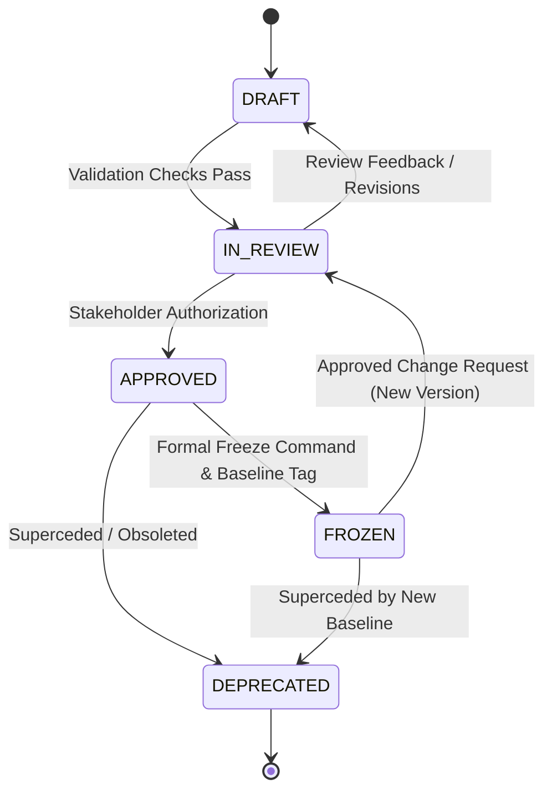
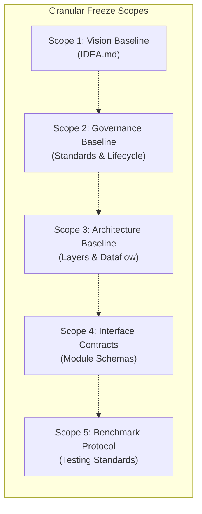

# LARIS Documentation Standard and Lifecycle Governance

How LARIS documents are structured, reviewed, frozen and changed.

## 1. Documentation Standard and Metadata

### 1. Overview & Purpose

The LARIS project enforces strict documentation discipline to ensure that architectural integrity, empirical provenance, and engineering standards are maintained as the system scales. This document specifies the required metadata schema, writing guidelines, terminology consistency rules, and source-of-truth policies for all technical documentation in the LARIS repository.

### 2. Required Document Metadata Schema

Every technical document in the repository MUST commence with a standardized YAML front matter block adhering to the schema below:

```yaml
---
document_id: "DOC-<TYPE>-<ID>"
title: "<Comprehensive Document Title>"
document_type: "idea | architecture | specification | adr | plan | research | test | report"
status: "DRAFT | IN_REVIEW | APPROVED | FROZEN | DEPRECATED"
version: "X.Y.Z"
created_at: "YYYY-MM-DD"
updated_at: "YYYY-MM-DD"
owner: "<Role or Team, e.g. LARIS Architecture Team>"
reviewers:
  - "<Reviewer 1>"
source_of_truth: true
related_documents:
  - "docs/path/to/related_document.md"
decision_references:
  - "ADR-001"
change_summary: "<Concise summary of the latest modification>"
---
```

#### 2.1. Metadata Field Definitions

| Field Name | Type | Allowed Values / Format | Description |
| :--- | :--- | :--- | :--- |
| `document_id` | String | `DOC-[A-Z0-9]+(-[A-Z0-9]+)*` | Globally unique identifier across all repository documents. |
| `title` | String | UTF-8 Text | Canonical human-readable document title. |
| `document_type` | Enum | `idea`, `architecture`, `specification`, `adr`, `plan`, `research`, `test`, `report` | Functional classification of the document. |
| `status` | Enum | `DRAFT`, `IN_REVIEW`, `APPROVED`, `FROZEN`, `DEPRECATED` | Lifecycle state as defined in `docs/development/DOCUMENTATION.md`. |
| `version` | String | Semantic Versioning `MAJOR.MINOR.PATCH` | Document content revision level. |
| `created_at` | String | ISO 8601 Date (`YYYY-MM-DD`) | Date of document creation. |
| `updated_at` | String | ISO 8601 Date (`YYYY-MM-DD`) | Date of most recent revision. |
| `owner` | String | Role, Team, or Author name | Accountable entity for document maintenance. |
| `reviewers` | List | Array of names/roles | Designated reviewers who vetted the document. |
| `source_of_truth` | Boolean | `true` or `false` | Indicates whether this document is the primary authority for its scope. |
| `related_documents`| List | Array of repository-relative paths | Key associated documents and upstream/downstream specifications. |
| `decision_references`| List | Array of ADR IDs (`ADR-XXX`) | Explicit architectural decisions governing this document. |
| `change_summary` | String | Text | Summary of changes introduced in the current version. |

### 3. Document Content Standards

#### 3.1. Normative Language (RFC 2119)
Authors MUST adhere strictly to standard requirement levels:
- **MUST / SHALL:** Absolute requirement. Non-negotiable for system correctness or policy compliance.
- **MUST NOT / SHALL NOT:** Absolute prohibition.
- **SHOULD / RECOMMENDED:** Best practice or strong recommendation. Valid reasons may exist in particular circumstances to ignore, but the full implications must be understood and documented.
- **SHOULD NOT / NOT RECOMMENDED:** Strongly discouraged practice.
- **MAY / OPTIONAL:** Permissible alternative without negative architectural impact.

#### 3.2. Categorical Separation of Epistemic Statements
To prevent ambiguity and unsubstantiated claims, documents MUST clearly separate:
1. **Facts:** Objectively verifiable observations, empirical measurements, or physical hardware constraints.
2. **Decisions:** Accepted, authorized architectural commitments (must reference an accepted ADR).
3. **Assumptions:** Working premises accepted temporarily without full empirical proof, explicitly flagged.
4. **Hypotheses:** Testable propositions that require future experimental validation before acceptance.
5. **Open Questions:** Unresolved issues, trade-offs, or unknowns requiring investigation or stakeholder approval.

#### 3.3. Ban on Empty Marketing Buzzwords
Technical documentation MUST NOT use vacuous qualifiers such as unquantified speed, accuracy, optimality, intelligence or smoothness claims unless accompanied by:
- A concrete mathematical definition or metric.
- An explicit target baseline or comparative threshold.
- The benchmark protocol used to measure it.

#### 3.4. Terminology Consistency
All technical terms, entity names, and architectural concepts MUST match their canonical definitions in [docs/GLOSSARY.md](../GLOSSARY.md). Inventing ad-hoc synonyms for established concepts is strictly prohibited.

#### 3.5. Evidence and Metric Sourcing
Any numerical figure (VRAM capacity, latency, accuracy percentage, parameter count) MUST:
- Cite its empirical measurement source (e.g. benchmark report or hardware spec sheet), OR
- Be explicitly labeled as `[ESTIMATE]` or `[THEORETICAL TARGET]`.

#### 3.6. Examples vs. Ground Truth
Illustrative code blocks, sample queries, and mock outputs MUST be explicitly prefixed with `[EXAMPLE]` to prevent developers or agents from misconstruing mock data as validated test baselines.

---

### 4. Document Types and Canonical Scopes

| Document Type | Primary Scope and Intent |
| :--- | :--- |
| **`idea`** | High-level vision, problem statement, philosophical tenets, system boundaries, and foundational constraints. Governed directly by project leadership. |
| **`architecture`** | System topology, structural layers, data flows, routing mechanics, storage hierarchy, and cross-cutting concerns. |
| **`specification`** | Formal, testable interface contracts: input/output schemas, error hierarchies, preconditions, postconditions, and invariant rules. |
| **`adr`** | Architectural Decision Records: contextual analysis, alternatives evaluated, trade-offs, and consequences of a single engineering choice. |
| **`plan`** | Work breakdowns, milestones, dependencies, resource allocations, entry/exit criteria, and risk mitigation schedules. |
| **`research`** | Theoretical foundations, algorithm evaluations, scientific literature reviews, model formulation, and experimental research notes. |
| **`test`** | Benchmark protocols, test harnesses, evaluation metrics, regression criteria, and empirical verification procedures. |
| **`report`** | Structured findings, benchmark outcomes, system status audits, and experimental results synthesized for human or agent consumption. |

---

### 5. Source-of-Truth Hierarchy & Conflict Resolution

#### 5.1. Hierarchy of Authority
When discrepancies arise between documents, authority is resolved in the following descending order:
1. **Frozen Architectural Decisions (Accepted ADRs):** The supreme technical authority for approved design choices.
2. **System Vision (`docs/archive/IDEA.md`):** The definitive authority for system scope, principles, and strategic goals.
3. **Formal Module Specifications (`docs/specifications/`):** The authoritative definition of runtime contracts and schemas.
4. **Architecture Documents (`docs/architecture/`):** Authoritative for overall topology and data flows.
5. **Research & Testing Specifications (`docs/research/`, `docs/testing/`):** Authoritative for experimental methods and benchmarks.
6. **Plans and Roadmaps (`docs/plans/`):** Operational scheduling; never overrides architectural specifications.
7. **Readmes and Summaries (`README.md`, `docs/README.md`):** Convenience indexes only. They MUST NOT introduce independent architectural specifications.

#### 5.2. Conflict Resolution Workflow
- Under no circumstance should a developer or agent arbitrarily select the newer file when a conflict exists.
- Any conflicting statements MUST be logged in [docs/OPEN_QUESTIONS.md](../OPEN_QUESTIONS.md) as a formal defect or open question.
- Resolution requires either an ADR amendment, a formal change request, or stakeholder consensus before code or documentation modifications proceed.

#### 5.3. Prohibition of Duplication
Do not copy large sections of text between documents. If a document depends on a definition, architecture diagram, or contract established elsewhere, it MUST provide a Markdown link to the canonical source-of-truth document.

---

## 2. Document Lifecycle and Freeze Governance

### 1. Purpose and Philosophy

In a complex, multi-layered research intelligence system, architectural ambiguity or uncoordinated document modifications lead to wasted compute, broken module contracts, and irreproducible research. 

This policy establishes:
1. The lifecycle states through which all LARIS technical documents transition.
2. The formal protocol for freezing baseline documents into immutable reference standards.
3. The Change Request (CR) process required to modify a frozen baseline.
4. Independent freeze scopes preventing premature lock-in across disparate layers.

---

### 2. Document Lifecycle States

All technical documents in LARIS MUST reflect exactly one of the five canonical lifecycle states in their YAML front matter:



#### 2.1. Detailed State Definitions

| State | Mutability | Implementation Authority | Definition & Operational Constraints |
| :--- | :--- | :--- | :--- |
| **`DRAFT`** | Fully Mutable | Advisory Only | Document is under active authoring. Ideas, schemas, or outlines may fluctuate freely. Code MUST NOT rely on draft specs as stable contracts. |
| **`IN_REVIEW`** | Substantively Stable | Provisional | Document is functionally complete and undergoing formal verification. All open questions, assumptions, and potential conflicts are explicitly documented. |
| **`APPROVED`** | Controlled Edits | Binding Baseline | Document has received explicit authorization from the project owner/lead architect. Serves as a binding specification for downstream implementation. |
| **`FROZEN`** | **Strictly Immutable** | **Permanent Ground Truth** | Versioned, locked reference baseline. Direct edits are programmatically prohibited. Any modification requires a formal Change Request (CR) and version bump. |
| **`DEPRECATED`** | Read-Only | Historical Reference | Document is obsolete. MUST contain a prominent banner linking directly to the replacement document. Retained for historical audit trails. |

> [!CAUTION]
> Creating a file, completing a draft, or running a code generator DOES NOT automatically transition a document to `APPROVED` or `FROZEN`. Premature declaration of `FROZEN` status without formal stakeholder review is a governance violation.

---

### 3. Baseline Freeze Protocol

A document transitions from `APPROVED` to `FROZEN` only when an explicit baseline freeze milestone is reached.

#### 3.1. Step-by-Step Freeze Workflow
1. **Authoring Completion:** Document is completed under `DRAFT` status and verified against [docs/development/DOCUMENTATION.md](DOCUMENTATION.md).
2. **Automated Verification:** The automated validation script (`scripts/validate_docs.py`) runs clean with zero errors:
   - Metadata schema completeness.
   - Internal link target validity.
   - ADR cross-reference resolution.
   - Absence of uncalibrated claims or marketing buzzwords.
3. **Epistemic & Risk Review:** All assumptions, potential failure modes, and open questions are vetted. No unverified assumptions are hidden in prose.
4. **Consistency Verification:** Document content is verified against all existing accepted ADRs to ensure zero architectural contradictions.
5. **Stakeholder Approval:** The project lead or designated review board reviews the document and marks it `APPROVED`.
6. **Freeze Execution:** Upon explicit instruction to establish a baseline:
   - The status is updated to `FROZEN`.
   - A cryptographic SHA-256 checksum or Git commit reference is calculated.
   - A permanent freeze entry is recorded in [docs/DECISION_LOG.md](../DECISION_LOG.md).
   - The version is tagged in the project's milestone record.
7. **Post-Freeze Lock:** Any subsequent pull request or edit targeting the file directly without an accompanying Change Request is rejected by automated CI checks.

---

### 4. Change Request (CR) Protocol for Frozen Baselines

Once a document is `FROZEN`, direct in-place modifications are strictly prohibited. Improvements, bug fixes, or architectural pivots MUST proceed through the formal Change Request workflow.

#### 4.1. Required Change Request Schema
Every change request targeting a frozen document MUST be documented in an RFC/CR record containing:
- **Change Request ID:** Format `CR-<TARGET_DOC_ID>-<SEQUENTIAL_NUM>` (e.g. `CR-DOC-IDEA-001-01`).
- **Motivation & Driver:** Empirical failure, newly discovered research bottleneck, or requirement shift justifying the change.
- **Impacted Documents & Versions:** Exact files, current versions, and downstream dependent specifications affected.
- **Detailed Delta Description:** Exact proposed textual, algorithmic, or schema modifications.
- **Architectural & Hardware Impact:** Detailed assessment of impacts on VRAM, host RAM, latency, modularity, and layer boundaries.
- **Test & Validation Impact:** Required additions or revisions to unit tests, contract suites, and capability benchmarks.
- **Migration & Rollback Plan:** Steps required to transition active implementations without breaking existing data pipelines.
- **Designated Approver & Decision:** Approval timestamp and decision record.
- **Next Version Number:** Target semantic version bump (e.g., `0.1.0` $\rightarrow$ `0.2.0` or `1.0.0`).

#### 4.2. Version Bumping Rules for Documentation
- **PATCH (`x.y.Z`):** Typographical corrections, clarification of existing non-normative text, or adding examples that do not alter interface contracts or architectural rules.
- **MINOR (`x.Y.0`):** Adding new optional fields to contracts, introducing new non-breaking skills/tools, or expanding taxonomies while maintaining backward compatibility.
- **MAJOR (`X.0.0`):** Breaking changes to module contracts, restructuring layer boundaries, altering core architectural principles, or changing fundamental epistemic rules.

---

### 5. Granular Freeze Scopes

To maintain engineering velocity without sacrificing rigor, LARIS does not require freezing the entire repository at once. Freezes occur across targeted, independent scopes:



1. **Vision Baseline:** Freezes `docs/archive/IDEA.md`, locking foundational goals, local-first requirements, and non-goals.
2. **Governance Baseline:** Freezes `docs/development/DOCUMENTATION.md` and `docs/development/DOCUMENTATION.md`.
3. **Architecture Topology Baseline:** Freezes `docs/architecture/` documents, locking layer boundaries and execution concepts.
4. **Interface Contract Baseline:** Freezes `docs/specifications/MODULE_CONTRACTS.md` and `DATA_SCHEMAS.md`, locking schemas for implementation.
5. **Benchmark & Evaluation Baseline:** Freezes `docs/testing/` test datasets, metrics, and regression thresholds.
6. **Milestone Release Baseline:** Comprehensive freeze tagged across all documentation and source code corresponding to a completed milestone release.
