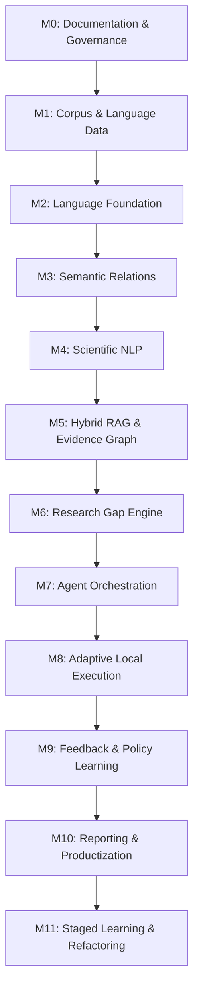

# LARIS Roadmap: Milestones and Exit Criteria

Milestone sequence and the exit criteria that gate each one. Task-level status lives in docs/plans/BACKLOG.md.

## 1. Implementation Roadmap

### 1. Roadmap Architecture & Execution Philosophy

The development of LARIS is organized into twelve sequential milestones (M0 through M11). In accordance with [ADR-008](../adr/ADR-008-evaluation-before-capability-claims.md), advancement from one milestone to the next requires satisfying explicit, empirical entry and exit criteria.

---

### 2. Milestone Summary Breakdown

#### Milestone M0: Documentation, Governance, and Architecture Baseline
- **Objective:** Establish the complete architectural, governance, and specification foundation before executing model training or heavy code implementation.
- **Deliverables:** Repository audit, official `IDEA.md`, documentation standards, freeze lifecycle policy, ADR baseline (ADR-001 through ADR-008), 12-layer specifications, module contracts, data schemas, validation scripts, and initial test harness.
- **Entry Criteria:** Clean greenfield repository.
- **Exit Criteria:** Validation script (`scripts/validate_docs.py`) runs with 0 errors; all core docs created and reviewed; milestone approval by project owner.

#### Milestone M1: Corpus Ingestion and Data Governance
- **Objective:** Construct clean, licensed scientific text corpora partitioned into leakage-proof splits for tokenizer and language foundation training.
- **Dependencies:** M0.
- **Deliverables:** License auditing pipeline, Unicode/math normalizer, deduplication engine, partitioned dataset splits (`data/processed/train`, `val`, `test`).
- **Exit Criteria:** Zero train-test leakage across document/author boundaries; 100% of corpus licensed and auditable.

#### Milestone M2: Language Foundation & Core Representations
- **Objective:** Train custom STEM subword tokenizer and compact scientific sentence encoders.
- **Dependencies:** M1.
- **Deliverables:** Trained tokenizer checkpoint, vocabulary artifact, compact encoder checkpoint, paraphrase benchmark suite.
- **Exit Criteria:** Tokenizer fertility $\le 1.4$ subwords/word on STEM test set; sentence encoder exceeds lexical BM25 baseline on semantic retrieval.

#### Milestone M3: Semantic Relations & Natural Language Inference
- **Objective:** Train and calibrate the in-house scientific NLI model and discourse relation parsers.
- **Dependencies:** M2.
- **Deliverables:** 3-way NLI model (Entailment, Contradiction, Neutral), coreference resolver, discourse parser.
- **Exit Criteria:** Macro F1 $\ge 0.82$ on scientific contradiction detection; zero conflation of high topical similarity with entailment.

#### Milestone M4: Scientific NLP & Discourse Intelligence
- **Objective:** Build discourse unit extraction models capable of heading-agnostic claim and limitation detection.
- **Dependencies:** M3.
- **Deliverables:** Claim, method, metric, result, and limitation extraction pipeline; unit normalizer.
- **Exit Criteria:** Heading-agnostic limitation detection recall $\ge 80\%$ on papers with stripped headings.

#### Milestone M5: Hybrid RAG and Evidence Knowledge Graph
- **Objective:** Implement the Layer 5 Evidence Graph and Layer 6 depth-adaptive hybrid retrieval engine.
- **Dependencies:** M4.
- **Deliverables:** Graph database / index, hybrid BM25 + dense + graph retrieval engine, coordinate mapping engine.
- **Exit Criteria:** 100% of retrieved evidence items retain valid source coordinates down to page and sentence index.

#### Milestone M6: Research Gap Discovery Engine
- **Objective:** Implement comparative experimental matrix synthesis, 12-class gap taxonomy evaluation, and adversarial counter-evidence search.
- **Dependencies:** M5.
- **Deliverables:** Cross-paper synthesis engine, contradiction detector, gap scorer, hypothesis and validation plan generator.
- **Exit Criteria:** System successfully identifies documented benchmark gaps while rejecting candidate gaps refuted by adversarial search.

#### Milestone M7: Multi-Agent Orchestration & Teaming
- **Objective:** Build the multi-agent orchestration runtime with the 10 specialist agents, task planners, and verification gates.
- **Dependencies:** M6.
- **Deliverables:** Agent supervisor, query planner, specialist agent contracts, cycle detectors, budget governors.
- **Exit Criteria:** Multi-agent workflows execute without cyclic loops; hard recursion ceiling ($N \le 10$) enforced.

#### Milestone M8: Adaptive Local Execution & Resource Telemetry
- **Objective:** Implement dynamic weight staging between VRAM, RAM, and SSD, ensuring strict adherence to the 16 GB VRAM budget.
- **Dependencies:** M7.
- **Deliverables:** Layer 9 task router, LRU specialist cache, real-time hardware telemetry monitor.
- **Exit Criteria:** Peak GPU VRAM allocation remains $\le 15.0$ GB under peak multi-agent workload; zero CUDA OOM crashes.

#### Milestone M9: Feedback, Error Taxonomy & Policy Learning
- **Objective:** Deploy continuous capability regression testing, error taxonomy tracking, hard-negative mining, and contextual bandit routing.
- **Dependencies:** M8.
- **Deliverables:** Regression test runner, scientific error logger, contextual bandit routing policy.
- **Exit Criteria:** Automated detection of capability regressions; measurable latency improvement via learned routing.

#### Milestone M10: Reporting & Productization
- **Objective:** Finalize default structured research report generation, citation inspection UI, on-demand manuscript composer, and release package.
- **Dependencies:** M9.
- **Deliverables:** Report generation engine, evidence inspection console, on-demand manuscript generator, user documentation.
- **Exit Criteria:** 100% of generated research report assertions cite valid coordinates; zero hallucination in formal audit; end-to-end system test pass.

#### Milestone M11: Staged Learning Pipeline Governance, Dataset Acquisition & Domain Refactoring
- **Objective:** Establish the authoritative 6-stage model learning sequence, execute licensing verification and empirical dataset acquisition, and refactor numbered source folders into domain packages while preserving the 12-layer architecture.
- **Dependencies:** M10.
- **Deliverables:** Staged learning pipeline specification (`DOC-SPEC-TRAIN-001`), implementation audit report (`DOC-RES-AUDIT-001`), dataset specification and licensing matrix, acquired and verified priority datasets (Universal Dependencies, PAWS, ANLI, SciFact, ViQuAD, DocLayNet, PubLayNet), S2ORC subset selection analysis, project-owned LARIS-GOLD specification, and domain-based package layout (`src/laris/corpus`, `src/laris/language`, `src/laris/scientific`, `src/laris/retrieval`, `src/laris/reasoning`, `src/laris/orchestration`, `src/laris/execution`, `src/laris/evaluation`, `src/laris/reporting`).
- **Exit Criteria:** Zero model training executed during M11; all priority datasets verified with checksums and schemas; S2ORC strictly bounded ($<20$ GB, $<20$M samples) or skipped if blocked; source refactoring complete with 100% of unit/contract tests passing and zero breaking changes to existing contracts.

---

## 2. Milestone Exit Criteria

| Milestone | Target State | Key Deliverable Artifacts | Primary Entry Gate | Empirical Exit Gate |
| :--- | :--- | :--- | :--- | :--- |
| **M0** | Documentation & Governance Baseline | `docs/` complete suite, ADR-001–008, `validate_docs.py`, skeleton tests. | Greenfield workspace initialized. | `scripts/validate_docs.py` passes 100% clean; project owner review. |
| **M1** | Corpus Ingestion & Data Governance | Partitioned datasets in `data/`, deduplication manifests, provenance records. | M0 Approved. | Zero train-test leakage; 100% license compliance verified. |
| **M2** | Language Foundation & Encoders | Tokenizer checkpoint, vocab file, sentence encoder weights. | M1 Exit Passed. | Tokenizer fertility $\le 1.4$ on STEM; retrieval MRR baseline surpassed. |
| **M3** | Semantic Relations & NLI | 3-way NLI model weights, coreference resolver, discourse parser. | M2 Exit Passed. | NLI macro F1 $\ge 0.82$; zero topical similarity conflation. |
| **M4** | Scientific NLP & Discourse | Claim/Limitation extractor, SI unit normalizer. | M3 Exit Passed. | Heading-agnostic limitation detection recall $\ge 80\%$. |
| **M5** | Hybrid RAG & Evidence Graph | Layer 5 Graph database, Layer 6 hybrid retriever. | M4 Exit Passed. | 100% retrieved items anchor to verified `EvidenceCoordinate`. |
| **M6** | Research Gap Engine | Comparative matrix engine, 12-class gap scorer, adversarial search. | M5 Exit Passed. | Benchmark gap discovery validated; false gaps refuted by search. |
| **M7** | Multi-Agent Orchestration | 10 Specialist Agents, Supervisor, DAG Planner. | M6 Exit Passed. | Zero cyclic loops; recursion ceiling ($N \le 10$) enforced. |
| **M8** | Adaptive Local Execution | Layer 9 Router, LRU Specialist Cache, VRAM monitor. | M7 Exit Passed. | Peak VRAM $\le 15.0$ GB on RTX 5070 Ti; zero OOM errors. |
| **M9** | Feedback & Policy Learning | Benchmark runner, error taxonomy logger, bandit policy. | M8 Exit Passed. | Automated regression detection operational; routing latency reduced. |
| **M10**| Reporting & Productization | Structured Report generator, citation viewer, release candidate. | M9 Exit Passed. | Zero unanchored claims in reports; full system integration test passed. |
