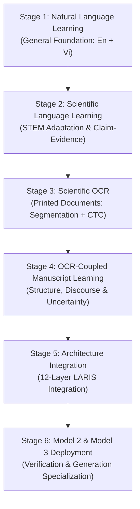

# LARIS Staged Learning Pipeline Specification & Execution Gates

## 1. Governance & Operational Principles

This document establishes the binding learning pipeline architecture for the Local Autonomous Research & Intelligence System (LARIS). In accordance with [ADR-002](file:///home/thientn204/laris/docs/adr/ADR-002-self-built-language-foundation.md), [ADR-003](file:///home/thientn204/laris/docs/adr/ADR-003-language-first-not-pdf-first.md), and [ADR-008](file:///home/thientn204/laris/docs/adr/ADR-008-evaluation-before-capability-claims.md), LARIS develops its language foundation from scratch without mandatory cloud inference APIs or proprietary black-box weights.

### Non-Negotiable Operational Constraints:
1. **Strict Stage Order:** The learning sequence is strictly unidirectional:
   $$\text{General Natural Language} \longrightarrow \text{Scientific Language} \longrightarrow \text{Scientific OCR} \longrightarrow \text{OCR-Coupled Manuscript} \longrightarrow \text{Architectural Integration}$$
   Skipping stages or attempting scientific manuscript comprehension prior to establishing general and scientific language competency is strictly prohibited.
2. **Distinct Model Responsibilities:**
   - **Model 1 (Language & Scientific Understanding):** Pretrained on general language corpora, fine-tuned on linguistic capabilities, and adapted to scientific terminology, discourse, and syntax.
   - **RAG & Multi-Agent Layer:** Manages search planning, hybrid indexing, coordinate verification, tool invocation, and dynamic retrieval.
   - **Model 2 (Reasoning & Verification):** Specializes in multi-hop inference, claim verification, 3-way NLI, contradiction detection, evidence sufficiency assessment, and research-gap discovery.
   - **Model 3 (Evidence-Grounded Generation):** Specializes in structured report synthesis, citation attribution, and on-demand manuscript drafting.
3. **Hardware Budget & Sequential Staging:**
   All execution must honor the hardware limits of a single workstation (Intel i5-14600KF, 32 GB host RAM, NVIDIA RTX 5070 Ti with 16 GB VRAM). Models must never be assumed to reside concurrently in VRAM. Active GPU allocations must remain $\le 15.0$ GB, enforced via sequential loading and LRU offloading ([ADR-005](file:///home/thientn204/laris/docs/adr/ADR-005-selective-loading-computation-access.md)).
4. **Scalable Data Floors (Not Caps):**
   The previously established target of **1,000,000 samples for Model 1** and **1,000,000 samples for Model 2** is a **minimum planning floor**, not an upper bound and not proof of training adequacy. Sample counts must be tracked by granular unit (source documents, sentence pairs, NLI triples, QA items, bounding boxes, tokens).
5. **English & Vietnamese Dual Tracks:**
   English and Vietnamese capabilities must be tracked, budgeted, and evaluated separately. Vietnamese counts cannot be blended into English totals to claim coverage.
6. **Strict Training Freeze in Milestone M11:**
   **NO MODEL TRAINING IS RUN DURING THIS PHASE.** All activities in Milestone M11 are restricted to governance, data inventory, authorized dataset acquisition, verification, and domain refactoring.

---

## 2. Mandatory Staged Learning Sequence

### Stage 1: Natural Language Learning (General Foundation)
- **Objective:** Establish core human language understanding before encountering specialized scientific literature.
- **Capabilities Acquired:**
  - Raw text preservation and task-specific reversible normalization (no blind lowercasing or symbol stripping).
  - Subword vocabulary and numerical representations.
  - Language modeling objectives (masked and autoregressive).
  - Syntax, morphology, part-of-speech (POS), and dependency parsing.
  - Semantic similarity and paraphrase equivalence detection.
  - 3-Way Natural Language Inference (`ENTAILMENT`, `CONTRADICTION`, `NEUTRAL`).
  - Reading comprehension and extractive/abstractive question answering.
  - Information extraction, named entity recognition, and coreference resolution.
  - Negation detection, epistemic modality, temporal order, and conditional statements.
  - Cross-sentence discourse structure.
- **Languages:** English and Vietnamese evaluated on isolated test splits.
- **Input Artifacts:** Raw Wikipedia dumps, Universal Dependencies (UD), PAWS, ANLI, Natural Questions (NQ), ViQuAD.
- **Output Artifacts:** General subword tokenizer, general language foundation checkpoint, linguistic capability benchmarks.

### Stage 2: Scientific Language Learning (STEM Specialization)
- **Objective:** Adapt the general language foundation to the lexicon, stylistic conventions, and epistemic structures of scientific research.
- **Prerequisites:** Stage 1 exit criteria fully satisfied.
- **Capabilities Acquired:**
  - Scientific terminology, nomenclature, and mathematical notation.
  - Scientific paraphrase detection and semantic equivalence across phrasing variants.
  - Scientific claim, hypothesis, and research question identification.
  - Experimental methodology, dataset descriptions, and metric extraction.
  - Result summarization, quantitative finding preservation, and limitation extraction.
  - Epistemic uncertainty, hedging (`suggests`, `indicates`), and evidential strength.
  - Cross-paper contradiction detection and methodological difference analysis.
- **Input Artifacts:** Verified STEM corpus (filtered subsets from S2ORC, arXiv open access, SciFact, PubMed Central Open Access).
- **Output Artifacts:** STEM-adapted vocabulary, scientific sentence encoder, scientific discourse classifier.

### Stage 3: Scientific OCR (Printed Document Image-to-Text)
- **Objective:** Develop high-fidelity transcription and layout analysis for printed scientific manuscripts.
- **Scope Limit:** **Printed scientific documents only. Handwriting is strictly out of scope.**
- **Prerequisites:** Stages 1 and 2 language and scientific representations ready for post-correction.
- **Capabilities Acquired:**
  - Image preprocessing: adaptive binarization, deskewing, dewarping, and artifact denoising.
  - Page layout detection: columns, headers, footers, margins, and reading order DAG.
  - Region segmentation: text blocks, tables, figures, captions, and formulas.
  - Line-level text recognition: CRNN / Vision-Transformer with CTC alignment.
  - Table structure extraction and formula transcription (LaTeX representation).
  - Epistemic preservation in post-correction: zero alteration of negation markers, numbers, units, chemical formulas, or citation markers.
- **Input Artifacts:** DocLayNet, PubLayNet, scientific PDF page image renders paired with verified ground-truth text.
- **Output Artifacts:** Document layout segmentation model, line OCR engine, coordinate-preserving text extractor.

### Stage 4: OCR-Coupled Manuscript Learning
- **Objective:** Learn end-to-end scientific manuscript structure and semantics directly on OCR-processed inputs, carrying bounding-box coordinates and transcription uncertainty forward.
- **Prerequisites:** Stage 3 OCR pipeline operational.
- **Capabilities Acquired:**
  - Document section boundary detection (Abstract, Intro, Methods, Results, Discussion, Conclusion).
  - Paragraph-level discourse roles (background, objective, method, result, limitation, future work).
  - Table and figure caption association with referenced body paragraphs.
  - Bibliographic reference parsing and citation coordinate mapping.
  - Cross-section claim-evidence alignment.
- **Input Artifacts:** Paired OCR outputs with human-annotated or gold-extracted scientific paper structures.
- **Output Artifacts:** Manuscript semantic parser, coordinate-anchored discourse graph.

### Stage 5: Resume & Integrate Existing LARIS Research Architecture
- **Objective:** Integrate the learned neural representations and models into the established 12-layer LARIS system.
- **Invariants:** Preserve existing module contracts (`src/laris/core`, `MODULE_CONTRACTS.md`), evidence graph schemas, and the 16 GB VRAM budget.
- **Integration Points:**
  - Layer 1: Replace hash-based encoder with trained STEM sentence encoder.
  - Layer 2: Replace heuristic NLI with calibrated neural NLI engine.
  - Layer 3: Replace regex discourse extraction with trained sequence labeler.
  - Layer 5 & 6: Ingest coordinate-grounded nodes into SQLite Evidence Graph and hybrid retrieval.
  - Layer 7: Power comparative matrix engine and gap discovery with neural contradiction scoring.

### Stage 6: Model 2 and Model 3 Roles & Sequential Runtime
- **Model 2 (Reasoning & Verification):**
  - Multi-hop claim verification across multiple papers.
  - Adversarial counter-evidence retrieval and sufficiency evaluation.
  - 12-class research gap classification and empirical contradiction scoring.
- **Model 3 (Evidence-Grounded Generation):**
  - Assertion-level evidence coordinate binding ($100\%$ citation coverage).
  - Zero hallucination guarantee on missing evidence.
  - On-demand structured manuscript drafting with uncertainty disclosures.
- **Runtime Lifecycle:**
  Sequential loading manager stages Model 1, Model 2, and Model 3 dynamically, ensuring active VRAM $\le 15.0$ GB at all times.

---

## 3. Data Requirements & Sizing Framework

### 3.1 Minimum Planning Floors vs Scalable Targets
The 1,000,000-sample figure for Model 1 and Model 2 represents a **minimum baseline floor**, not an adequacy cap. Sizing must be planned by granular capability:

| Stage / Model | Capability Group | Sample Unit | Minimum Floor | Target Range | Held-Out Eval Split |
| :--- | :--- | :--- | :--- | :--- | :--- |
| **Model 1 (Stage 1)** | General Language LM | Clean Documents | 250,000 | 500,000 – 1,000,000 | 25,000 |
| **Model 1 (Stage 1)** | Syntax & POS | Annotated Sentences | 100,000 | 200,000 – 400,000 | 10,000 |
| **Model 1 (Stage 1)** | Paraphrase & Similarity | Sentence Pairs | 150,000 | 300,000 – 600,000 | 15,000 |
| **Model 1 (Stage 1)** | General NLI (3-way) | Hypothesis-Premise Pairs | 250,000 | 500,000 – 1,000,000 | 25,000 |
| **Model 1 (Stage 1)** | Reading Comprehension / QA | Context-Question-Answer Triples | 150,000 | 250,000 – 500,000 | 15,000 |
| **Model 1 (Stage 1)** | Coreference & Discourse | Document / Paragraphs | 100,000 | 150,000 – 300,000 | 10,000 |
| **Model 1 (Stage 2)** | Scientific Domain LM | Open Access STEM Papers | 200,000 | 400,000 – 800,000 | 20,000 |
| **Model 1 (Stage 2)** | Scientific Claims & Evidence | Claim-Evidence Pairs | 100,000 | 200,000 – 400,000 | 15,000 |
| **Model 1 Total** | *All Capabilities Combined* | *Aggregated Units* | **$\ge$ 1,300,000** | **2,500,000 – 5,000,000** | **$\ge$ 120,000** |
| **Model 2 (Stage 6)** | Evidence-Grounded QA | Grounded QA Pairs | 250,000 | 400,000 – 800,000 | 25,000 |
| **Model 2 (Stage 6)** | Multi-Hop Scientific NLI | Multi-Premise Triples | 300,000 | 500,000 – 1,000,000 | 30,000 |
| **Model 2 (Stage 6)** | Contradiction & Refutation | Opposing Claim Pairs | 150,000 | 250,000 – 500,000 | 20,000 |
| **Model 2 (Stage 6)** | Sufficiency & Abstention | Unanswerable / Insufficient Sets | 150,000 | 250,000 – 400,000 | 20,000 |
| **Model 2 (Stage 6)** | 12-Class Gap Identification | Annotated Gap Instances | 150,000 | 250,000 – 500,000 | 15,000 |
| **Model 2 Total** | *All Reasoning Tasks* | *Aggregated Units* | **$\ge$ 1,000,000** | **1,650,000 – 3,200,000** | **$\ge$ 110,000** |
| **OCR (Stage 3)** | Layout & Line Transcription | Document Pages / Bounding Boxes | 100,000 pages | 250,000 – 500,000 pages | 15,000 pages |

### 3.2 English vs Vietnamese Separation
- **English Track:** Primary initial focus for all general and STEM capabilities.
- **Vietnamese Track:** Maintained as an independent dataset and evaluation pipeline:
  - Universal Dependencies Vietnamese (VTB).
  - ViQuAD (Vietnamese Question Answering Dataset) for reading comprehension.
  - Vietnamese Wikipedia for vocabulary and baseline language modeling.
  - Vietnamese scientific abstracts from open Vietnamese research repositories where available.
- All evaluation reports must produce disaggregated metrics: $M_{\text{EN}}$ and $M_{\text{VI}}$.

---

## 4. Empirical Evaluation Gates & Acceptance Criteria

Advancement between stages requires passing explicit quantitative exit gates on held-out benchmarks:

| Stage Transition | Target Gate | Metric / Benchmark | Minimum Passing Threshold |
| :--- | :--- | :--- | :--- |
| **Stage 1 $\rightarrow$ Stage 2** | General NLI Gate | Macro F1 on ANLI / SNLI test sets | $\ge 0.85$ (EN), $\ge 0.78$ (VI) |
| **Stage 1 $\rightarrow$ Stage 2** | Paraphrase Detection | Accuracy & F1 on PAWS test set | $\ge 0.88$ (EN) |
| **Stage 1 $\rightarrow$ Stage 2** | Reading Comprehension | Exact Match / F1 on NQ / ViQuAD | $\ge 70.0 / 82.0$ (EN), $\ge 65.0 / 78.0$ (VI) |
| **Stage 1 $\rightarrow$ Stage 2** | Fertility Gate | Subword fertility on general test text | $\le 1.35$ tokens/word |
| **Stage 2 $\rightarrow$ Stage 3** | Scientific NLI Gate | Macro F1 on SciFact contradiction/entailment | $\ge 0.82$ |
| **Stage 2 $\rightarrow$ Stage 3** | Claim-Evidence Alignment | Precision / Recall on evidence verification | $\ge 0.80 / 0.80$ |
| **Stage 3 $\rightarrow$ Stage 4** | OCR Character Error Rate | Character Error Rate (CER) on test pages | $\le 1.5\%$ on clean, $\le 3.0\%$ on degraded |
| **Stage 3 $\rightarrow$ Stage 4** | Layout IoU Gate | Mean IoU on DocLayNet/PubLayNet regions | $\ge 0.88$ across 11 layout classes |
| **Stage 4 $\rightarrow$ Stage 5** | Discourse Role F1 | Macro F1 on 6 scientific discourse roles | $\ge 0.82$ on OCR-transcribed manuscripts |
| **Stage 5 $\rightarrow$ Stage 6** | System VRAM Headroom | Peak allocation under full multi-agent load | $\le 15.0$ GB on RTX 5070 Ti |

---

## 5. Milestone M11 Training Freeze Statement

In strict adherence to repository governance and the execution mandate:
**NO MODEL TRAINING WAS RUN.**

No pretraining, fine-tuning, optimizer steps, checkpoint generation, or adapter updates were performed during Milestone M11. This specification serves as the formal architectural and governance contract required before future authorized training phases.
