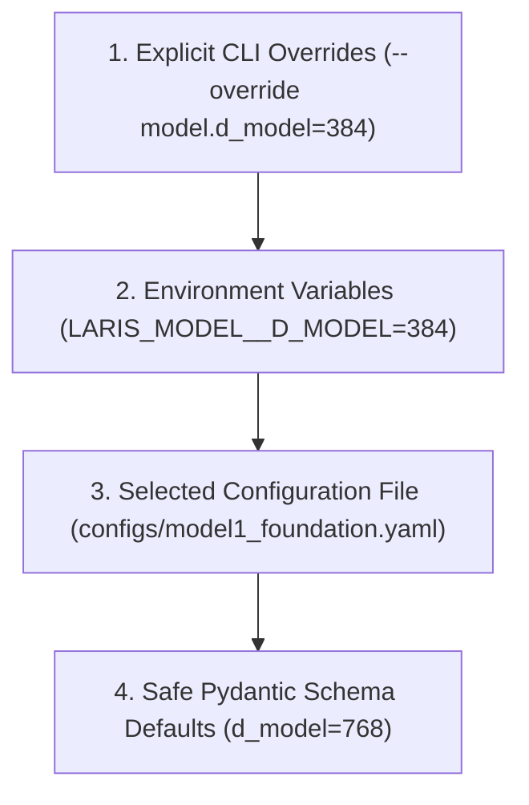

# LARIS Centralized Configuration System & Hardcoded-Parameter Audit

## 1. Executive Summary & Audit Mandate

In strict accordance with GitHub Issue [#215](https://github.com/ntdev204/laris/issues/215) (`[M11-CONFIG-001] Centralized Configuration System & Hardcoded-Parameter Audit`), [ADR-001](file:///home/thientn204/laris/docs/adr/ADR-001-local-first-system-boundary.md), [ADR-002](file:///home/thientn204/laris/docs/adr/ADR-002-self-built-language-foundation.md), and [ADR-005](file:///home/thientn204/laris/docs/adr/ADR-005-selective-loading-computation-access.md), this audit catalogs, analyzes, and classifies parameters across LARIS.

### 1.1. Parameter Taxonomy
Parameters are classified into four mutually exclusive categories:
1. **Tunable Hyperparameters:** Operational settings that researchers or deployment environments may tune via YAML files, environment variables, or CLI arguments (e.g., learning rate, batch size, dropout, sequence length, split ratios).
2. **Immutable Domain Invariants:** Core architectural axioms and safety constraints that **MUST NEVER** be overridden or disabled via configuration (e.g., maximum VRAM ceiling of 14.5 GB on the RTX 5070 Ti, zero cross-split evaluation leakage, special token indices, RoPE positional encoding, RMSNorm pre-normalization).
3. **Safe Defaults:** Baseline defaults embedded in canonical Pydantic schemas serving as fallbacks when configuration files or environment overrides do not provide explicit values.
4. **Test & Fixture Constants:** Scoped fixtures used strictly in isolated unit and contract tests.

---

## 2. Parameter Classification Matrix

| Parameter Name | Target Module | Current Location | Classification | Default Value | Rationale & Governance Rule |
| :--- | :--- | :--- | :--- | :--- | :--- |
| `max_vram_gb` | Hardware | `schemas.py`, `profiling.py` | **INVARIANT** | `14.5` GB | RTX 5070 Ti 16 GB hardware safety governor; strictly enforced ceiling (ADR-005). |
| `zero_test_leakage` | Corpus / Language | `partition.py`, `artifacts.py`| **INVARIANT** | `True` | Evaluation split isolation; zero document or question overlap permitted (ADR-008). |
| `norm_type` | Language | `neural.py` | **INVARIANT** | `"rmsnorm"` | Pre-RMSNorm scale without bias is an architectural constant of Model 1. |
| `pos_encoding` | Language | `neural.py` | **INVARIANT** | `"rope"` | Rotary position embeddings applied directly to Q/K states. |
| `activation` | Language | `neural.py` | **INVARIANT** | `"gelu"` | Gaussian Error Linear Unit feed-forward activation. |
| `tie_embeddings` | Language | `neural.py` | **INVARIANT** | `True` | MLM output projection tied to token embeddings to respect memory budget. |
| `special_token_ids` | Language | `schemas.py` | **INVARIANT** | `0..7` | Canonical IDs for PAD (0), UNK (1), CLS (2), SEP (3), MASK (4), MATH (5), GREEK (6), UNIT (7). |
| `vocab_size` | Language | `neural.py`, `schemas.py` | **TUNABLE** | `32000` | Balanced bilingual vocabulary capacity (16k EN, 12k VI, 4k STEM). |
| `max_sequence_length`| Language | `schemas.py`, `neural.py` | **TUNABLE** | `512` | Maximum sequence token context capacity. |
| `d_model` | Language | `schemas.py`, `neural.py` | **TUNABLE** | `768` | Hidden representation dimension (constrained to 384 or 768). |
| `num_layers` | Language | `neural.py` | **TUNABLE** | `12` | Transformer encoder layer depth. |
| `num_heads` | Language | `neural.py` | **TUNABLE** | `12` | Multi-head attention projection count (d_model must be divisible by heads). |
| `d_ff` | Language | `neural.py` | **TUNABLE** | `3072` | Intermediate FFN hidden dimension ($4 \times d_{\text{model}}$). |
| `dropout` | Language | `neural.py` | **TUNABLE** | `0.1` | Dropout regularization probability. |
| `precision` | Language | `neural.py` | **TUNABLE** | `"bf16"` | Mixed precision compute precision (`bf16` or `fp16`). |
| `seed` | Core / Language | `schemas.py`, `neural.py` | **TUNABLE** | `42` | PRNG seed for reproducible initialization. |
| `batch_size` | Training | `config_handoff.py` | **TUNABLE** | `32` | Effective optimization batch size. |
| `micro_batch_size` | Training | `config_handoff.py` | **TUNABLE** | `4` | Per-step device batch size to avoid out-of-memory. |
| `gradient_accumulation_steps` | Training | `config_handoff.py` | **TUNABLE** | `8` | Multiplier yielding effective batch size ($4 \times 8 = 32$). |
| `learning_rate` | Training | `config_handoff.py` | **TUNABLE** | `1e-4` | Peak AdamW learning rate. |
| `warmup_steps` | Training | `config_handoff.py` | **TUNABLE** | `2000` | Linear learning rate warmup steps. |
| `max_steps` | Training | `config_handoff.py` | **TUNABLE** | `100000` | Maximum pretraining optimization step ceiling. |
| `loss_lambda_mlm` | Training | `config_handoff.py` | **TUNABLE** | `0.35` | Multi-task mixture weight for Masked Language Modeling. |
| `loss_lambda_nli` | Training | `config_handoff.py` | **TUNABLE** | `0.25` | Multi-task mixture weight for 3-way NLI. |
| `loss_lambda_para` | Training | `config_handoff.py` | **TUNABLE** | `0.15` | Multi-task mixture weight for Paraphrase Detection. |
| `loss_lambda_sim` | Training | `config_handoff.py` | **TUNABLE** | `0.10` | Multi-task mixture weight for Continuous Similarity (STS-B). |
| `loss_lambda_qa` | Training | `config_handoff.py` | **TUNABLE** | `0.15` | Multi-task mixture weight for Span QA. |
| `train_split_ratio` | Corpus | `partition.py`, `task_splits.py` | **TUNABLE** | `0.80` | Target fraction for TRAIN split. |
| `val_split_ratio` | Corpus | `partition.py`, `task_splits.py` | **TUNABLE** | `0.10` | Target fraction for VAL split. |
| `test_split_ratio` | Corpus | `partition.py`, `task_splits.py` | **TUNABLE** | `0.10` | Target fraction for TEST split. |
| `character_coverage` | Language | `tokenizer_trainer.py` | **TUNABLE** | `0.9995` | Character coverage threshold for tokenizer vocabulary induction. |

---

## 3. Four-Tier Precedence Architecture

The canonical configuration loader enforces an unambiguous four-tier precedence hierarchy:

1. **CLI Overrides (Highest):** Explicit key-value pairs passed via CLI or direct invocation overrides dictionary.
2. **Environment Variables:** Uppercase, prefix-isolated environment variables with double-underscore nesting (e.g., `LARIS_MODEL__D_MODEL=384`, `LARIS_TRAINING__LEARNING_RATE=0.0002`).
3. **Configuration File:** Declarative YAML files located in `configs/` or an explicit user path.
4. **Safe Defaults (Lowest):** Centralized, type-checked default values in canonical Pydantic models.

---

## 4. Cryptographic Hashing & Secret Redaction

To satisfy #19 and [ADR-002](file:///home/thientn204/laris/docs/adr/ADR-002-self-built-language-foundation.md):
- Every resolved configuration instance produces a deterministic SHA-256 `config_hash`.
- Keys containing sensitive substrings (`password`, `secret`, `token`, `key`, `credential`) are automatically redacted to `[REDACTED]` prior to serialization or hashing.
- Machine-specific absolute filesystem paths are scrubbed or normalized.
- The `config_hash` is recorded in `LanguageTrainingRunManifest` and `BundleManifest`.

---

## 5. Compliance Confirmation

In accordance with repository governance:  
**NO MODEL TRAINING WAS RUN.**
