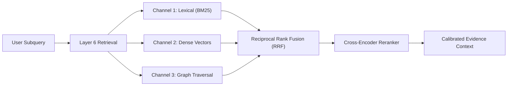

# Research Strategy: Hybrid Hierarchical RAG & Multi-Channel Retrieval

## 1. Multi-Channel Retrieval Architecture

Standard RAG architectures rely exclusively on dense vector similarity over fixed chunks. LARIS implements a hybrid, multi-stage retrieval architecture:

1. **Channel 1: Lexical Search (BM25):** Ensures exact matching of specialized acronyms, chemical formulas, and mathematical notation.
2. **Channel 2: Dense Semantic Search:** Matches paraphrased concepts, equivalent research methodologies, and related semantic questions.
3. **Channel 3: Graph Traversal:** Discovers indirect relations, multi-hop citations, and shared experimental baselines in the Layer 5 Evidence Graph.

---

## 2. Multi-Stage Reranking & Depth Adaptation

Retrieved candidates are fused using Reciprocal Rank Fusion (RRF) and scored via a lightweight cross-encoder reranker that evaluates:
$$\text{Relevance Score} = \alpha \cdot \text{LexicalMatch} + \beta \cdot \text{SemanticSimilarity} + \gamma \cdot \text{DiscourseFit} + \delta \cdot \text{EvidenceCredibility}$$

Retrieval depth dynamically expands from sentence level to paragraph and section level only when the epistemic uncertainty of the retrieved context exceeds the confidence threshold.
