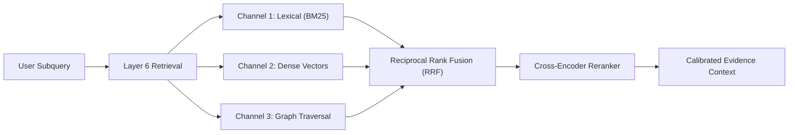

# Research Strategy: Evaluation, Scientific NLP, Hybrid Retrieval and Gap Discovery

## Part 1 — Scientific Capability Evaluation & Policy Optimization

### 1. Capability Evaluation Framework

In accordance with [ADR-008](../adr/ADR-008-evaluation-before-capability-claims.md), capability claims must be supported by empirical, reproducible benchmarks.

#### The Eight Empirical Capability Dimensions:
1. **Paraphrase & Question Intent Equivalence:** Macro F1 and accuracy on scientific paraphrase sets.
2. **NLI & Contradiction Detection:** Precision/Recall on scientific claim pairs with conflicting findings.
3. **Discourse & Claim Extraction:** Token-level F1 and span exact-match on methods, metrics, and claims.
4. **Heading-Agnostic Limitation Inference:** Sensitivity in detecting implicit caveats in discussion narratives.
5. **Cross-Paper Synthesis Consistency:** Coherence and factual accuracy of comparative condition tables.
6. **Verifiable Gap Discovery Quality:** Expert validation rate of proposed research gaps.
7. **Provenance & Zero Hallucination Rate:** Percentage of generated assertions linked to verified coordinates (Target: 100%).
8. **Hardware Telemetry Compliance:** Peak VRAM $\le 15.0$ GB, zero OOM events, bounded latency.

---

### 2. Policy Learning & Contextual Bandits

For Layer 8 and Layer 9 agent routing and tool selection:
- Initial policy: Deterministic rules and static routing heuristics.
- Intermediate policy: Contextual bandit optimizing tool selection based on task difficulty and historical execution latency.
- Reinforcement learning (RL): Activated **only** after deterministic simulation environments, validated reward signals, and frozen evaluation benchmarks are fully established. Surface fluency is strictly forbidden as a reward signal.

## Part 2 — Scientific NLP & Heading-Agnostic Discourse Parsing

### 1. Discourse Unit Extraction Beyond Section Headings

Scientific text relies on rhetorical moves rather than section titles to communicate findings. In accordance with [ADR-003](../adr/ADR-003-language-first-not-pdf-first.md), LARIS models scientific discourse using semantic sentence classification:

- **Background / Problem Formulation:** Context and existing paradigms.
- **Methodology & Protocol:** Concrete experimental setup, hardware, parameters, and algorithms.
- **Empirical Metric & Result:** Numerical measurements, standard deviations, and benchmarks.
- **Limitation & Caveat:** Sample size constraints, instrument uncalibration, environmental assumptions.
- **Theoretical Assumption:** Explicit or implicit boundary conditions (e.g. linearity, steady-state).

---

### 2. Heading-Agnostic Limitation Inference

Authors frequently bury limitations in general narrative discussion without a formal "Limitations" section:
- *Example:* "While the algorithm converged in 94% of cases, runtime scaled exponentially with graph density, and performance degraded significantly when signal-to-noise ratio fell below 6 dB."

LARIS detects these rhetorical patterns using:
1. Lexical and syntactic cue patterns (concessive markers: *although*, *nevertheless*, *restricted to*, *degraded when*).
2. Boundary condition extractors that bind performance metrics to specific operational ranges.
3. Contrastive classification trained on annotated scientific discussions.

## Part 3 — Hybrid Hierarchical RAG & Multi-Channel Retrieval

### 1. Multi-Channel Retrieval Architecture

Standard RAG architectures rely exclusively on dense vector similarity over fixed chunks. LARIS implements a hybrid, multi-stage retrieval architecture:

1. **Channel 1: Lexical Search (BM25):** Ensures exact matching of specialized acronyms, chemical formulas, and mathematical notation.
2. **Channel 2: Dense Semantic Search:** Matches paraphrased concepts, equivalent research methodologies, and related semantic questions.
3. **Channel 3: Graph Traversal:** Discovers indirect relations, multi-hop citations, and shared experimental baselines in the Layer 5 Evidence Graph.

---

### 2. Multi-Stage Reranking & Depth Adaptation

Retrieved candidates are fused using Reciprocal Rank Fusion (RRF) and scored via a lightweight cross-encoder reranker that evaluates:
$$\text{Relevance Score} = \alpha \cdot \text{LexicalMatch} + \beta \cdot \text{SemanticSimilarity} + \gamma \cdot \text{DiscourseFit} + \delta \cdot \text{EvidenceCredibility}$$

Retrieval depth dynamically expands from sentence level to paragraph and section level only when the epistemic uncertainty of the retrieved context exceeds the confidence threshold.

## Part 4 — Scientific Research Gap Discovery & Epistemic Verification

### 1. Principles of Valid Research Gap Discovery

A research gap is **never** declared simply because a keyword is rare, an author says "future work," or search returns few results. A legitimate scientific gap requires:
1. Proof that existing methodologies fail under documented boundary conditions.
2. Direct empirical contradictions between reputable independent studies.
3. Unexplored parameter combinations where theoretical models diverge.
4. Methodological blind spots where evaluation metrics fail to measure real-world performance.

---

### 2. Multi-Study Comparative Matrix

The foundation of gap discovery in LARIS is the automated construction of a **Comparative Experimental Matrix**:

| Study | Proposed Method | Dataset / Environment | Measured Metric | Limitation / Boundary Condition | Epistemic Status |
| :--- | :--- | :--- | :--- | :--- | :--- |
| Paper A | CNN-Transformer Hybrid | Synthetic Radar Data | SNR = 18 dB, Acc = 91% | Breaks when clutter $> 30\%$ | Empirically Supported |
| Paper B | Graph Neural Network | Real-world Field Data | SNR = 12 dB, Acc = 84% | High latency (180 ms) | Empirically Supported |

By aligning experimental setups, the Reasoning Engine discovers that no published study has achieved real-time execution ($< 50$ ms) on real-world field data under low SNR conditions ($\le 12$ dB).

---

### 3. Adversarial Counter-Evidence Querying

Before presenting any candidate gap to the user, LARIS executes an adversarial search:
- The system generates targeted queries asserting that the gap has already been solved.
- If counter-evidence is located in the corpus, the candidate gap is immediately rejected or marked as `PREVIOUSLY_ADDRESSED`.
- If no counter-evidence exists within the defined corpus boundary, the gap is scored and advanced to the report.
