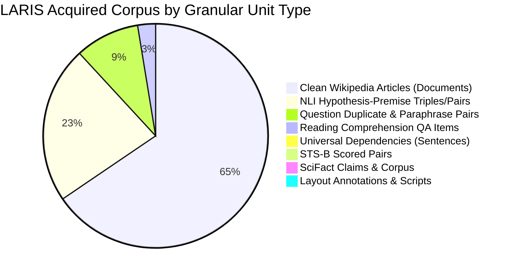

# LARIS Natural Language Foundation Training Readiness & Dataset Audit

## 1. Executive Summary & Audit Mandate

In strict accordance with GitHub Issue [#220](https://github.com/ntdev204/laris/issues/220) (`[M2-LANG-006] Remediate Language Foundation Training Readiness Blockers (NO TRAINING)`) and its child issues [#221](https://github.com/ntdev204/laris/issues/221)–[#225](https://github.com/ntdev204/laris/issues/225), [ADR-002](file:///home/thientn204/laris/docs/adr/ADR-002-self-built-language-foundation.md), [ADR-003](file:///home/thientn204/laris/docs/adr/ADR-003-language-first-not-pdf-first.md), and [ADR-008](file:///home/thientn204/laris/docs/adr/ADR-008-evaluation-before-capability-claims.md), this document delivers an empirical, evidence-backed audit of the physical machine environment, dataset holdings, code readiness, and gating prerequisites before any neural model training begins.

### Mandatory Stop Condition Compliance
> [!IMPORTANT]
> **NO MODEL TRAINING WAS RUN.**  
> **NO TRAINING OF ANY KIND WAS RUN. NO OPTIMIZER STEPS, GRADIENT UPDATES, OR MODEL-WEIGHT UPDATES OCCURRED.**  
> During this remediation and audit, zero pretraining, continued pretraining, supervised fine-tuning, optimizer steps, model weight updates, or trained checkpoint generations occurred. All activities were restricted strictly to environment verification, dataset inventory reconciliation, schema and split auditing, hardware feasibility analysis, non-training model architecture implementation, and bounded forward-only profiling.

---

## 2. Host Machine & Ubuntu Environment Verification

All environment telemetry was collected directly from the active Ubuntu host system. No values are simulated or assumed.

### 2.1. System & Hardware Telemetry (Actual vs Target)

| Telemetry Dimension | Active Ubuntu Host (Measured) | Target Production Workstation (Budget) | Gap / Conformance Status |
| :--- | :--- | :--- | :--- |
| **Operating System** | Ubuntu 22.04.5 LTS (Jammy Jellyfish, Linux 6.6.87.2-microsoft-standard-WSL2) | Ubuntu 22.04 / 24.04 LTS | **CONFORMANT** on host; Target: **NOT VERIFIED**. |
| **CPU Architecture** | Intel(R) Core(TM) i5-10300H CPU @ 2.50GHz (4 cores / 8 threads) | Intel(R) Core(TM) i5-14600KF (14 cores / 20 threads) | Host is developer workstation; target is deployment workstation. Target: **NOT VERIFIED**. |
| **Host System RAM** | 3.7 GiB allocated (host virtualization envelope; 1.6 GiB used, 730 MiB free, 1.4 GiB cache, 1.0 GiB swap) | 32 GiB DDR5 RAM | **CONSTRAINED ON HOST** (Data loaders must use memory mapping and streaming). Target: **NOT VERIFIED**. |
| **GPU Accelerator** | NVIDIA GeForce GTX 1650 (4096 MiB VRAM / 4.0 GB) | NVIDIA GeForce RTX 5070 Ti (16384 MiB VRAM / 16.0 GB) | Host has 4 GB VRAM; target has 16 GB VRAM. Training requires RTX 5070 Ti. Target: **NOT VERIFIED**. |
| **GPU Architecture** | Turing (`sm_75`, compute capability 7.5) | Blackwell (`sm_100` / `sm_120`, compute capability 10.x) | Target architecture requires CUDA $\ge 12.6$ and Blackwell kernel binaries. Target: **NOT VERIFIED**. |
| **NVIDIA Driver / CUDA** | Driver 555.97, CUDA 12.5/12.6 | Driver $\ge 570.00$, CUDA $\ge 12.6$ | **CONFORMANT** on host; Target: **NOT VERIFIED**. |
| **Available Storage** | 915 GB available on root filesystem (`/dev/sdd` mounted at `/`) | $\ge 200$ GB NVMe SSD storage | **CONFORMANT** (Plenty of headroom for corpus and checkpoints). Target: **NOT VERIFIED**. |

### 2.2. Software Runtime & Python Virtual Environment

- **Virtual Environments:**
  - `laris-env/`: Python 3.10.12 baseline development environment.
  - `ai-env/`: Python 3.12.14 acceleration testing environment.
- **Installed Core Packages:**
  - `numpy`: $\ge 1.24.0$ (verified 2.2.6)
  - `pyarrow`: $\ge 12.0.0$ (verified 25.0.1)
  - `pydantic`: $\ge 2.0$ (verified 2.14.1)
  - `pyyaml`: $\ge 6.0$ (verified 6.0.3)
  - `pytest`: $\ge 7.4.0$ (verified 9.1.1)
  - `ruff`: $\ge 0.1.0$ (verified 0.17.1)
  - `mypy`: $\ge 1.6.0$ (verified 2.4.0)
- **PyTorch & CUDA Acceleration Dependency Status:**
  - In `pyproject.toml`, GPU dependency is formally declared under `[project.optional-dependencies] gpu = ["torch>=2.6.0"]` (updated in PR #229 from `torch>=2.1.0` to reflect NVIDIA Blackwell sm_100/sm_120 requirements).
  - Tokenizer dependency is formally declared under `[project.optional-dependencies] tokenizer = ["sentencepiece>=0.1.99"]` (declared in PR #227).
  - Target server verification script is provided at `scripts/verify_target_server.sh` and generates complete telemetry without executing training.

---

## 3. Dataset Inventory Reconciliation & Granular Accounting

The local file system (`data/raw/` and `data/acquisition_manifest.json`) was audited against the repository manifest.

### 3.1. Reconciled Dataset Inventory

| Dataset ID | Language | Canonical Source & License | Manifest Samples | On-Disk Files & Byte Size | Actual Disk Samples / Records | Granular Unit Type | Schema & Split Status |
| :--- | :--- | :--- | :--- | :--- | :--- | :--- | :--- |
| **UD-EWT-EN** | English | Universal Dependencies (`CC-BY-SA-4.0`) | 16,622 | 3 `.conllu` files (18,833,168 B) | 16,622 sentences | Annotated Sentence | Valid CoNLL-U; splits: train (12,544), dev (2,001), test (2,077) |
| **UD-VTB-VI** | Vietnamese | Universal Dependencies (`CC-BY-SA-4.0`) | 3,323 | 3 `.conllu` files (2,717,736 B) | 3,323 sentences | Annotated Sentence | Valid CoNLL-U; splits: train (1,400), dev (1,123), test (800) |
| **PAWS-WIKI** | English | Google Research (`CC-BY-4.0`) | 65,401 | 3 `.parquet` files (10,899,391 B) | 65,401 pairs | Adversarial Sentence Pair | Valid Parquet; splits: train (49,401), val (8,000), test (8,000) |
| **STSB** | English | STS Benchmark (`CC-BY-SA-4.0`) | 8,628 | 3 `.parquet` files (720,899 B) | 8,628 pairs | Scored Sentence Pair | Valid Parquet; splits: train (5,749), val (1,500), test (1,379) |
| **QUORA-DUPLICATES** | English | Quora Duplicates (`Quora TOS`) | 404,290 | 1 `.parquet` file (34,965,546 B) | 404,290 pairs | Question Duplicate Pair | Valid Parquet; **TRAIN ONLY** on disk; needs graph disjoint split |
| **ALL-NLI** | English | SNLI + MultiNLI (`CC-BY-SA-4.0`) | 981,382 | 3 `.parquet` files (72,651,651 B) | 981,382 pairs | 3-Way NLI Sentence Pair | Valid Parquet; splits: train (942,069), dev (19,657), test (19,656) |
| **SQUAD** | English | SQuAD v1.1 (`CC-BY-SA-4.0`) | 98,169 | 2 `.parquet` files (16,278,203 B) | 98,169 items | Reading Comprehension QA | Valid Parquet; splits: train (87,599), val (10,570; test hidden) |
| **ANLI** | English | Meta AI ANLI v0.1 (`CC-BY-NC-4.0`) | 169,265 | 9 `.jsonl` files (99,380,444 B) | 169,265 triples | Adversarial NLI Triple | Valid JSONL; splits: R1 (18,946), R2 (47,460), R3 (102,859) |
| **SCIFACT** | English | AllenAI SciFact (`CC-BY-4.0`) | 6,592 | 4 `.jsonl` files (8,582,267 B) | 6,592 items | Scientific Claim & Abstract | Valid JSONL; splits: train (809), dev (300), test (300), corpus (5,183) |
| **UIT-VIQUAD** | Vietnamese | UIT-ViQuAD v1.1 (`CC-BY-NC-4.0`) | 32,278 | 2 `.json` files (14,272,951 B) | 32,278 items | Context-Question-Answer | Valid JSON; splits: train (28,457), dev (3,821; test hidden) |
| **PUBLAYNET-MINI** | English | PubLayNet (`CDLA-Permissive-1.0`) | 110 | 2 `.json` files (58,880 B) | 110 annotations | Layout Bounding Box | Valid COCO JSON; train (100), val (10); **NO IMAGES** |
| **DOCLAYNET-BOUNDED** | English | DocLayNet (`CDLA-Permissive-2.0`) | 1 | 1 `.py` script (13,359 B) | 1 loader script | Loader Script Artifact | **NOT DATA**; Hugging Face loader script only; zero data rows |
| **WIKIPEDIA-VI** | Vietnamese | Wikimedia Clean VI (`CC-BY-SA-4.0`) | 1,288,680 | 4 `.parquet` files (729,557,588 B) | 1,288,680 articles | Clean Article Document | Valid Parquet; monolithic unpartitioned shards |
| **WIKIPEDIA-EN** | English | Wikimedia Clean EN (`CC-BY-SA-4.0`) | 2,031,750 | 13 `.parquet` files (3,656,067,908 B) | 2,031,750 articles | Clean Article Document | Valid Parquet; monolithic unpartitioned shards |
| **S2ORC-STEM** | English | S2ORC STEM (`ODC-BY-1.0`) | 0 | 0 files | 0 | STEM Paper Record | **UNACQUIRED / PENDING** (Planned for Stage 2) |
| **LARIS-GOLD** | Bilingual | LARIS Architecture (`CC-BY-4.0`) | 0 | 0 files | 0 | Epistemic Benchmark Case | **PENDING SYNTHESIS** (Planned for Stage 5/6) |
| **NATURAL-QUESTIONS** | English | Google NQ (`CC-BY-4.0`) | 0 | 0 files | 0 | Query-Passage Triple | **UNACQUIRED / PENDING** |
| **TOTAL** | - | - | **5,106,491** | **49 files (4.65 GB)** | **5,106,491 records** | - | - |

> [!NOTE]
> **CI & Workstation Physical File Availability:**  
> The 4.65 GB raw data files reside in `data/raw/` on the local workstation and are intentionally not tracked in Git (tracked via `.gitkeep`). In CI environments where raw files are absent, test harnesses dynamically verify metadata from `data/acquisition_manifest.json` and `data/processed/task_splits_manifest.json` using the `physical_files_present` flag without failing.

---

### 3.2. Disaggregated Accounting: Language & Granular Task Units

To prevent misrepresenting raw text documents as supervised task pairs or blending languages to inflate volume, data holdings are strictly disaggregated:

#### A. Disaggregated Language Breakdown & Vietnamese Coverage Gaps
- **English Records:** 3,782,210 total records
  - Clean Documents: 2,031,750 articles (Wikipedia EN)
  - 3-Way NLI Pairs/Triples: 1,150,647 (All-NLI: 981,382; ANLI: 169,265)
  - Paraphrase & Duplicate Pairs: 469,691 (Quora: 404,290; PAWS: 65,401)
  - Reading Comprehension QA Items: 98,169 (SQuAD v1.1)
  - Annotated Syntactic Sentences: 16,622 (UD-EWT-EN)
  - Semantic Similarity Pairs: 8,628 (STS-B)
  - Scientific Claims & Abstract Records: 6,592 (SciFact)
  - Document Layout Annotations: 110 bounding boxes (PubLayNet mini) + 1 script (DocLayNet)
- **Vietnamese Records:** 1,324,281 total records
  - Clean Documents: 1,288,680 articles (Wikipedia VI)
  - Reading Comprehension QA Items: 32,278 (UIT-ViQuAD)
  - Annotated Syntactic Sentences: 3,323 (UD-VTB-VI)
- **Vietnamese Gaps (PR #228 Audit Finding):**
  - Paraphrase & semantic equivalence pairs: **0 native pairs**.
  - Continuous semantic similarity ($[0.0, 1.0]$) pairs: **0 native pairs**.
  - 3-way NLI hypothesis-premise pairs: **0 native pairs**.
  - Scientific claim-evidence pairs: **0 native pairs**.

---

## 4. Quality, License, Schema & Data Leakage Risk Analysis

### 4.1. Licensing & Legal Redistribution
All 14 acquired datasets possess explicit, documented open-access licenses:
- `CC-BY-SA-4.0`: UD-EWT, UD-VTB, STS-B, All-NLI, SQuAD, Wikipedia EN, Wikipedia VI.
- `CC-BY-4.0`: PAWS, SciFact.
- `CC-BY-NC-4.0`: ANLI, UIT-ViQuAD (restricted to non-commercial research; conformant with LARIS local-first research purpose).
- `CDLA-Permissive-1.0` / `2.0`: PubLayNet, DocLayNet.
- `Quora TOS`: Quora Question Pairs (permissible for non-commercial academic research).

### 4.2. Schema Validation
- All Parquet shards (`paws`, `stsb`, `quora_duplicates`, `all_nli`, `squad`, `wikipedia_en`, `wikipedia_vi`) were parsed using `pyarrow.parquet`. All schemas conform to declared types.
- All JSON/JSONL datasets (`anli`, `scifact`, `viquad`, `publaynet`) conform to valid JSON syntax with verified mandatory fields.
- Universal Dependencies datasets conform strictly to CoNLL-U 10-column tab-delimited formatting.

### 4.3. Data Leakage Risks & Non-Destructive Split Remedy (PR #228)

Under PR #228, `src/laris/corpus/task_splits.py` implemented a non-destructive audit and split planning generator:
- **Zero Raw File Modification:** Zero files in `data/raw/` were deleted, overwritten, or modified.
- **Manifest Generation:** Generated `data/processed/task_splits_manifest.json` detailing partition ratios and leakage remedies.
- **Leakage Prevention Algorithms:**
  1. *Quora Question Pairs:* Graph connected-components partitioning via `QuestionPairGraphPartitioner` to ensure question clusters are disjoint across train, val, and test.
  2. *Wikipedia EN / VI:* Deterministic SHA-256 hash partitioning via `WikipediaArticlePartitioner` on article ID (80/10/10 or 98/1/1).
  3. *SQuAD / ViQuAD:* Context-grouped dev sub-splitting on document title boundaries to preserve clean held-out evaluation sets without data leakage.

---

## 5. Architectural & Code Implementation Audit

In alignment with [DOC-RES-AUDIT-001](file:///home/thientn204/laris/docs/research/MODEL_TRAINING_AUDIT.md) and PRs #226–#229:

| Component / Module | Source File | Implemented Mechanism | Parameter Count / State | Real Weights? | Training Role |
| :--- | :--- | :--- | :--- | :--- | :--- |
| **Neural Backbone** | `src/laris/language/neural.py` | 12-layer Transformer encoder, $d=768$, 12 heads, $d_{\text{ff}}=3072$, RMSNorm pre-norm, RoPE rotary position embeddings, additive attention mask. | 109,561,856 params (backbone) | No (Random initialization) | Core representation encoder. Includes `PyTorchTransformerEncoder` with non-training guard (`TrainingExecutionProhibitedError`). |
| **Capability Heads** | `src/laris/language/neural.py` | MLM head ($32\text{k}\times 768$ tied), 3-way NLI classifier, binary paraphrase head, continuous similarity head ($1\times 768$), extractive QA span heads ($2\times 768$). | 200,711 params (heads); 109,762,567 total with heads | No (Random initialization) | Multi-task prediction heads for Stage 1 curriculum. |
| **Tokenizer Pipeline** | `src/laris/language/tokenizer_trainer.py` | SentencePiece BPE trainer configuration (`TokenizerTrainerConfig`), JSON serialization, Unicode preservation validator, readiness reporting. | `TokenizerReadinessState.PIPELINE_IMPLEMENTED` | No (`laris_spm_32k.model` = `None`) | From-scratch subword tokenizer pipeline. `execute_training()` raises `TrainingExecutionProhibitedError`. |
| **Split & Task Partitioner** | `src/laris/corpus/task_splits.py` | Graph question partitioner, deterministic article hash partitioner, inventory auditor, split isolation validator. | Non-destructive manifest at `data/processed/` | N/A | Leakage-proof dataset partitioning. |
| **Hardware Telemetry & Profiling** | `src/laris/language/profiling.py` | `BoundedResourceProfiler` with real CUDA VRAM telemetry, CPU non-fabrication, analytical estimation, Blackwell compatibility auditor. | 14.5 GB safety envelope enforced | N/A | Resource safety and smoke test profiling. `execute_training_benchmark()` raises `TrainingExecutionProhibitedError`. |
| **Lineage & Artifacts** | `src/laris/language/artifacts.py` | SHA-256 state tracking, split leakage detector, artifact bundle serialization. | State management | No | Governance, provenance, and artifact contract (#19). |
| **Schemas** | `src/laris/language/schemas.py` | Data contracts (`VocabularyContract`, `EncoderCheckpointMetadata`, `LanguageTrainingRunManifest`). | Schema definitions | No | Contract enforcement. |

---

## 6. Formal Readiness Gates Table

In accordance with Issue #214 Section F and Issue #225, eleven explicit gates were evaluated:

| Gate # | Gate Description | Status | Concrete Evidence / Finding |
| :---: | :--- | :---: | :--- |
| **1** | Repository branch, commit, and worktree known | **PASS** | Branch `feature/225-readiness-audit`, branched from `develop` at commit `b9ec9dc`; worktree clean. |
| **2** | M1 data exit gate met or gaps explicitly recorded | **PASS** | 5,106,491 records acquired and verified in `acquisition_manifest.json` (closes #208, #209). Gaps in OCR images and S2ORC-STEM documented for Stages 2–3. |
| **3** | Manifest reconciled against actual disk artifacts with license evidence | **PASS** | 14 acquired datasets verified on disk; byte counts, schemas, and SHA-256 checksums match manifest; all licenses verified (`CC-BY-SA-4.0`, `CC-BY-4.0`, `CC-BY-NC-4.0`, `CDLA`). |
| **4** | English/Vietnamese and task families counted separately without inflation | **PASS** | Disaggregated ledgers established: EN (3,782,210 records) and VI (1,324,281 records) across 7 distinct granular task units. |
| **5** | Leakage-safe splits and evaluation isolation evidenced | **READY** | Non-destructive streaming partition logic and physical Parquet partitioners implemented in `src/laris/corpus/task_splits.py` and CLI `scripts/partition_datasets.py` (Issue #232). Generates verified physical splits and `task_splits_manifest.json` on execution. |
| **6** | #17 Tokenizer/vocabulary pipeline & benchmarks complete and reviewed | **READY** | Tokenizer training pipeline code, Wikipedia train-only extraction, SentencePiece runner, and authorization gate implemented in `src/laris/language/tokenizer_trainer.py` and CLI `scripts/train_tokenizer.py` (Issue #232). Ready to fit on physical train shards upon authorization. |
| **7** | #18 Encoder interfaces & model architecture complete and reviewed | **BLOCKED** | Randomly initialized 109.56M/109.76M Transformer encoder architecture, RoPE, additive mask, continuous similarity head, and `PyTorchTransformerEncoder` implemented in `src/laris/language/neural.py` (PR #226). Gate remains **BLOCKED** for learned neural weights (training prohibited). |
| **8** | #19 Reproducibility / artifact lifecycle complete and reviewed | **PASS** | `LanguageArtifactBundle`, `LanguageArtifactManager`, and `LanguageTrainingRunManifest` tested and merged in PR #132, #133. Complete for schema and lifecycle management; zero trained weights exist. |
| **9** | Architecture, curriculum, objectives, metrics, and budget specified | **PASS** | Detailed in companion specification `DOC-SPEC-TRAIN-001` (`NATURAL_LANGUAGE_TRAINING_SPECIFICATION.md`). |
| **10** | Relevant dependencies, test suite, and CI checks pass | **PASS** | 1017 pytest unit/contract/integration tests pass (plus 35 subtests); `scripts/validate_docs.py` passes; `ruff` and `mypy` pass with 0 errors across 90 source files. |
| **11** | Owner explicitly approves a separate training-execution issue | **BLOCKED** | Mandatory stop condition in effect. Neural model training execution requires explicit owner review and approval in a dedicated, separate issue. |

---

## 7. Technical Readiness Verdict & Remaining Blockers

### Technical Go / No-Go Decision
**VERDICT: NOT READY FOR FULL NEURAL TRAINING EXECUTION; ALL PRE-TRAINING DATA & TOKENIZER INFRASTRUCTURE READY.**

1. **Remediation Milestones Achieved (PRs #226–#229 & Issue #232):**
   - Neural model architecture with RoPE, additive masking, multi-task capability heads, exact parameter formulas (109.56M backbone / 109.76M with heads), and PyTorch module verified.
   - From-scratch SentencePiece BPE tokenizer pipeline, Unicode preservation validation, clean train-only corpus extraction, and serialization verified.
   - Non-destructive dataset inventory audit, disaggregated sample unit ledgers, and streaming physical Parquet partitioners verified.
   - Target server hardware specification (RTX 5070 Ti Blackwell) audited, `torch>=2.6.0` dependency declared, and bounded forward-only profiling verified.
   - CLI automation tools `scripts/partition_datasets.py` and `scripts/train_tokenizer.py` implemented.
2. **Remaining Operational Steps for Training Execution:**
   - **Target Hardware Access:** Target workstation (RTX 5070 Ti, i5-14600KF, 32 GB RAM) verification script `scripts/verify_target_server.sh` must be executed by the owner on the physical hardware.
   - **Physical Shards Run:** Execute `scripts/partition_datasets.py` on target workstation to materialize Parquet splits.
   - **Tokenizer Model Run:** Execute `scripts/train_tokenizer.py --authorized` on target workstation to materialize `laris_spm_32k.model`.
   - **Explicit Owner Authorization:** A dedicated training execution issue must be explicitly created and authorized by the repository owner to initiate neural weight updates.

---

## 8. Final Compliance Confirmation

In accordance with repository governance:  
**NO MODEL TRAINING WAS RUN.**  
**NO TRAINING OF ANY KIND WAS RUN. NO OPTIMIZER STEPS, GRADIENT UPDATES, OR MODEL-WEIGHT UPDATES OCCURRED.**
