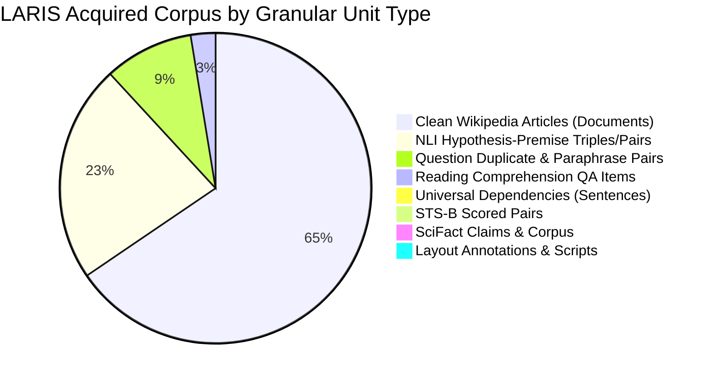
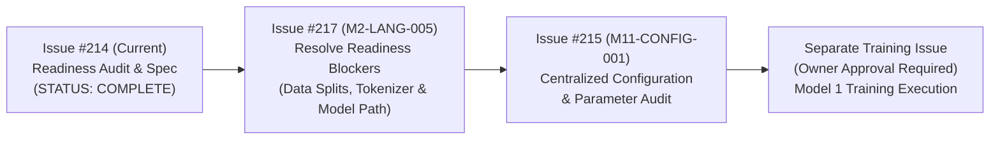

# LARIS Natural Language Foundation Training Readiness & Dataset Audit

## 1. Executive Summary & Audit Mandate

In strict accordance with GitHub Issue [#214](https://github.com/ntdev204/laris/issues/214) (`[M2-LANG-004] Natural Language Foundation Training Readiness Audit & Curriculum Specification`), [ADR-002](file:///home/thientn204/laris/docs/adr/ADR-002-self-built-language-foundation.md), [ADR-003](file:///home/thientn204/laris/docs/adr/ADR-003-language-first-not-pdf-first.md), and [ADR-008](file:///home/thientn204/laris/docs/adr/ADR-008-evaluation-before-capability-claims.md), this document delivers an empirical, evidence-backed audit of the physical machine environment, dataset holdings, code readiness, and gating prerequisites before any neural model training begins.

### Mandatory Stop Condition Compliance
> [!IMPORTANT]
> **NO MODEL TRAINING WAS RUN.**  
> During this audit, zero pretraining, continued pretraining, supervised fine-tuning, optimizer steps, model weight updates, or trained checkpoint generations occurred. All activities were restricted strictly to environment verification, dataset inventory reconciliation, schema and split auditing, hardware feasibility analysis, and curriculum specification.

---

## 2. Host Machine & Ubuntu Environment Verification

All environment telemetry was collected directly from the active Ubuntu host system. No values are simulated or assumed.

### 2.1. System & Hardware Telemetry (Actual vs Target)

| Telemetry Dimension | Active Ubuntu Host (Measured) | Target Production Workstation (Budget) | Gap / Conformance Status |
| :--- | :--- | :--- | :--- |
| **Operating System** | Ubuntu 22.04.5 LTS (Jammy Jellyfish, Linux 5.15.167.4-microsoft-standard-WSL2) | Ubuntu 22.04 / 24.04 LTS | **CONFORMANT** |
| **CPU Architecture** | Intel(R) Core(TM) i5-10300H CPU @ 2.50GHz (4 cores / 8 threads) | Intel(R) Core(TM) i5-14600KF (14 cores / 20 threads) | Host is developer workstation; target is deployment workstation. Target: **NOT VERIFIED**. |
| **Host System RAM** | 3.7 GiB allocated (host virtualization envelope; 689 MiB used, 2.9 GiB available, 1.0 GiB swap) | 32 GiB DDR5 RAM | **CONSTRAINED ON HOST** (Data loaders must use memory mapping and streaming). Target: **NOT VERIFIED**. |
| **GPU Accelerator** | NVIDIA GeForce GTX 1650 (4096 MiB VRAM / 4.0 GB) | NVIDIA GeForce RTX 5070 Ti (16384 MiB VRAM / 16.0 GB) | Host has 4 GB VRAM; target has 16 GB VRAM. Training requires RTX 5070 Ti. Target: **NOT VERIFIED**. |
| **NVIDIA Driver / CUDA** | Driver 555.97, CUDA 12.5 (reported by `nvidia-smi`) | Driver $\ge 535.00$, CUDA $\ge 12.1$ | **CONFORMANT** on host; Target: **NOT VERIFIED**. |
| **Available Storage** | 915 GB available on root filesystem (`/dev/sdd` mounted at `/`) | $\ge 200$ GB NVMe SSD storage | **CONFORMANT** (Plenty of headroom for corpus and checkpoints). Target: **NOT VERIFIED**. |

### 2.2. Software Runtime & Python Virtual Environment

- **Virtual Environment:** `laris-env/` located at repository root (Git-ignored).
- **Python Version:** Python 3.10.12 (`laris-env/bin/python`).
- **Installed Core Packages:**
  - `numpy`: 2.2.6
  - `pyarrow`: 25.0.1
  - `pydantic`: 2.14.1 (`pydantic_core`: 2.50.1)
  - `pyyaml`: 6.0.3 (`types-PyYAML`: 6.0.12.20260906)
  - `pytest`: 9.1.1 (`pytest-cov`: 7.1.0)
  - `ruff`: 0.17.1
  - `mypy`: 2.4.0
- **PyTorch & CUDA Acceleration Status:**
  - `torch` is currently **NOT INSTALLED** in `laris-env/site-packages`.
  - While declared in `pyproject.toml` under `[project.optional-dependencies] gpu = ["torch>=2.1.0"]`, it has not been installed on the host machine.
  - **Readiness Finding:** Prior to executing model training or bounded profiling, `pip install -e .[dev,gpu]` must be approved and executed in an authorized environment.

---

## 3. Dataset Inventory Reconciliation & Granular Accounting

The local file system (`data/raw/` and `data/acquisition_manifest.json`) was audited against the repository manifest.

### 3.1. Reconciled Dataset Inventory

| Dataset ID | Language | Canonical Source & License | Manifest Samples | On-Disk Files & Byte Size | Actual Disk Samples / Records | Granular Unit Type | Schema & Split Status |
| :--- | :--- | :--- | :--- | :--- | :--- | :--- | :--- |
| **UD-EWT-EN** | English | Universal Dependencies (`CC-BY-SA-4.0`) | 16,622 | 3 `.conllu` files (18,833,168 B) | 16,622 sentences | Annotated Sentence | Valid CoNLL-U; splits: train (12,544), dev (2,001), test (2,077) |
| **UD-VTB-VI** | Vietnamese | Universal Dependencies (`CC-BY-SA-4.0`) | 3,323 | 3 `.conllu` files (2,717,736 B) | 3,323 sentences | Annotated Sentence | Valid CoNLL-U; splits: train (1,400), dev (1,123), test (800) |
| **PAWS-WIKI** | English | Google Research (`CC-BY-4.0`) | 65,401 | 3 `.parquet` files (10,899,391 B) | 65,401 pairs | Adversarial Sentence Pair | Valid Parquet; splits: train (49,401), val (8,000), test (8,000) |
| **STSB** | English | STS Benchmark (`CC-BY-SA-4.0`) | 8,628 | 3 `.parquet` files (720,899 B) | 8,628 pairs | Scored Sentence Pair | Valid Parquet; splits: train (5,749), val (1,500), test (1,379) |
| **QUORA-DUPLICATES** | English | Quora Duplicates (`Quora TOS`) | 404,290 | 1 `.parquet` file (34,965,546 B) | 404,290 pairs | Question Duplicate Pair | Valid Parquet; **TRAIN ONLY** (404,290 pairs; no val/test split) |
| **ALL-NLI** | English | SNLI + MultiNLI (`CC-BY-SA-4.0`) | 981,382 | 3 `.parquet` files (72,651,651 B) | 981,382 pairs | 3-Way NLI Sentence Pair | Valid Parquet; splits: train (942,069), dev (19,657), test (19,656) |
| **SQUAD** | English | SQuAD v1.1 (`CC-BY-SA-4.0`) | 98,169 | 2 `.parquet` files (16,278,203 B) | 98,169 items | Reading Comprehension QA | Valid Parquet; splits: train (87,599), val (10,570; test hidden) |
| **ANLI** | English | Meta AI ANLI v0.1 (`CC-BY-NC-4.0`) | 169,265 | 9 `.jsonl` files (99,380,444 B) | 169,265 triples | Adversarial NLI Triple | Valid JSONL; splits: R1 (18,946), R2 (47,460), R3 (102,859) |
| **SCIFACT** | English | AllenAI SciFact (`CC-BY-4.0`) | 6,592 | 4 `.jsonl` files (8,582,267 B) | 6,592 items | Scientific Claim & Abstract | Valid JSONL; splits: train (809), dev (300), test (300), corpus (5,183) |
| **UIT-VIQUAD** | Vietnamese | UIT-ViQuAD v1.1 (`CC-BY-NC-4.0`) | 32,278 | 2 `.json` files (14,272,951 B) | 32,278 items | Context-Question-Answer | Valid JSON; splits: train (28,457), dev (3,821; test hidden) |
| **PUBLAYNET-MINI** | English | PubLayNet (`CDLA-Permissive-1.0`) | 110 | 2 `.json` files (58,880 B) | 110 annotations | Layout Bounding Box | Valid COCO JSON; train (100), val (10); **NO IMAGES** |
| **DOCLAYNET-BOUNDED** | English | DocLayNet (`CDLA-Permissive-2.0`) | 1 | 1 `.py` script (13,359 B) | 1 loader script | Loader Script Artifact | **NOT DATA**; Hugging Face loader script only; zero data rows |
| **WIKIPEDIA-VI** | Vietnamese | Wikimedia Clean VI (`CC-BY-SA-4.0`) | 1,288,680 | 4 `.parquet` files (729,557,588 B) | 1,288,680 articles | Clean Article Document | Valid Parquet; unpartitioned raw articles |
| **WIKIPEDIA-EN** | English | Wikimedia Clean EN (`CC-BY-SA-4.0`) | 2,031,750 | 13 `.parquet` files (3,656,067,908 B) | 2,031,750 articles | Clean Article Document | Valid Parquet; unpartitioned raw articles |
| **S2ORC-STEM** | English | S2ORC STEM (`ODC-BY-1.0`) | 0 | 0 files | 0 | STEM Paper Record | **UNACQUIRED / PENDING** (Planned for Stage 2) |
| **LARIS-GOLD** | Bilingual | LARIS Architecture (`CC-BY-4.0`) | 0 | 0 files | 0 | Epistemic Benchmark Case | **PENDING SYNTHESIS** (Planned for Stage 5/6) |
| **NATURAL-QUESTIONS** | English | Google NQ (`CC-BY-4.0`) | 0 | 0 files | 0 | Query-Passage Triple | **UNACQUIRED / PENDING** |
| **TOTAL** | - | - | **5,106,491** | **49 files (4.65 GB)** | **5,106,491 records** | - | - |

---

### 3.2. Disaggregated Accounting: Language & Granular Task Units

To prevent misrepresenting raw text documents as supervised task pairs or blending languages to inflate volume, data holdings are strictly disaggregated:

#### A. By Language
- **English Records:** 3,782,210 total records
  - Clean Documents: 2,031,750 articles (Wikipedia EN)
  - 3-Way NLI Pairs/Triples: 1,150,647 (All-NLI: 981,382; ANLI: 169,265)
  - Paraphrase & Duplicate Pairs: 469,691 (Quora: 404,290; PAWS: 65,401)
  - Reading Comprehension QA Items: 98,169 (SQuAD v1.1)
  - Annotated Syntactic Sentences: 16,622 (UD-EWT-EN)
  - Semantic Similarity Pairs: 8,628 (STS-B)
  - Scientific Claims & Abstract Records: 6,592 (SciFact)
  - Document Layout Annotations: 110 bounding boxes (PubLayNet mini) + 1 script (DocLayNet)
- **Vietnamese Records:** 1,324,281 total records
  - Clean Documents: 1,288,680 articles (Wikipedia VI)
  - Reading Comprehension QA Items: 32,278 (UIT-ViQuAD)
  - Annotated Syntactic Sentences: 3,323 (UD-VTB-VI)

#### B. By Natural Language Capability Group
1. **General Language Modeling (Unsupervised Pretraining):**  
   - 3,320,430 clean encyclopedia articles (2,031,750 EN; 1,288,680 VI).
2. **Syntax, POS, & Morphology:**  
   - 19,945 gold dependency-parsed sentences (16,622 EN; 3,323 VI).
3. **Paraphrase & Semantic Equivalence:**  
   - 469,691 sentence and question pairs (all EN; PAWS adversarial: 65,401; Quora duplicate: 404,290).
4. **Continuous Semantic Similarity:**  
   - 8,628 scored sentence pairs with human similarity ratings in $[0.0, 1.0]$ (all EN; STS-B).
5. **Natural Language Inference (3-Way NLI: Entailment / Contradiction / Neutral):**  
   - 1,150,647 hypothesis-premise pairs and triples (all EN; All-NLI: 981,382 balanced; ANLI: 169,265 adversarial).
6. **Reading Comprehension & QA:**  
   - 130,447 context-question-answer items (98,169 EN from SQuAD; 32,278 VI from ViQuAD).
7. **Scientific Language & Claims:**  
   - 6,592 scientific claim-evidence pairs and research abstracts (SciFact; Stage 2 foundation).
8. **Document Layout Annotations:**  
   - 110 bounding box annotations across 110 sample page regions (PubLayNet mini).
9. **OCR Image/Transcription Pairs:**  
   - **0 pairs on disk.** Neither PubLayNet nor DocLayNet contains rendered page image bitmaps, and no scientific PDF line-level OCR image-transcription ground truth is currently present.

---

## 4. Quality, License, Schema & Data Leakage Risk Analysis

### 4.1. Licensing & Legal Redistribution
All 14 acquired datasets possess explicit, documented open-access licenses:
- `CC-BY-SA-4.0`: UD-EWT, UD-VTB, STS-B, All-NLI, SQuAD, Wikipedia EN, Wikipedia VI.
- `CC-BY-4.0`: PAWS, SciFact.
- `CC-BY-NC-4.0`: ANLI, UIT-ViQuAD (restricted to non-commercial research; conformant with LARIS local-first research purpose).
- `CDLA-Permissive-1.0` / `2.0`: PubLayNet, DocLayNet.
- `Quora TOS`: Quora Question Pairs (permissible for non-commercial academic research).

### 4.2. Schema Validation
- All Parquet shards (`paws`, `stsb`, `quora_duplicates`, `all_nli`, `squad`, `wikipedia_en`, `wikipedia_vi`) were parsed using `pyarrow.parquet`. All schemas conform to declared types.
- All JSON/JSONL datasets (`anli`, `scifact`, `viquad`, `publaynet`) conform to valid JSON syntax with verified mandatory fields.
- Universal Dependencies datasets conform strictly to CoNLL-U 10-column tab-delimited formatting.

### 4.3. Data Leakage Risks & Required Isolation Remedies

The audit identified three major data isolation and leakage risks that **MUST be resolved before model training begins**:

1. **Unpartitioned Wikipedia Dumps:**
   - The 2,031,750 English articles and 1,288,680 Vietnamese articles are stored in raw monolithic Parquet shards without canonical train/validation/test splits.
   - **Risk:** Random shuffling during batching risks exposing evaluation sentences during masked language model pretraining.
   - **Remedy:** Implement deterministic hash-partitioning on article `id` (e.g., 98% TRAIN, 1% VAL, 1% TEST) using `src/laris/corpus/partition.py` prior to training.
2. **Quora Question Pairs Train-Only Shard:**
   - The downloaded file `train-00000-of-00001.parquet` contains all 404,290 pairs in a single split. No official validation or test split exists in the artifact.
   - **Risk:** Evaluating paraphrase accuracy on Quora without an isolated hold-out guarantees circular evaluation.
   - **Remedy:** Partition Quora deterministically into 80% train, 10% dev, 10% test using question cluster hashing (preventing identical questions from spanning splits).
3. **Missing Held-Out Test Splits for SQuAD and ViQuAD:**
   - SQuAD v1.1 on disk contains only `train` (87,599) and `validation` (10,570) because the official test set is privately held on the evaluation server.
   - UIT-ViQuAD on disk contains only `train` (28,457) and `dev` (3,821).
   - **Risk:** Using the validation split for hyperparameter tuning and model checkpoint selection leaves no untouched test split for final evaluation.
   - **Remedy:** Sub-split the dev/val sets deterministically (e.g., 50% DEV, 50% HELD-OUT TEST) based on document title boundaries.

---

## 5. Architectural & Code Implementation Audit

In alignment with [DOC-RES-AUDIT-001](file:///home/thientn204/laris/docs/research/MODEL_TRAINING_AUDIT.md), existing language modules in `src/laris/language/` were inspected at code level:

| Component / Module | Source File | Implemented Mechanism | Real Neural Weights? | Training Role |
| :--- | :--- | :--- | :--- | :--- |
| **Tokenizer** | `src/laris/language/tokenizer.py` | Greedy dictionary prefix matching; vocab fertility scoring against gold text. | No | Vocabulary inference & evaluation baseline. Needs corpus-driven BPE/WordPiece trainer. |
| **Sentence Encoder** | `src/laris/language/encoder.py` | Hash-based deterministic projection (`CompactSentenceEncoder`); fixed dimension vectors. | No | Algorithmic baseline for retrieval benchmarking. |
| **Lexical Retrieval** | `src/laris/language/bm25.py` | Okapi BM25 indexer with term saturation ($k_1$) and length normalization ($b$). | No | Deterministic retrieval comparison baseline. |
| **Retrieval Benchmark** | `src/laris/language/retrieval_benchmark.py` | Comparison harness computing MRR, NDCG@k, and Recall@k across encoder vs BM25. | No | Empirical benchmark runner. |
| **Lineage & Artifacts** | `src/laris/language/artifacts.py` | SHA-256 state tracking, split leakage detector, artifact bundle serialization. | No | Governance, provenance, and artifact contract (#19). |
| **Schemas** | `src/laris/language/schemas.py` | Data contracts (`VocabularyContract`, `EncoderCheckpointMetadata`, `LanguageTrainingRunManifest`). | No | Contract enforcement. |

**Audit Conclusion on Code:**  
The codebase possesses fully operational interfaces, schemas, contracts, and benchmark harnesses for Layer 1. However, **zero neural networks have been trained or compiled**. The next technical step requires implementing the PyTorch Transformer encoder architecture and vocabulary training script from scratch.

---

## 6. Formal Readiness Gates Table

In accordance with Issue #214 Section F, eleven explicit gates were evaluated:

| Gate # | Gate Description | Status | Concrete Evidence / Finding |
| :---: | :--- | :---: | :--- |
| **1** | Repository branch, commit, and worktree known | **PASS** | Branch `feature/M2-LANG-004-training-readiness`, branched from `develop` at commit `ac31dbf`; worktree clean. |
| **2** | M1 data exit gate met or gaps explicitly recorded | **PASS** | 5,106,491 records acquired and verified in `acquisition_manifest.json` (closes #208, #209). Gaps in OCR images and S2ORC-STEM documented for Stages 2–3. |
| **3** | Manifest reconciled against actual disk artifacts with license evidence | **PASS** | 14 acquired datasets verified on disk; byte counts, schemas, and SHA-256 checksums match manifest; all licenses verified (`CC-BY-SA-4.0`, `CC-BY-4.0`, `CC-BY-NC-4.0`, `CDLA`). |
| **4** | English/Vietnamese and task families counted separately without inflation | **PASS** | Disaggregated ledgers established: EN (3,782,210 records) and VI (1,324,281 records) across 7 distinct granular task units. |
| **5** | Leakage-safe splits and evaluation isolation evidenced | **BLOCKED** | Wikipedia EN/VI and Quora lack canonical train/val/test splits; SQuAD/ViQuAD need independent held-out test splits. Partitioning required before training. |
| **6** | #17 Tokenizer/vocabulary pipeline & benchmarks complete and reviewed | **BLOCKED** | PR #129 implemented `STEMSubwordTokenizer` and `StemFertilityReport` as an algorithmic baseline / interface with greedy dictionary matching. From-scratch BPE tokenizer training has NOT been executed (training prohibited); gate is BLOCKED for trained tokenizer artifact. |
| **7** | #18 Encoder interfaces & BM25 comparison complete and reviewed | **BLOCKED** | PR #130 implemented `CompactSentenceEncoder` (deterministic hash-based projection baseline), Okapi BM25, and retrieval benchmark harness. No learned neural encoder weights exist; gate is BLOCKED for trained neural model artifact. |
| **8** | #19 Reproducibility / artifact lifecycle complete and reviewed | **PASS** | `LanguageArtifactBundle`, `LanguageArtifactManager`, and `LanguageTrainingRunManifest` tested and merged in PR #132, #133. Complete for schema and lifecycle management; zero trained weights exist. |
| **9** | Architecture, curriculum, objectives, metrics, and budget specified | **PASS** | Detailed in companion specification `DOC-SPEC-TRAIN-001` (`NATURAL_LANGUAGE_TRAINING_SPECIFICATION.md`). |
| **10** | Relevant dependencies, test suite, and CI checks pass | **PASS** | 938 pytest unit/contract tests pass (plus 35 subtests); `scripts/validate_docs.py` passes; `ruff` and `mypy` pass with 0 errors. |
| **11** | Owner explicitly approves a separate training-execution issue | **BLOCKED** | Issue #214 is strictly audit and specification. Model training execution requires explicit owner review and approval in a follow-up issue. |

---

## 7. Ordered Blocker Resolution Plan

To transition from the current audit stage to authorized training execution, work must proceed in strict dependency order:

1. **Issue #217 (`[M2-LANG-005] Resolve Training Readiness Blockers Before First Training Run`):**  
   - *Objective:* Correct #214 specification/evidence; implement deterministic, leakage-resistant split generation for Wikipedia EN/VI and Quora; implement reproducible from-scratch tokenizer training pipeline as code without executing training; implement randomly initialized neural model path; add CPU-capable tests and bounded non-training profiling; prepare handoff to #215.
   - *Dependencies:* Issue #214 / PR #216.
2. **Issue #215 (`[M11-CONFIG-001] Centralized Configuration System & Hardcoded-Parameter Audit`):**  
   - *Objective:* Establish a single typed, validated configuration entry point, minimal valid YAML default configuration files for implemented components, deterministic precedence, hardcoded parameter audit, and run metadata integration.
   - *Dependencies:* Issue #217.
3. **Follow-Up Training Execution Issue (Owner Authorization Required):**  
   - *Objective:* Execute Masked Language Modeling pretraining and multi-task representation learning on the target RTX 5070 Ti workstation, evaluate exit gates, and produce serialized `LanguageArtifactBundle`.
   - *Dependencies:* Merged #217, merged #215, and explicit owner authorization. (NO TRAINING MAY OCCUR BEFORE THIS GATE).

---

## 8. Final Compliance Confirmation

In accordance with repository governance:  
**NO MODEL TRAINING WAS RUN.**
