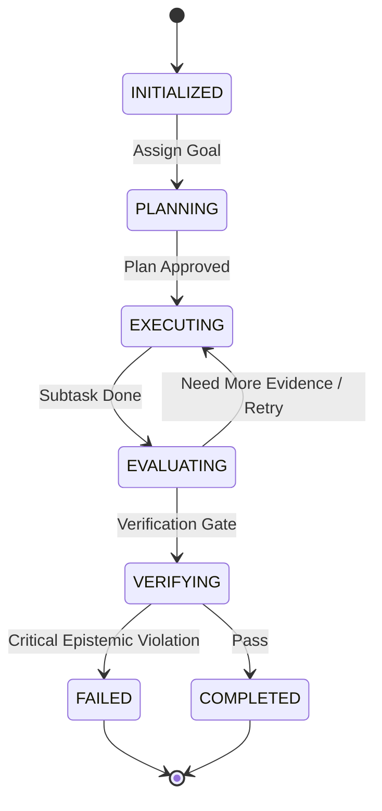

# LARIS Multi-Agent Role & Orchestration Specification

## 1. Multi-Agent Philosophy

In LARIS, agents are not generic open-ended conversationalists. Each agent is a bounded, role-specialized software actor with explicit state machines, typed communication contracts, allowed tools, and resource budgets.

Agents collaborate under the supervision of the `Supervisor / Orchestrator` to execute complex scientific workflows.

---

## 2. The Ten Specialist Agent Roles

| Agent Role | Primary Objective | Allowed Tools & Skills |
| :--- | :--- | :--- |
| **`Supervisor / Orchestrator`** | Decomposes overarching research goals, tracks task state, monitors convergence, and manages resource budgets. | Graph scheduler, DAG dispatcher. |
| **`Query Planner`** | Translates ambiguous user research queries into atomic sub-questions and structured retrieval intents. | Intent normalizer, semantic parser. |
| **`Language Analysis Agent`** | Evaluates syntactic dependencies, coreference, ambiguity, and linguistic paraphrase. | NLI engine, coreference resolver, syntax tagger. |
| **`Document Analysis Agent`** | Ingests raw papers, reconstructs reading order, parses tables/equations, and maps physical coordinates. | PDF layout parser, OCR evaluator. |
| **`Evidence Retrieval Agent`** | Executes depth-adaptive multi-hop retrieval across lexical, dense, and graph indexes. | BM25 search, vector retriever, graph traversal tool. |
| **`Scientific Claim Agent`** | Extracts claims, experimental methods, metrics, results, and heading-agnostic limitations. | Claim extraction skill, limitation inferencer. |
| **`Cross-Paper Synthesis Agent`** | Reconciles conflicting findings, aligns experimental conditions, and builds comparison matrices. | Method comparator, condition aligner. |
| **`Gap Discovery Agent`** | Evaluates literature against the 12-class gap taxonomy and generates candidate gap hypotheses. | Gap evaluation skill, counter-evidence search. |
| **`Critical Reviewer / Verifier`** | Acts as an adversarial auditor, verifying coordinate validity, citation accuracy, and epistemic boundaries. | Coordinate resolver, provenance checker. |
| **`Report Composer`** | Assembles verified synthesis and ranked gaps into structured, evidence-anchored research reports. | Markdown compiler, citation formatter. |

---

## 3. Agent Lifecycle State Machine

---

## 4. Orchestration Safety Invariants

1. **Hard Recursion Ceiling:** An agent execution chain MUST NOT exceed 10 sequential iterations without terminating or requesting human confirmation.
2. **Cycle Detection:** If an agent dispatches an identical tool call with identical arguments twice in a single task, the orchestrator halts execution immediately with `CyclicExecutionError`.
3. **Budget Exhaustion:** If cumulative latency or memory exceeds allocated budget limits, the orchestrator triggers graceful degradation and summarizes findings gathered to that point.
