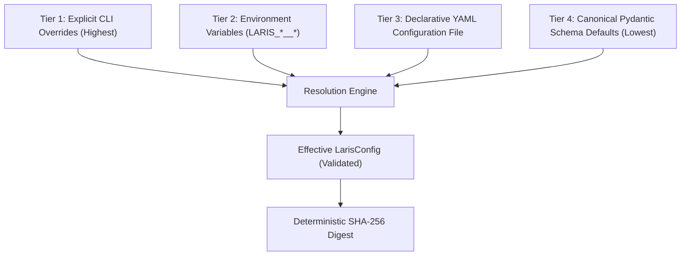

# LARIS Centralized Configuration Specification & Governance

## 1. Executive Summary

This document specifies the canonical configuration architecture for the LARIS project under Issue #215. It unifies parameter handling across all subsystems, enforces structural invariants, prevents hardware budget overruns, guarantees reproducibility via deterministic cryptographic hashing, and enforces strict separation between tunable hyperparameters and immutable architectural constants.

## 2. 4-Tier Precedence Architecture

Configuration values are resolved through a deterministic 4-tier precedence hierarchy:



1. **Tier 1 — Explicit CLI Overrides**: Dot-separated key-value pairs passed directly to invocation commands (e.g. `{"model.d_model": 384}`).
2. **Tier 2 — Environment Variables**: Prefixed environment variables formatted as `LARIS_<SECTION>__<KEY>` (e.g. `LARIS_TRAINING__BATCH_SIZE=64`).
3. **Tier 3 — Selected YAML Configuration File**: Declarative configuration templates stored in `configs/` or custom run configurations.
4. **Tier 4 — Canonical Pydantic Schema Defaults**: Hardened safe defaults declared in `laris.config.schemas`.

## 3. Schema Hierarchy & Structural Invariants

The root object `LarisConfig` coordinates four core domain sub-configurations:

| Subsystem | Schema Class | Tunable Parameters | Immutable Domain Invariants |
| :--- | :--- | :--- | :--- |
| **Model** | `ModelConfig` | `vocab_size`, `d_model` (384/768), `num_layers`, `num_heads`, `d_ff`, `dropout`, `precision`, `seed` | `norm_type == 'rmsnorm'`, `pos_encoding == 'rope'`, `activation == 'gelu'`, `tie_embeddings == True` |
| **Training** | `TrainingConfig` | `batch_size`, `micro_batch_size`, `gradient_accumulation_steps`, `learning_rate`, `warmup_steps`, `loss_lambda_*` | `micro_batch_size <= batch_size` |
| **Data** | `DataConfig` | `train_ratio`, `val_ratio`, `test_ratio`, `partition_seed`, `character_coverage` | `train_ratio + val_ratio + test_ratio == 1.0` |
| **Hardware** | `HardwareConfig` | `target_device` | `max_vram_gb <= 14.5` (Safety governor for RTX 5070 Ti) |

## 4. Hardware Safety Governor

Under ADR-005, the single physical GPU allocation target is the NVIDIA GeForce RTX 5070 Ti (16 GB total physical VRAM). To guarantee operating system stability, display server operation, and CUDA workspace headroom, an invariant hardware safety ceiling is enforced:

$$\text{max\_vram\_gb} \le 14.5\text{ GB}$$

Any configuration attempting to specify `max_vram_gb > 14.5` will immediately raise `HardwareBudgetExceededError` at schema instantiation, preventing runaway resource allocations.

## 5. Cryptographic Hashing & Experiment Traceability

Every resolved configuration generates an authoritative SHA-256 digest:

```python
from laris.config import compute_config_hash, load_config

cfg = load_config("configs/default.yaml")
digest = compute_config_hash(cfg)
```

- **Invariance to Secrets**: All credential keys, tokens, and passwords are automatically redacted prior to hashing, ensuring secret rotation does not invalidate reproducibility signatures.
- **Canonical Serialization**: JSON serialization with sorted keys guarantees that semantically equivalent configs yield identical SHA-256 fingerprints across architectures.

## 6. Consumer Module Integration

Downstream modules ingest configuration via standardized factory methods:
- `TransformerEncoderConfig.from_config(laris_config)`: Configures the 109.56M parameter neural architecture.
- `WikipediaArticlePartitioner.from_config(laris_config)`: Ingests data split ratios and partition seeds.
- `TokenizerTrainerConfig.from_config(laris_config)`: Ingests target vocabulary size and character coverage requirements.

Testing confirms that mutating configuration fields (e.g., setting `d_model=384`) directly modifies downstream execution behavior (reducing parameter count to 33.56M).
