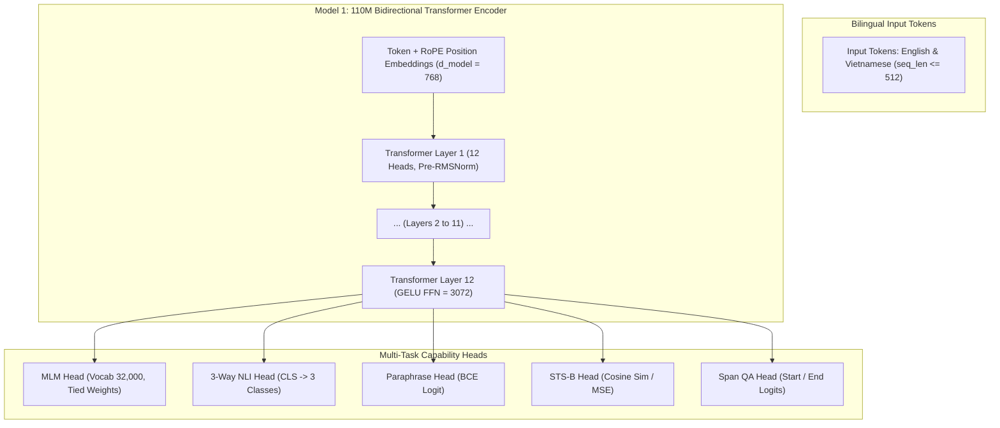

# Language encoder training specification

## 1. Scope and current state

Model 01 is the general English/Vietnamese language foundation. Model 02 is a
later scientific-language specialization; its model/data/evaluation pipeline is
not implemented. Existing general-language checkpoints are not qualified for
stage promotion. The historical scientific-paper pilot is an integration diagnostic,
not evidence that scientific-language training has been completed.

The owner alone executes training. During the current preparation work, agents
MUST NOT run tokenizer fitting, neural training, backward/optimizer steps, or
optimizer-bearing profiling/tests. Commands may be prepared and parsed, never
executed. Do not set training authorization in the agent environment.

### 2. Model 1 Foundation Architecture

Model 1 serves as the foundational text encoder powering syntax analysis, semantic representation, 3-way NLI, paraphrase detection, and dense retrieval across the 12 architectural layers.

#### 2.1. Structural Hyperparameters

| Hyperparameter | Value | Architectural Justification |
| :--- | :--- | :--- |
| **Model Type** | Bidirectional Transformer Encoder | Bidirectional context is optimal for sentence encoding, classification, and retrieval. |
| **Number of Layers ($L$)** | 12 | Standard depth providing expressive representation capacity while fitting in memory budget. |
| **Hidden Dimension ($d_{\text{model}}$)** | 768 | Complies with `ALLOWED_EMBEDDING_DIMENSIONS = {384, 768}` in `schemas.py`. |
| **Attention Heads ($H$)** | 12 | Head dimension $d_k = 768 / 12 = 64$; standard multi-head dot-product attention ($W_q, W_k, W_v, W_o \in \mathbb{R}^{d \times d}$). |
| **Intermediate FFN Dimension ($d_{\text{ff}}$)** | 3,072 | Standard $4 \times d_{\text{model}}$ 2-matrix feed-forward network with GELU activation ($W_1 \in \mathbb{R}^{d \times d_{\text{ff}}}, W_2 \in \mathbb{R}^{d_{\text{ff}} \times d}$; no projection bias). |
| **Positional Encoding** | Rotary Position Embeddings (RoPE) | Applied directly to query and key states; zero learned absolute positional parameters. |
| **Layer Normalization** | Pre-LayerNorm (RMSNorm) | Scale parameter $\gamma \in \mathbb{R}^d$ without bias $\beta$ on attention and FFN inputs ($2 \times d$ per layer), plus final RMSNorm ($d$). |
| **Vocabulary Size ($V$)** | 32,000 | Balanced bilingual subwords: ~16,000 EN, ~12,000 VI, ~4,000 STEM/Math/Special tokens. |
| **Embedding Tying** | Tied MLM Output Projection | The MLM prediction head output projection shares the $V \times d$ weight matrix with the input embedding, adding only a $V$-dim output bias ($32,000$ params). |
| **Maximum Sequence Length** | 512 tokens | Conforms to `DEFAULT_MAX_SEQUENCE_LENGTH = 512` in `schemas.py`. |
| **Total Parameters** | **109,561,856** ($\approx 109.56\text{M}$) | Exact equation: $V \cdot d + L \cdot (4 d^2 + 2 d \cdot d_{\text{ff}} + 2 d) + d + V = 24,576,000 + 12 \times 7,079,424 + 768 + 32,000 = 109,561,856$. (If untied MLM head: $134,137,856 \approx 134.14\text{M}$). |

#### 2.2. Scaled Foundation Model (512.9M Tier Architecture)

To maximize compute capacity on the target RTX 5070 Ti, LARIS provides the 512.9M scaled encoder profile (`LargeLanguageEncoderConfig`):

| Hyperparameter | Scaled Value | Architectural Justification |
| :--- | :--- | :--- |
| **Model Type** | Bidirectional Transformer Encoder | Symmetrical bi-directional attention for deep linguistic reasoning. |
| **Number of Layers ($L$)** | 24 | Doubled depth for expressive multi-hop syntactic and semantic representations. |
| **Hidden Dimension ($d_{\text{model}}$)** | 1,280 | Approved in `ALLOWED_EMBEDDING_DIMENSIONS = {384, 768, 1024, 1280}`. |
| **Attention Heads ($H$)** | 20 | Head dimension $d_k = 1280 / 20 = 64$ (optimal for GPU Tensor Cores). |
| **Intermediate FFN Dimension ($d_{\text{ff}}$)** | 5,120 | Standard $4 \times d_{\text{model}}$ expansion. |
| **Maximum Sequence Length** | 1,024 tokens | Doubled context length for full-length scientific paper abstracts and discourse spans. |
| **Vocabulary Size ($V$)** | 32,000 | Shared bilingual SentencePiece BPE vocabulary. |
| **Positional Encoding & Norm** | RoPE + Pre-RMSNorm | Preserves exact architectural invariants without parameter bloat. |
| **Total Backbone Parameters** | **512,913,920** ($\approx 512.91\text{M}$) | Formula: $32000 \cdot 1280 + 24 \cdot (4 \cdot 1280^2 + 2 \cdot 1280 \cdot 5120 + 2 \cdot 1280) + 1280 + 32000$. Total with heads: **513,247,751** ($\approx 513.25\text{M}$). |

---

## 3. Curriculum and operational contract

The current multi-task trainer mixes MLM, NLI, paraphrase, similarity and span QA.
Default weights are 0.35, 0.25, 0.15, 0.10 and 0.15 respectively. The executable
source of configuration is `configs/language_encoder/{compact,large}.yaml`, with
CLI overrides. The compact default context is 512 tokens; large is 1,024; explicit
`--max-seq-len` is honored. A run's recorded configuration is authoritative.

The tokenizer is fitted on training text only. MLM uses 15% dynamic masking.
NLI uses three labels; paraphrase uses a binary head; similarity uses a learned
scalar head; QA predicts start/end token positions. Do not describe the similarity
head as a contrastive retrieval objective: that objective is not implemented.
Dataset and language sampling follow the actual streaming loader, not a claimed
sequence of separately trained models. Train/val/test shards remain isolated.

Resume restores saved model/optimizer/scheduler/RNG/counters, but not the exact
stream position. It is not a bitwise-equivalent continuation of the data stream.
Checkpoint/tokenizer/dataset provenance and their digests must be preserved.
Weights, optimizer state and data shards stay outside Git.

## 4. Hardware evidence

The local target is RTX 5070 Ti with 16 GB VRAM and approximately 32 GB host RAM.
The preparation limit remains 14.5 GB for measured training allocations. Inference
measurements do not certify training memory. Analytical weight/activation estimates
are estimates only; the earlier 4.40/13.84 GB projections are not measured safety
certificates. Dtype, sequence lengths, optimizer and allocator state affect the peak.

`--profile-only` performs a real optimizer step when
`LARIS_TRAINING_AUTHORIZED=1`; without that authorization it is forward-only.
Consequently agents MUST NOT execute authorized profiling under the current
owner instruction. Only the owner may measure training-memory feasibility.

## 5. Formal foundation exit gates

Every required gate must pass on held-out test data with matching protocols and
artifact identity before promotion. Validation is for development; a baseline-floor
PASS is not stage qualification. Missing metrics/protocols are NOT VERIFIED,
not implicitly passed. English and Vietnamese are tracked separately.

The earlier document disagreed on English QA (70/82 versus 72/83). This revision
retains the stricter existing 72/83 requirement, without relaxing any gate. PAWS
requires both accuracy and two-class macro F1, not positive-class F1 or AUC.
ViNLI supplies Vietnamese NLI; a QA dataset is not an NLI benchmark.

| Gate | Dataset | Language | Metric | Required | Protocol |
| --- | --- | --- | --- | ---: | --- |
| G01 | anli | en | macro_f1 | >= 0.85 | three-class NLI |
| G02 | vinli | vi | macro_f1 | >= 0.78 | three-class NLI |
| G03 | paws | en | accuracy | >= 0.88 | binary classification |
| G04 | paws | en | macro_f1 | >= 0.88 | two-class macro F1 |
| G05 | stsb | en | spearman | >= 0.82 | rank correlation |
| G06 | squad | en | exact_match | >= 0.72 | normalized answer text |
| G07 | squad | en | f1 | >= 0.83 | normalized answer text |
| G08 | viquad_v2 | vi | exact_match | >= 0.65 | normalized answer text |
| G09 | viquad_v2 | vi | f1 | >= 0.78 | normalized answer text |
| G10 | unseen_text | en | fertility | <= 1.35 | unseen text, tokens/word |
| G11 | unseen_text | vi | fertility | <= 1.35 | unseen text, tokens/word |
| G12 | stem_retrieval | all | mrr | >= 0.82 and > BM25 | held-out query relevance |

The evaluator now reports normalized answer-text QA scores (`exact_match`, `f1`, protocol
`normalized_answer_text`) and keeps token-position scores separately as
`token_span_exact_match`/`token_span_f1`. Older reports contain only token-position QA
scores and still do not satisfy G06-G09. They also omit PAWS macro F1, tokenizer fertility
and the required retrieval benchmark. These omissions block qualification; they must not be filled
with invented values. The 6-query paper pilot is not the required benchmark.

## 6. Execution-readiness checklist

These are checks to perform for a proposed owner run, not a snapshot claiming all
checks have passed. They do not replace the capability exit gates above.

| Gate | Requirement |
| --- | --- |
| **1** | Record branch, commit and working-tree state. |
| **2** | Reconcile acquisition and split manifests with intended task coverage. |
| **3** | Check data identity, source permissions and on-disk checksums. |
| **4** | Count examples by task, dataset and language without double counting. |
| **5** | Verify partition isolation and preserve held-out test data. |
| **6** | Verify tokenizer identity, special tokens and vocabulary size. |
| **7** | Verify architecture, initialization and inference contracts. |
| **8** | Verify checkpoint digests, provenance and resume limitations. |
| **9** | Record exact curriculum, optimizer, configuration and hardware budget. |
| **10** | Pass the checks appropriate to the change; agents use non-training tests only. |
| **11** | Owner alone authorizes and executes training; agent execution remains blocked. |

## 7. Evaluation and promotion

`laris evaluate language-encoder` produces per-dataset metrics and sample-weighted
per-task/language groups. `configs/evaluation/language_encoder.yaml` defines
baseline-relative regression floors; those floors do not encode section 5.
Never ratchet those floors using test data. Do not repeatedly tune against test.
Use `--no-evaluate-after` for owner development runs to avoid the current automatic
test evaluation; explicitly evaluate validation checkpoints first.

A separate offline readiness check consumes existing reports and formal gates.
It must reject missing measurements, incompatible protocols, mixed checkpoints,
non-finite values and validation-only evidence for promotion. It does not run a
model, train weights or change thresholds. See the training index for commands.

## 8. Ordered learning sequence

A stage starts only after the preceding stage passes its exit gates. Planning and
preparing a later stage do not authorize executing it or declaring it complete.

| Stage | Capability | Gate and current state |
| --- | --- | --- |
| 1 | General natural language EN/VI | All section 5 gates; implemented, not qualified. |
| 2 | Scientific language / STEM adaptation | SciFact NLI macro F1 >= 0.82; evidence precision and recall >= 0.80; not implemented. |
| 3 | Scientific OCR | CER <= 1.5% clean / 3.0% degraded; layout IoU >= 0.88; blocked by stage 2. |
| 4 | OCR-coupled manuscript learning | Discourse-role macro F1 >= 0.82; blocked by stage 3. |
| 5 | Integration into the 12-layer system | Measured full-load VRAM <= 15.0 GB; blocked by stage 4. |
| 6 | Reasoning/verification/generation specialists | Per-specialist contracts; blocked by predecessors. |

No new training, fitting, gradient updates or checkpoint creation is part of this
repository-preparation task. Existing local training artifacts are historical
measurements and are not evidence that any later stage has passed.
