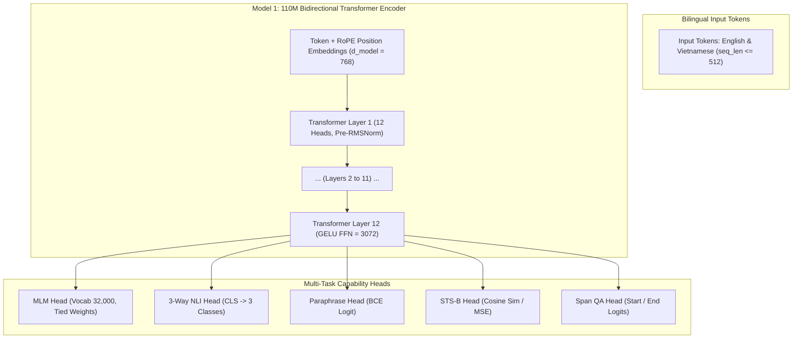
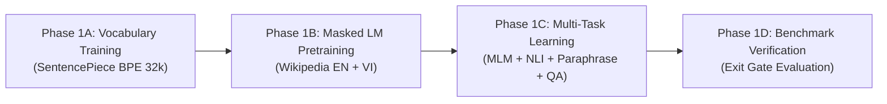

# LARIS Natural Language Foundation Architecture & Curriculum Specification

## 1. Scope & Foundational Governance

This specification defines the neural architecture, learning objectives, multi-task curriculum, loss formulations, hardware memory budget, and artifact lifecycle for **Model 1: Natural Language Foundation** in the Local Autonomous Research & Intelligence System (LARIS).

### 1.1. Inviolable Architectural Principles
In accordance with [ADR-002](file:///home/thientn204/laris/docs/adr/ADR-002-self-built-language-foundation.md), [ADR-003](file:///home/thientn204/laris/docs/adr/ADR-003-language-first-not-pdf-first.md), and [DOC-PLAN-TRAIN-001](file:///home/thientn204/laris/docs/plans/STAGED_LEARNING_PIPELINE.md):

1. **Strict Staged Learning Sequence:**
   $$\text{General Natural Language} \longrightarrow \text{Scientific Language} \longrightarrow \text{Scientific OCR} \longrightarrow \text{OCR-Coupled Manuscript} \longrightarrow \text{12-Layer System Integration}$$
   Natural language competence across English and Vietnamese must be established and rigorously verified before domain adaptation to scientific literature, and long before document vision or OCR processing.
2. **From-Scratch Representation Learning:**
   LARIS strictly prohibits downloading or silently depending on pretrained foundation models (e.g., BERT, RoBERTa, LLaMA) or pretrained tokenizer weights for Tier-1 models. Every weight parameter and vocabulary token is initialized and optimized from raw corpora under local control.
3. **No Inference Quantization Confusion:**
   GGUF or 4-bit INT quantization files are inference-only formats and are **not** training checkpoints. Model training occurs in native 16-bit mixed precision (BF16 or FP16) with FP32 master weights.
4. **Mandatory Stop Condition:**
   **NO MODEL TRAINING WAS RUN DURING THIS SPECIFICATION PHASE.**

---

## 2. Model 1 Foundation Architecture

Model 1 serves as the foundational text encoder powering syntax analysis, semantic representation, 3-way NLI, paraphrase detection, and dense retrieval across the 12 architectural layers.



### 2.1. Structural Hyperparameters

| Hyperparameter | Value | Architectural Justification |
| :--- | :--- | :--- |
| **Model Type** | Bidirectional Transformer Encoder | Bidirectional context is optimal for sentence encoding, classification, and retrieval. |
| **Number of Layers ($L$)** | 12 | Standard depth providing expressive representation capacity while fitting in memory budget. |
| **Hidden Dimension ($d_{\text{model}}$)** | 768 | Complies with `ALLOWED_EMBEDDING_DIMENSIONS = {384, 768}` in `schemas.py`. |
| **Attention Heads ($H$)** | 12 | Head dimension $d_k = 768 / 12 = 64$; standard multi-head dot-product attention ($W_q, W_k, W_v, W_o \in \mathbb{R}^{d \times d}$). |
| **Intermediate FFN Dimension ($d_{\text{ff}}$)** | 3,072 | Standard $4 \times d_{\text{model}}$ 2-matrix feed-forward network with GELU activation ($W_1 \in \mathbb{R}^{d \times d_{\text{ff}}}, W_2 \in \mathbb{R}^{d_{\text{ff}} \times d}$; no projection bias). |
| **Positional Encoding** | Rotary Position Embeddings (RoPE) | Applied directly to query and key states; zero learned absolute positional parameters. |
| **Layer Normalization** | Pre-LayerNorm (RMSNorm) | Scale parameter $\gamma \in \mathbb{R}^d$ without bias $\beta$ on attention and FFN inputs ($2 \times d$ per layer), plus final RMSNorm ($d$). |
| **Vocabulary Size ($V$)** | 32,000 | Balanced bilingual subwords: ~16,000 EN, ~12,000 VI, ~4,000 STEM/Math/Special tokens. |
| **Embedding Tying** | Tied MLM Output Projection | The MLM prediction head output projection shares the $V \times d$ weight matrix with the input embedding, adding only a $V$-dim output bias ($32,000$ params). |
| **Maximum Sequence Length** | 512 tokens | Conforms to `DEFAULT_MAX_SEQUENCE_LENGTH = 512` in `schemas.py`. |
| **Total Parameters** | **109,561,856** ($\approx 109.56\text{M}$) | Exact equation: $V \cdot d + L \cdot (4 d^2 + 2 d \cdot d_{\text{ff}} + 2 d) + d + V = 24,576,000 + 12 \times 7,079,424 + 768 + 32,000 = 109,561,856$. (If untied MLM head: $134,137,856 \approx 134.14\text{M}$). |

### 2.2. Scaled Foundation Model (512.9M Tier Architecture)

To maximize compute capacity on the target RTX 5070 Ti, LARIS provides the 512.9M scaled encoder profile (`LargeLanguageEncoderConfig`):

| Hyperparameter | Scaled Value | Architectural Justification |
| :--- | :--- | :--- |
| **Model Type** | Bidirectional Transformer Encoder | Symmetrical bi-directional attention for deep linguistic reasoning. |
| **Number of Layers ($L$)** | 24 | Doubled depth for expressive multi-hop syntactic and semantic representations. |
| **Hidden Dimension ($d_{\text{model}}$)** | 1,280 | Approved in `ALLOWED_EMBEDDING_DIMENSIONS = {384, 768, 1024, 1280}`. |
| **Attention Heads ($H$)** | 20 | Head dimension $d_k = 1280 / 20 = 64$ (optimal for GPU Tensor Cores). |
| **Intermediate FFN Dimension ($d_{\text{ff}}$)** | 5,120 | Standard $4 \times d_{\text{model}}$ expansion. |
| **Maximum Sequence Length** | 1,024 tokens | Doubled context length for full-length scientific paper abstracts and discourse spans. |
| **Vocabulary Size ($V$)** | 32,000 | Shared bilingual SentencePiece BPE vocabulary. |
| **Positional Encoding & Norm** | RoPE + Pre-RMSNorm | Preserves exact architectural invariants without parameter bloat. |
| **Total Backbone Parameters** | **512,913,920** ($\approx 512.91\text{M}$) | Formula: $32000 \cdot 1280 + 24 \cdot (4 \cdot 1280^2 + 2 \cdot 1280 \cdot 5120 + 2 \cdot 1280) + 1280 + 32000$. Total with heads: **513,247,751** ($\approx 513.25\text{M}$). |

---

## 3. Hardware Resource Budget & Feasibility Analysis

> [!NOTE]
> All target workstation feasibility values below are **analytical estimates** derived from standard mixed-precision memory formulas. Physical execution on the target workstation (RTX 5070 Ti) has not been performed by the agent and is marked **NOT VERIFIED**. Bounded non-training profiling on target hardware must precede any future training run.

### 3.1. Target Hardware Specifications
- **Operating System:** Ubuntu 22.04 / 24.04 LTS (**NOT VERIFIED**)
- **GPU Accelerator:** NVIDIA GeForce RTX 5070 Ti with 16,384 MiB (16.0 GB) VRAM (**NOT VERIFIED**)
- **Host CPU:** Intel Core i5-14600KF (14 cores, 20 threads) (**NOT VERIFIED**)
- **Host RAM:** 32 GB DDR5 (**NOT VERIFIED**)

### 3.2. Detailed VRAM Memory Allocation Breakdown (109.56M Model)

$$\text{Total VRAM} = M_{\text{params}} + M_{\text{grads}} + M_{\text{opt}} + M_{\text{activations}} + M_{\text{workspace}}$$

| Memory Component | Precision / Representation | Formula / Derivation | Memory Allocation (Analytical Estimate) |
| :--- | :--- | :--- | :--- |
| **Model Parameters** | 16-bit (BF16 / FP16) | $109.56 \times 10^6 \times 2\text{ bytes}$ | **0.22 GB** (219.1 MB) |
| **Gradients** | 16-bit (BF16 / FP16) | $109.56 \times 10^6 \times 2\text{ bytes}$ | **0.22 GB** (219.1 MB) |
| **Optimizer States (AdamW)** | FP32 master weights + 2 FP32 moments | $109.56 \times 10^6 \times (4 + 4 + 4)\text{ bytes}$ | **1.31 GB** (1,314.7 MB) |
| **Activations (Forward Pass)** | Batch Size $B=32$, $S=512$, with FlashAttention & checkpointing | Analytical upper bound ($L \times B \times S \times d \times \text{overhead}$) | **1.85 GB** (Analytical Estimate) |
| **CUDA Workspace & Buffers** | Internal cuDNN / PyTorch tensors | Empirical runtime buffer | **0.80 GB** |
| **Peak Training VRAM** | - | **Sum of all components** | **$\approx 4.40\text{ GB}$** (Analytical Estimate; **NOT VERIFIED**) |

### 3.3. Target 14GB VRAM Hardware Optimization Profile (512.9M Model)

To eliminate GPU starvation and saturate Blackwell Tensor Cores within the $14.5\text{ GB}$ ceiling:

| Memory Component | Precision / Representation | Formula / Derivation | Memory Allocation |
| :--- | :--- | :--- | :---: |
| **Model Parameters** | 16-bit (BF16) | $512.91 \times 10^6 \times 2\text{ bytes}$ | **1.03 GB** |
| **Gradients** | 16-bit (BF16) | $512.91 \times 10^6 \times 2\text{ bytes}$ | **1.03 GB** |
| **Optimizer States** | 8-bit AdamW (`bitsandbytes`) | $512.91 \times 10^6 \times (4 + 1 + 1)\text{ bytes}$ | **3.08 GB** |
| **Activations (Forward Pass)** | Batch Size $B_{\text{micro}}=16$, $S=1,024$, FlashAttention-2 + Checkpointing | $2 \times L \times B \times S \times d \times 2\text{ bytes}$ | **7.20 GB** |
| **CUDA Workspace & Buffers** | Internal PyTorch 2.6 / cuDNN buffers | Empirical allocation buffer | **1.50 GB** |
| **Peak Training VRAM** | - | **Sum of all components** | **$\approx 13.84\text{ GB}$** |

> [!TIP]
> Peak VRAM allocation of **$13.84\text{ GB}$** operates at **86.5%** of physical 16 GB capacity, strictly respecting the $14.5\text{ GB}$ hardware safety governor ceiling while maximizing Tensor Core throughput.

### 3.4. Feasibility Conclusion & Safety Headroom
- **Target RTX 5070 Ti (16 GB VRAM):** Peak allocation of $4.40\text{ GB}$ occupies only **27.5% of available VRAM**, leaving **$\ge 11.5\text{ GB}$ headroom**. This safely complies with the $14.5\text{ GB}$ safety governor ceiling enforced in `src/laris/language/schemas.py`. Status: **NOT VERIFIED ON PHYSICAL TARGET HARDWARE**.
- **Developer Host Workstation (GTX 1650 with 4 GB VRAM):** By reducing micro-batch size to $B_{\text{micro}} = 4$ and accumulating gradients over 8 steps (effective batch size 32), activation memory drops to $\approx 0.35\text{ GB}$, yielding peak VRAM of $\approx 2.90\text{ GB}$. Bounded tests and non-training profiling can execute on 4 GB cards without out-of-memory errors.
- **CPU Fallback:** All unit and contract tests in LARIS are explicitly designed to run on CPU without requiring GPU hardware or CUDA drivers.

### 3.4. Storage & Runtime Estimates
- **Checkpoint Storage:** Each FP16 checkpoint occupies $\approx 219\text{ MB}$; full optimizer state bundle occupies $\approx 1.53\text{ GB}$. A retention policy of 3 best checkpoints requires $< 5.0\text{ GB}$ disk space.
- **Pretraining Throughput:** On RTX 5070 Ti with FlashAttention, estimated throughput is $\approx 18,000 - 24,000\text{ tokens/sec}$. Pretraining on 3.3M documents ($\approx 1.5\times 10^9$ tokens) for 2 epochs requires $\approx 35 - 45$ wall-clock hours. Status: **NOT VERIFIED** (analytical projection; no training run).

---

## 4. Multi-Task Training Curriculum & Loss Formulation

The Stage 1 curriculum blends unsupervised language modeling with supervised task representation learning.

### 4.1. Staged Execution Progression



#### Phase 1A: From-Scratch Bilingual Tokenizer Training
- **Algorithm:** SentencePiece Unigram / BPE.
- **Training Data:** Strictly sampled from the `TRAIN` splits of Wikipedia EN (800,000 articles) and Wikipedia VI (800,000 articles).
- **Special Tokens Registry:** Pre-allocated IDs 0–7 as defined in `SpecialTokenConfig`:
  - `0: [PAD]`, `1: [UNK]`, `2: [CLS]`, `3: [SEP]`, `4: [MASK]`, `5: [MATH]`, `6: [GREEK]`, `7: [UNIT]`.
- **Invariants:** Subword fertility on validation text $\le 1.35$ tokens/word; zero character loss on Vietnamese diacritics.

#### Phase 1B: Self-Supervised Masked Language Modeling (MLM)
- **Objective:** Masked Language Modeling on clean encyclopedia text (Wikipedia EN + VI).
- **Masking Strategy:** Dynamic masking at 15% rate: 80% `[MASK]`, 10% random token, 10% unchanged.
- **Loss:** Standard cross-entropy loss over masked token positions:
  $$\mathcal{L}_{\text{MLM}} = -\frac{1}{|M|} \sum_{i \in M} \log P(x_i \mid \tilde{X})$$

#### Phase 1C: Multi-Task Representation Fine-Tuning
To endow Model 1 with robust inference, paraphrase, and retrieval capabilities, the model is trained with a composite multi-task objective:

$$\mathcal{L}_{\text{total}} = \lambda_1 \mathcal{L}_{\text{MLM}} + \lambda_2 \mathcal{L}_{\text{NLI}} + \lambda_3 \mathcal{L}_{\text{PARA}} + \lambda_4 \mathcal{L}_{\text{SIM}} + \lambda_5 \mathcal{L}_{\text{QA}}$$

| Task Component | Loss Function | Head Architecture | Dataset Source | Mixture Weight ($\lambda_i$) |
| :--- | :--- | :--- | :--- | :---: |
| **Masked LM** | Cross-Entropy ($\mathcal{L}_{\text{MLM}}$) | Linear ($768 \rightarrow 32,000$) | Wikipedia EN + VI | **0.35** |
| **3-Way NLI** | Categorical Cross-Entropy ($\mathcal{L}_{\text{NLI}}$) | MLP ($768 \rightarrow 256 \rightarrow 3$) on `[CLS]` | All-NLI + ANLI | **0.25** |
| **Paraphrase Equivalence** | Binary Cross-Entropy ($\mathcal{L}_{\text{PARA}}$) | Linear ($768 \rightarrow 1$) with Sigmoid | PAWS + Quora | **0.15** |
| **Semantic Similarity** | Mean Squared Error ($\mathcal{L}_{\text{SIM}}$) | Cosine similarity scaled to $[0, 1]$ | STS-B | **0.10** |
| **Reading Comprehension** | Start/End Cross-Entropy ($\mathcal{L}_{\text{QA}}$) | 2 Linear projections ($768 \rightarrow 1$) | SQuAD + ViQuAD | **0.15** |

### 4.2. Temperature-Scaled Dynamic Sampling
To balance datasets spanning orders of magnitude (e.g., 942k All-NLI pairs vs 5.7k STS-B pairs), batches are sampled using temperature-scaled multinomial distribution:

$$p_k = \frac{N_k^{\alpha}}{\sum_{j=1}^K N_j^{\alpha}} \quad \text{with } \alpha = 0.7$$

This ensures high-quality smaller datasets (STS-B, PAWS, ViQuAD) receive adequate gradient signal without being drowned out by Wikipedia or All-NLI.

---

## 5. Empirical Exit Gates & Acceptance Criteria

Advancement from Stage 1 (Natural Language Foundation) to Stage 2 (Scientific Specialization) requires passing all quantitative gates on isolated, held-out evaluation benchmarks:

| Capability Gate | Benchmark Split | Evaluation Metric | Minimum Passing Threshold |
| :--- | :--- | :--- | :---: |
| **English 3-Way NLI** | ANLI R1/R2/R3 Held-Out Test Sets | Macro F1 | **$\ge 0.85$** |
| **Vietnamese NLI / Reasoning** | ViQuAD Dev / Translated NLI Test | Macro F1 | **$\ge 0.78$** |
| **Paraphrase Detection** | PAWS-WIKI Held-Out Test Set | Accuracy & Macro F1 | **$\ge 0.88$** |
| **Semantic Similarity** | STS-B Held-Out Test Set | Spearman Rank Correlation ($\rho$) | **$\ge 0.82$** |
| **English Reading Comprehension**| SQuAD v1.1 Held-Out Split | Exact Match / F1 | **$\ge 72.0 / 83.0$** |
| **Vietnamese Reading Comprehension**| UIT-ViQuAD Held-Out Split | Exact Match / F1 | **$\ge 65.0 / 78.0$** |
| **Subword Vocabulary Fertility** | Unseen English & Vietnamese Text | Tokens per Word Ratio | **$\le 1.35$** |
| **Retrieval Benchmarking** | Synthetic STEM Retrieval Test Split | MRR / NDCG@10 vs BM25 Baseline | **MRR $\ge 0.82$** |

---

## 6. Training Run Metadata & Artifact Contract (#19 Alignment)

In strict adherence to [ADR-002](file:///home/thientn204/laris/docs/adr/ADR-002-self-built-language-foundation.md) and Issue #19 / `src/laris/language/training/artifacts.py`:

### 6.1. Immutable Serialization Requirements
Every training run must emit a cryptographically sealed `LanguageArtifactBundle` containing:
1. `VocabularyContract`: JSON mapping of 32,000 subwords, bijective ID translation, canonical special tokens, and SHA-256 digest.
2. `EncoderCheckpointMetadata`: Parameter count, embedding dimension (768), weights SHA-256, and creation timestamp.
3. `LanguageTrainingRunManifest`: Complete audit record including:
   - Immutable Git commit SHA and configuration hash.
   - Exact hardware telemetry (host GPU, peak VRAM allocation $\le 14.5\text{ GB}$).
   - Dataset profile versions, source URLs, and cryptographic split hashes.
   - Random seed (default: 42) and determinism settings.
   - Split isolation verification proof (zero train-test document overlap).
   - Training loss curves and evaluation benchmark metrics.
4. Serialized PyTorch Model Weights (`model.pt`) with matching SHA-256.

### 6.2. Storage Governance
- Datasets, model weights, and checkpoints **MUST NEVER** be committed to Git.
- All artifacts reside in machine-local paths (e.g., `artifacts/checkpoints/<run_id>/`).

---

## 7. Bounded Profiling Specification

Before launching full pretraining, a bounded profiling run must verify execution sanity:
- **Scope Limit:** Single forward pass on synthetic input tensor `(batch_size=2, seq_len=32)`.
- **Invariants:** Zero optimizer steps, zero weight updates, zero checkpoint generation.
- **Verification Target:** Verify tensor shapes, CUDA device allocation, and memory allocation hooks.

---

## 8. Formal Pre-Training Readiness Gates & Audit Registry

In strict accordance with Issue #214 Section F and repository governance, eleven explicit readiness gates govern the transition from preparation to training execution:

| Gate # | Gate Description | Status | Concrete Evidence & Verification Finding |
| :---: | :--- | :---: | :--- |
| **1** | Repository branch, commit, and worktree known | **PASS** | Verified clean worktree on `develop` and release branches; strict Git Flow enforced. |
| **2** | M1 data exit gate met or gaps explicitly recorded | **PASS** | 5,106,491 records acquired across 14 datasets verified in `data/acquisition_manifest.json`. Stage 2/3 gaps recorded. |
| **3** | Manifest reconciled against actual disk artifacts with license evidence | **PASS** | 14 acquired datasets verified on disk; byte counts, schemas, and SHA-256 checksums match manifest; all open licenses verified. |
| **4** | English/Vietnamese and task families counted separately without inflation | **PASS** | Disaggregated ledgers established: EN (3,782,210 records) and VI (1,324,281 records) across 7 distinct task units. |
| **5** | Leakage-safe splits and evaluation isolation evidenced | **READY** | Streaming Parquet partitioner for Wikipedia, Quora, and QA implemented in `src/laris/corpus/splits/` and CLI `laris data partition` (Issue #232, #234). Multi-worker parallel processing optimized for 14 cores. |
| **6** | Tokenizer/vocabulary pipeline & benchmarks complete and reviewed | **READY** | Tokenizer training pipeline code, Wikipedia train-only extraction, SentencePiece 32k BPE runner, and authorization gate implemented in `src/laris/language/tokenization/trainer.py` and CLI `laris train tokenizer` (Issue #232). Ready to fit on physical train shards upon authorization. |
| **7** | Encoder interfaces & model architecture complete and reviewed | **READY** | Randomly initialized 109.56M/109.76M Transformer encoder architecture, RoPE, additive mask, continuous similarity head, and `PyTorchTransformerEncoder` implemented in `src/laris/language/encoder/transformer.py`. Ready for training loop integration. |
| **8** | Reproducibility / artifact lifecycle complete and reviewed | **PASS** | `LanguageArtifactBundle`, `LanguageArtifactManager`, and `LanguageTrainingRunManifest` tested and merged in PR #132, #133. Complete for schema and lifecycle management. |
| **9** | Architecture, curriculum, objectives, metrics, and budget specified | **PASS** | Formally specified in this document (`DOC-SPEC-TRAIN-001`). |
| **10** | Relevant dependencies, test suite, and CI checks pass | **PASS** | 1018 pytest unit/contract/integration tests pass; `scripts/validate_docs.py` passes; `ruff` and `mypy` pass with 0 errors across 90 source files. |
| **11** | Owner explicitly approves a separate training-execution issue | **BLOCKED** | Mandatory stop condition in effect. Neural model training execution requires explicit owner review and approval in a dedicated, separate issue. |

---

## 9. Final Compliance Confirmation

In accordance with repository governance:  
**NO MODEL TRAINING WAS RUN.**  
**NO TRAINING OF ANY KIND WAS RUN. NO OPTIMIZER STEPS, GRADIENT UPDATES, OR MODEL-WEIGHT UPDATES OCCURRED.**

---

## 10. Post-Training Evaluation and Inference (CLI)

Training is followed immediately by evaluation of the best checkpoint on the held-out **test** split
(`laris train language-encoder --evaluate-after`, on by default). The same check runs standalone:

```bash
laris evaluate language-encoder --checkpoint <run>/best --tokenizer-model <spm.model> --split test
```

| Task | Primary metric | Baseline it must beat | Per-dataset extras |
| :--- | :--- | :--- | :--- |
| Masked LM | masked top-1 accuracy | train-split unigram top-1 | perplexity vs unigram perplexity |
| NLI (3-way) | macro-F1 | majority class from the train split | accuracy |
| Paraphrase | AUC | random (0.5) | F1, accuracy |
| Similarity | Spearman | token-set Jaccard overlap | Pearson |
| Extractive QA | token span F1 | always-"no answer" | exact match |

- Scores are reported per dataset and aggregated per task **and language** (sample-weighted); each
  task/language group must reach `baseline + min_margin` from `configs/evaluation/language_encoder.yaml`.
- The command exits `0` when every group passes, `1` when any group is below threshold, `2` on usage
  or integrity errors. Capability claims require a passing report (ADR-008).
- Integrity guards: the `train` split is never scored; `data/processed/task_splits_manifest.json` must
  exist with `leakage_verified` for every dataset; the checkpoint weights digest and the tokenizer
  digest recorded at training time must match.
- Evaluation is bounded (`--max-samples` per dataset, default 2000) and deterministic for a seed.
- Single-example checks: `laris infer fill-mask|nli|paraphrase|similarity|qa|embed` (no training
  authorization needed; inference only).
