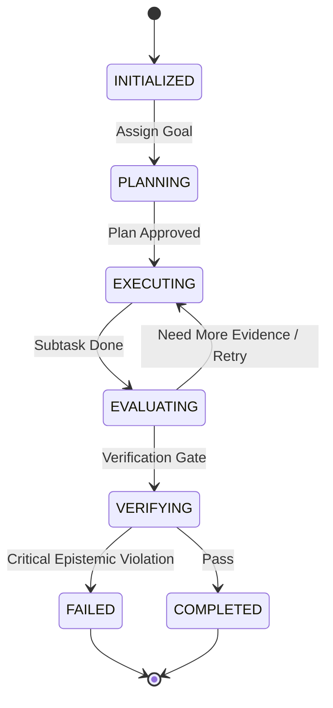

# LARIS Orchestration Specification: Agents, Skills, Tools and Workflows

Agents execute workflows (DAGs) by invoking skills, which are built from tools. Parts 1-4 define each concept; the safety invariants in Part 1 apply to all of them.

## 1. Agents: Roles and Orchestration

### 1. Multi-Agent Philosophy

In LARIS, agents are not generic open-ended conversationalists. Each agent is a bounded, role-specialized software actor with explicit state machines, typed communication contracts, allowed tools, and resource budgets.

Agents collaborate under the supervision of the `Supervisor / Orchestrator` to execute complex scientific workflows.

---

### 2. The Ten Specialist Agent Roles

| Agent Role | Primary Objective | Allowed Tools & Skills |
| :--- | :--- | :--- |
| **`Supervisor / Orchestrator`** | Decomposes overarching research goals, tracks task state, monitors convergence, and manages resource budgets. | Graph scheduler, DAG dispatcher. |
| **`Query Planner`** | Translates ambiguous user research queries into atomic sub-questions and structured retrieval intents. | Intent normalizer, semantic parser. |
| **`Language Analysis Agent`** | Evaluates syntactic dependencies, coreference, ambiguity, and linguistic paraphrase. | NLI engine, coreference resolver, syntax tagger. |
| **`Document Analysis Agent`** | Ingests raw papers, reconstructs reading order, parses tables/equations, and maps physical coordinates. | PDF layout parser, OCR evaluator. |
| **`Evidence Retrieval Agent`** | Executes depth-adaptive multi-hop retrieval across lexical, dense, and graph indexes. | BM25 search, vector retriever, graph traversal tool. |
| **`Scientific Claim Agent`** | Extracts claims, experimental methods, metrics, results, and heading-agnostic limitations. | Claim extraction skill, limitation inferencer. |
| **`Cross-Paper Synthesis Agent`** | Reconciles conflicting findings, aligns experimental conditions, and builds comparison matrices. | Method comparator, condition aligner. |
| **`Gap Discovery Agent`** | Evaluates literature against the 12-class gap taxonomy and generates candidate gap hypotheses. | Gap evaluation skill, counter-evidence search. |
| **`Critical Reviewer / Verifier`** | Acts as an adversarial auditor, verifying coordinate validity, citation accuracy, and epistemic boundaries. | Coordinate resolver, provenance checker. |
| **`Report Composer`** | Assembles verified synthesis and ranked gaps into structured, evidence-anchored research reports. | Markdown compiler, citation formatter. |

---

### 3. Agent Lifecycle State Machine



---

### 4. Orchestration Safety Invariants

1. **Hard Recursion Ceiling:** An agent execution chain MUST NOT exceed 10 sequential iterations without terminating or requesting human confirmation.
2. **Cycle Detection:** If an agent dispatches an identical tool call with identical arguments twice in a single task, the orchestrator halts execution immediately with `CyclicExecutionError`.
3. **Budget Exhaustion:** If cumulative latency or memory exceeds allocated budget limits, the orchestrator triggers graceful degradation and summarizes findings gathered to that point.

---

## 2. Skills

### 1. Overview & Concept

A **Skill** in LARIS represents a modular, high-level scientific capability that can be dynamically loaded and invoked by autonomous agents without requiring architectural modification or full model retraining.

Skills combine domain rules, specialized models, executable tools, and evaluation benchmarks into a declarative package.

---

### 2. Skill Schema & Contract

Every skill is defined by a canonical descriptor:

```yaml
skill_id: "SKILL-EXTRACT-CLAIMS"
name: "extract_scientific_claims"
version: "0.1.0"
description: "Extracts fine-grained scientific claims, empirical findings, and limitations from normalized DocumentTrees."
prerequisites:
  models:
    - "MOD-LANG-001"
    - "MOD-SCINLP-001"
  tools:
    - "TOOL-DISCOURSE-PARSER"
    - "TOOL-COORDINATE-RESOLVER"
inputs:
  document_tree: "DocumentTree"
  confidence_threshold: 0.85
outputs:
  extracted_claims: "List[ScientificClaim]"
  extraction_metadata: "dict"
evaluation_benchmark: "BENCH-CLAIM-EXTRACT-V1"
resource_budget:
  max_vram_mb: 2048
  max_latency_sec: 10
```

---

### 3. Standard Core Skills

LARIS Milestone M0 establishes five baseline skill specifications:
1. `extract_scientific_claims`: Discovers claims, methods, metrics, and experimental outcomes.
2. `compare_experimental_methods`: Constructs cross-paper comparative condition matrices.
3. `infer_latent_limitations`: Identifies unstated boundary conditions and limitations in narrative text.
4. `detect_empirical_contradictions`: Searches for conflicting quantitative results across studies.
5. `evaluate_research_gap`: Evaluates candidate gaps across the 12-class taxonomy and computes calibrated scores.

---

## 3. Tools

### 1. Overview & Tool Definition

A **Tool** in LARIS is a deterministic, executable software component with strict input/output schemas, sandboxed error boundaries, and explicit execution timeouts.

Tools represent the atomic physical actuators through which autonomous agents and skills interact with files, databases, algorithms, and models.

---

### 2. Core Tool Catalog

| Tool ID | Tool Name | Scope & Function | Determinism |
| :--- | :--- | :--- | :--- |
| `TOOL-PDF-LAYOUT-PARSER` | `parse_pdf_layout` | Converts PDF bytes into canonical `DocumentTree` with coordinates. | High |
| `TOOL-CORPUS-SEARCH` | `query_corpus_bm25` | Executes lexical search with STEM token stemming against corpus. | 100% Deterministic |
| `TOOL-GRAPH-TRAVERSAL` | `query_evidence_graph` | Traverses Layer 5 Evidence Graph for k-hop paths and contradictions. | 100% Deterministic |
| `TOOL-UNIT-NORMALIZER` | `normalize_stem_units` | Normalizes electrical/STEM units (GHz, dB, V, W) into SI base units. | 100% Deterministic |
| `TOOL-BENCHMARK-RUNNER` | `execute_benchmark_suite`| Runs automated capability regressions against frozen evaluation sets. | 100% Deterministic |
| `TOOL-COORDINATE-RESOLVER`| `resolve_text_coordinates` | Resolves sentence or token spans to exact page, line, and bounding box. | 100% Deterministic |

---

### 3. Tool Execution Invariants

1. **Strict Type Enforcement:** Tool arguments and return values MUST validate against their JSON schema before and after execution.
2. **Hard Timeouts:** Every tool execution has an enforced wall-clock timeout (default 30 seconds); timeout violations abort execution immediately.
3. **No Unchecked Exceptions:** All internal tool failures must be mapped to typed `ToolExecutionError` classes with structured error payloads.

---

## 4. Workflows and Orchestration DAGs

### 1. Overview

Workflows in LARIS formalize multi-agent and multi-tool execution pipelines into repeatable, auditable Directed Acyclic Graphs (DAGs). Each workflow defines explicit entry conditions, branching thresholds, retry parameters, resource budgets, and stopping criteria.

---

### 2. Core Workflow Catalog

#### 2.1. Workflow 1: Research Gap Discovery & Synthesis (Primary Default Workflow)
- **Trigger:** User submits a research topic, hypothesis, or exploratory inquiry.
- **Goal:** Synthesize literature, identify empirical contradictions, evaluate candidate research gaps, and produce a structured research report.
- **Execution DAG:**
  1. `Query Planner`: Normalize intent into 3–5 sub-questions.
  2. `Evidence Retrieval Agent`: Multi-hop hierarchical search across corpus and Layer 5 graph.
  3. `Scientific Claim Agent`: Extract claims, metrics, and limitations.
  4. `Cross-Paper Synthesis Agent`: Construct comparative experimental matrix.
  5. `Gap Discovery Agent`: Synthesize candidate gaps (12 classes) and query for adversarial counter-evidence.
  6. `Critical Reviewer`: Audit evidence coordinates and epistemic classifications.
  7. `Report Composer`: Assemble final structured research report.
- **Stopping Conditions:**
  - Success: All sub-questions answered with evidence citations $\ge 0.85$ confidence.
  - Insufficient Evidence: Bounded corpus searched completely; gaps marked as `INSUFFICIENT_CORPUS_COVERAGE`.
  - Timeout: Cumulative execution time reaches 180 seconds.

#### 2.2. Workflow 2: Corpus Ingestion & Knowledge Graph Construction
- **Trigger:** New documents added to `data/raw/` or requested by user.
- **Goal:** Convert raw documents into clean `DocumentTrees` and populate the Layer 5 Evidence Graph.
- **Execution Steps:** License audit $\rightarrow$ Unicode normalization $\rightarrow$ Layout parsing $\rightarrow$ Tokenization $\rightarrow$ Discourse extraction $\rightarrow$ Graph ingestion.

#### 2.3. Workflow 3: On-Demand Manuscript Drafting (Secondary Workflow)
- **Trigger:** Explicit user command requesting an academic paper or manuscript draft (e.g. "Draft an IEEE conference paper based on this report").
- **Constraint:** Strictly gated. System MUST NOT execute this workflow unless explicitly requested.
- **Execution Steps:** Load verified Research Report $\rightarrow$ Draft Introduction & Problem Statement $\rightarrow$ Synthesize Literature Review from comparative matrix $\rightarrow$ Detail Gap & Proposed Methodology $\rightarrow$ Format LaTeX/Markdown citations.
