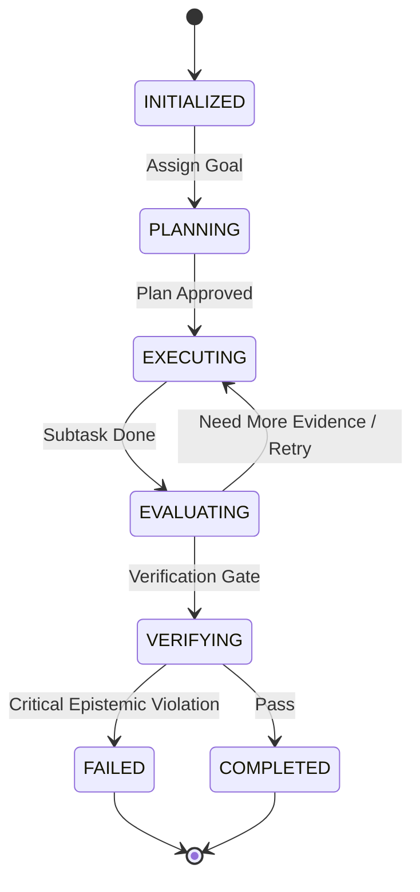

# LARIS Orchestration Specification: Agents, Skills, Tools and Workflows

Agents execute workflows (DAGs) by invoking skills, which are built from tools. The safety invariants in Section 1.3 apply to all of them.

## 1. Agents

Agents are bounded, role-specialized actors with explicit state machines, typed communication contracts, allowed tools and resource budgets; they are not open-ended conversationalists. The `Supervisor / Orchestrator` supervises all others.

### 1.1 Specialist Roles

| Agent Role | Primary Objective | Allowed Tools & Skills |
| :--- | :--- | :--- |
| **Supervisor / Orchestrator** | Decomposes research goals, tracks task state and convergence, manages budgets. | Graph scheduler, DAG dispatcher. |
| **Query Planner** | Turns ambiguous queries into atomic sub-questions and retrieval intents. | Intent normalizer, semantic parser. |
| **Language Analysis Agent** | Syntactic dependencies, coreference, ambiguity, paraphrase. | NLI engine, coreference resolver, syntax tagger. |
| **Document Analysis Agent** | Ingests papers, restores reading order, parses tables and equations, maps coordinates. | PDF layout parser, OCR evaluator. |
| **Evidence Retrieval Agent** | Depth-adaptive multi-hop retrieval over lexical, dense and graph indexes. | BM25 search, vector retriever, graph traversal. |
| **Scientific Claim Agent** | Extracts claims, methods, metrics, results and heading-agnostic limitations. | Claim extraction skill, limitation inferencer. |
| **Cross-Paper Synthesis Agent** | Reconciles conflicting findings, aligns conditions, builds comparison matrices. | Method comparator, condition aligner. |
| **Gap Discovery Agent** | Evaluates literature against the 12-class gap taxonomy and proposes candidate gaps. | Gap evaluation skill, counter-evidence search. |
| **Critical Reviewer / Verifier** | Adversarial audit of coordinates, citations and epistemic boundaries. | Coordinate resolver, provenance checker. |
| **Report Composer** | Assembles verified synthesis and ranked gaps into evidence-anchored reports. | Markdown compiler, citation formatter. |

### 1.2 Lifecycle State Machine



### 1.3 Safety Invariants

1. **Hard recursion ceiling:** an agent chain MUST NOT exceed 10 sequential iterations without terminating or requesting human confirmation.
2. **Cycle detection:** an identical tool call with identical arguments twice in one task halts execution with `CyclicExecutionError`.
3. **Budget exhaustion:** exceeding latency or memory budgets triggers graceful degradation and a summary of the findings gathered so far.

## 2. Skills

A **skill** is a declarative package of domain rules, models, tools and benchmarks that agents can load without architectural change or retraining. Every skill has a canonical descriptor:

```yaml
skill_id: "SKILL-EXTRACT-CLAIMS"
name: "extract_scientific_claims"
version: "0.1.0"
description: "Extracts scientific claims, empirical findings and limitations from normalized DocumentTrees."
prerequisites:
  models: ["MOD-LANG-001", "MOD-SCINLP-001"]
  tools: ["TOOL-DISCOURSE-PARSER", "TOOL-COORDINATE-RESOLVER"]
inputs: {document_tree: "DocumentTree", confidence_threshold: 0.85}
outputs: {extracted_claims: "List[ScientificClaim]", extraction_metadata: "dict"}
evaluation_benchmark: "BENCH-CLAIM-EXTRACT-V1"
resource_budget: {max_vram_mb: 2048, max_latency_sec: 10}
```

Milestone M0 defines five baseline skills:

1. `extract_scientific_claims`: claims, methods, metrics and experimental outcomes.
2. `compare_experimental_methods`: cross-paper comparative condition matrices.
3. `infer_latent_limitations`: unstated boundary conditions and limitations in narrative text.
4. `detect_empirical_contradictions`: conflicting quantitative results across studies.
5. `evaluate_research_gap`: candidate gaps across the 12-class taxonomy with calibrated scores.

## 3. Tools

A **tool** is a deterministic, executable component with strict input/output schemas, sandboxed error boundaries and explicit timeouts; it is the atomic actuator through which agents and skills touch files, databases, algorithms and models.

| Tool ID | Tool Name | Scope & Function | Determinism |
| :--- | :--- | :--- | :--- |
| `TOOL-PDF-LAYOUT-PARSER` | `parse_pdf_layout` | PDF bytes to a canonical `DocumentTree` with coordinates. | High |
| `TOOL-CORPUS-SEARCH` | `query_corpus_bm25` | Lexical search with STEM token stemming. | 100% |
| `TOOL-GRAPH-TRAVERSAL` | `query_evidence_graph` | k-hop paths and contradictions in the Layer 5 graph. | 100% |
| `TOOL-UNIT-NORMALIZER` | `normalize_stem_units` | Electrical/STEM units (GHz, dB, V, W) to SI base units. | 100% |
| `TOOL-BENCHMARK-RUNNER` | `execute_benchmark_suite` | Automated capability regressions on frozen evaluation sets. | 100% |
| `TOOL-COORDINATE-RESOLVER` | `resolve_text_coordinates` | Sentence or token spans to page, line and bounding box. | 100% |

Execution invariants:

1. **Strict types:** arguments and return values validate against their JSON schema before and after execution.
2. **Hard timeouts:** every execution has a wall-clock timeout (default 30 seconds); a violation aborts immediately.
3. **No unchecked exceptions:** failures map to typed `ToolExecutionError` classes with structured payloads.

## 4. Workflows

Workflows formalize multi-agent, multi-tool pipelines as repeatable, auditable DAGs with explicit entry conditions, branching thresholds, retry parameters, budgets and stopping criteria.

### 4.1 Research Gap Discovery & Synthesis (default)

- **Trigger:** the user submits a research topic, hypothesis or exploratory inquiry.
- **Goal:** synthesize literature, find empirical contradictions, evaluate candidate gaps, produce a structured report.
- **DAG:**
  1. `Query Planner`: normalize intent into 3-5 sub-questions.
  2. `Evidence Retrieval Agent`: multi-hop hierarchical search over corpus and Layer 5 graph.
  3. `Scientific Claim Agent`: extract claims, metrics and limitations.
  4. `Cross-Paper Synthesis Agent`: build the comparative experimental matrix.
  5. `Gap Discovery Agent`: propose candidate gaps (12 classes) and query adversarial counter-evidence.
  6. `Critical Reviewer`: audit evidence coordinates and epistemic classifications.
  7. `Report Composer`: assemble the report.
- **Stopping:** success when all sub-questions are answered with citations at confidence of 0.85 or higher; `INSUFFICIENT_CORPUS_COVERAGE` when the bounded corpus is exhausted; timeout at 180 seconds of cumulative execution.

### 4.2 Corpus Ingestion & Knowledge Graph Construction

- **Trigger:** new documents in `data/raw/` or a user request.
- **Goal:** convert raw documents into clean `DocumentTrees` and populate the Layer 5 graph.
- **Steps:** license audit, Unicode normalization, layout parsing, tokenization, discourse extraction, graph ingestion.

### 4.3 On-Demand Manuscript Drafting (secondary)

- **Trigger:** an explicit user command for an academic paper draft (for example "Draft an IEEE conference paper based on this report").
- **Constraint:** strictly gated; the system MUST NOT run this workflow unless explicitly requested.
- **Steps:** load the verified report, draft introduction and problem statement, build the literature review from the comparison matrix, detail the gap and proposed methodology, format LaTeX/Markdown citations.
