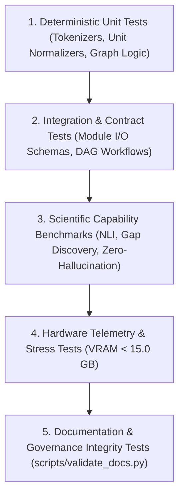

# LARIS Test Strategy & Verification Architecture

## 1. Testing Pyramid in LARIS

To guarantee that software contracts, epistemic invariants, and physical hardware constraints are satisfied, LARIS implements a five-tier testing pyramid:

---

## 2. Test Categories & Scopes

1. **Deterministic Unit Tests (`tests/unit/`):** Fast, isolated tests verifying algorithmic components (e.g. SI unit normalizers, Unicode sanitizers, graph path traversal, schema validation). Zero GPU required.
2. **Module Contract Tests (`tests/contract/`):** Verifies that all 11 boundaries conform strictly to input/output JSON schemas defined in `docs/specifications/DATA_SCHEMAS.md`.
3. **Integration & Workflow Tests (`tests/integration/`):** End-to-end multi-agent execution DAGs, verifying that data propagates through ingestion, retrieval, synthesis, and report generation.
4. **Documentation & Governance Tests (`tests/documentation/` & `scripts/validate_docs.py`):** Automated static analysis verifying YAML metadata, unique document IDs, internal link resolution, ADR references, and immutability of frozen baselines.
5. **Hardware Telemetry & Resource Safety Tests:** Stress tests verifying that GPU VRAM usage remains strictly $\le 15.0$ GB on the RTX 5070 Ti and that weight offloading prevents CUDA OOM crashes.
